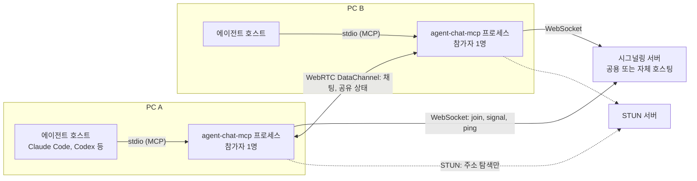
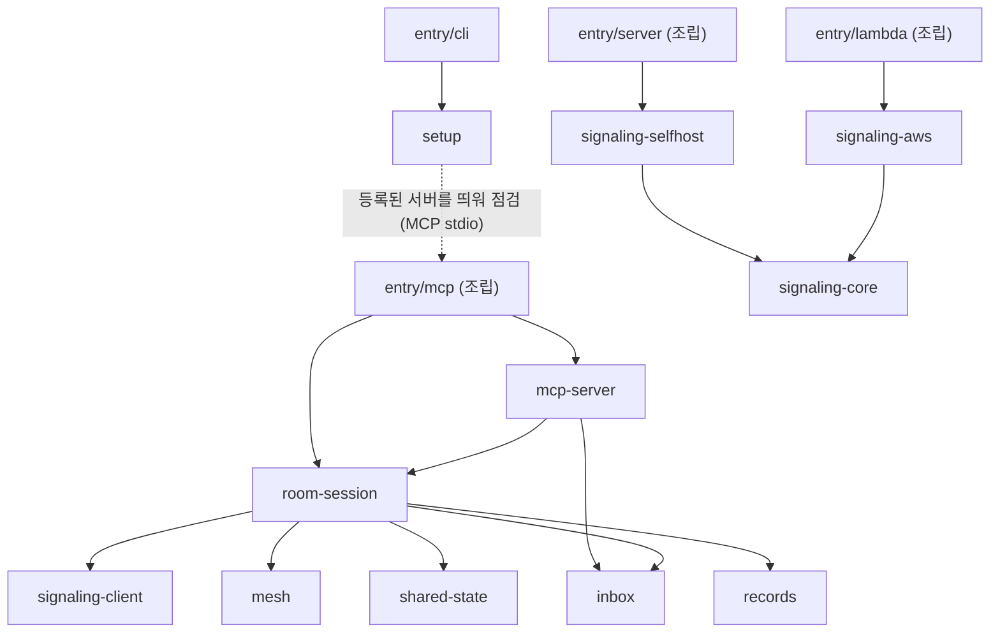

# 아키텍처

구성 요소, 모듈 경계, 설정 값, 로깅, 주요 시나리오 흐름을 정한다. 메시지 형식은 [protocol.md](protocol.md), tool 은 [mcp-interface.md](mcp-interface.md), 서버 배포는 [deployment.md](deployment.md) 가 소유한다. 이 문서는 그 정의를 되풀이하지 않고 링크한다.

- 상태: 설계안. 구현 전이다. 아래 경로와 이름은 모두 **제안**이다. 구현 후에는 각 모듈의 `contract.ts`(타입)와 테스트가 원본이다.
- 표기는 [protocol.md](protocol.md) 머리말과 같다(**[실측]**, **[문서]**, **[소스]**, **[추론]**, **[가정]**, **[제안]**, `PRE-…`, `A-…`).

## 1. 구성 요소와 프로세스 경계



그림은 정적 검토만 했다. 렌더러로 확인하지 않았다.

| 프로세스 | 실행 위치 | 진입점(제안) | 수명 | 맡는 일 |
|---|---|---|---|---|
| `agent-chat-mcp` | 각 PC. 에이전트 호스트의 자식 프로세스 | `dist/entry/mcp.js` | 호스트 세션과 같다 | MCP tool 제공, 시그널링 접속, WebRTC mesh, 공유 상태 복제본, 수신함, 로컬 기록 |
| `agent-chat-server` | 공용 IP 를 가진 컴퓨터 | `dist/entry/server.js` | 상주 | 자체 호스팅 시그널링(ws + 메모리) |
| 공용 서버 Lambda | AWS(API Gateway WebSocket 뒤) | `build/lambda/index.mjs` | 호출마다 | 공용 시그널링(DynamoDB 저장) |
| 설치·점검 | 각 PC | `installer/*.sh`(셸 진입점), `scripts/install.mjs`, `dist/entry/cli.js` | 1회 실행 | Node 찾기, 의존성 설치, 빌드, MCP 등록, 연결 점검 |

경계에서 정한 것:

- **MCP 프로세스 하나가 참가자 한 명이다.** 별도 상주 데몬은 없다. 호스트 세션이 끝나면 참가자도 나간다.
  - 비용: 호스트가 주는 종료 유예가 짧다(Claude Code 는 SIGINT 뒤 약 500ms **[문서]**). 세션을 다시 열면 mesh 를 처음부터 다시 만든다.
  - 데몬으로 분리할 근거가 생기면(예: 세션 재시작에도 연결을 유지해야 한다는 요구) `room-session` 아래 모듈을 그대로 옮길 수 있게, MCP 어댑터(`mcp-server`)와 참가 로직(`room-session` 이하)을 나눠 둔다.
- 한 MCP 프로세스는 한 번에 방 하나에만 있는다. PRD 에 여러 방 요구가 없다.
- 서버는 채팅과 테스트 상태를 보지도 저장하지도 않는다.
- STUN 은 주소 탐색에만 쓴다. TURN 과 어떤 형태의 데이터 중계도 없다([protocol.md 7절](protocol.md#7-ice-서버-설정-검증)).

## 2. 모듈 목록과 의존 방향

| 모듈 (`src/` 아래) | 한 줄 책임 | 쓰는 프로세스 |
|---|---|---|
| `protocol` | 와이어 스키마, 식별자, 상한, 주소 정규화, ICE 설정 검증. I/O 없음 | 전부 |
| `diagnostics` | 진단 로그(JSONL), 허용 필드 필터, 7일 보존 | 전부 |
| `signaling-core` | 시그널링 규칙: 방·참가자·전달·검증·속도 제한 | 서버 둘 |
| `signaling-selfhost` | ws 리스너 + 메모리 저장으로 core 를 조립 | `agent-chat-server` |
| `signaling-aws` | Lambda 이벤트 + DynamoDB + 연결 관리 API 로 core 를 조립 | Lambda |
| `signaling-client` | 서버 접속, 등록, 시그널 송수신, ping, 재접속 루프, 게이트웨이 프레임 판별 | MCP |
| `mesh` | 피어별 WebRTC 연결과 DataChannel, 시그널 재전송, 링크 생존 판정 | MCP |
| `shared-state` | 공유 상태 복제본, 병합, 테스트 규칙 판정. I/O 없음 | MCP |
| `inbox` | 에이전트에게 줄 사건 대기열, 커서, 전달 모드(poll/channel), 수신 중 여부 | MCP |
| `records` | 로컬 기록 파일과 최종 보고서 | MCP |
| `room-session` | 방 참가 한 번의 조율: 입장, mesh 보정, P2P 메시지 처리, 채팅 | MCP |
| `mcp-server` | MCP tool, instructions, 채널 알림, stdio 수명 | MCP |
| `setup` | MCP 등록과 제거, Channels 가능 여부 보고, 연결 점검 | CLI |



- 모든 모듈은 `protocol` 과 `diagnostics` 의 로그 포트(타입)에 의존할 수 있다. 그림에서 생략했다.
- **형제끼리는 서로 부르지 않는다.** `signaling-client`, `mesh`, `shared-state`, `inbox`, `records` 는 서로를 import 하지 않는다. 타입도 가져다 쓰지 않는다. 연결은 `room-session` 이 한다. 예: `mesh` 는 시그널을 보낼 함수를 주입받을 뿐 `signaling-client` 를 모른다.
- **아래 모듈은 위 모듈의 타입을 쓰지 않는다.** 여러 모듈이 함께 쓰는 타입은 그것을 만드는 모듈의 `contract.ts` 나 `protocol` 에 둔다. 수신함 사건 타입은 `inbox`, 규칙 오류 코드는 `shared-state`, 보고서 입력 타입은 `records`, 방 동작의 결과 코드는 `room-session` 이 소유한다. `mcp-server` 는 그것을 tool 결과로 옮길 뿐이다.
- `signaling-core` 는 `ws` 와 AWS SDK 를 import 하지 않는다. 포트(`RoomStore`, `ConnectionSink`)만 안다.
- 외부 SDK 는 한 모듈에만 닿는다: `ws` → `signaling-selfhost`, `signaling-client`. `node-datachannel` → `mesh`. `@modelcontextprotocol/sdk` → `mcp-server`(서버 쪽), `setup`(클라이언트 쪽. 연결 점검이 등록된 서버를 띄워 부른다). AWS SDK → `signaling-aws`.
  - MCP SDK 는 **하위 경로까지** 정해 둔다. `mcp-server` 의 제품 코드는 `server/index.js`, `server/mcp.js`, `server/stdio.js`, `server/completable.js`, `types.js`, `shared/*` 만 쓴다. `setup` 은 `client/index.js`, `client/stdio.js`, `types.js`, `shared/*` 만 쓴다. 전송은 양쪽 다 stdio 뿐이다. HTTP·SSE·WebSocket 전송과 인증 라우터는 쓰지 않는다. `mcp-server` 는 SDK 의 클라이언트 쪽을 쓰지 않는다(클라이언트 stdio 전송은 프로세스를 띄운다).
  - `client/stdio.js` 를 쓰는 파일은 `setup/mcp-process.ts` 하나다([3.13](#313-setup)).
  - `node-datachannel` 은 패키지 이름 그대로만 import 한다. `node-datachannel/polyfill` 을 쓰지 않는다([3.6](#36-mesh)).
  - 시험 파일은 SDK 하위 경로 규칙을 따르지 않는다(`mcp-server` 의 시험이 SDK 클라이언트를 붙여 본다).
- 생성과 주입은 `src/entry/*` 에서만 한다. 전역 가변 상태를 두지 않는다(모듈 최상위의 `let`·`var`, 전역 객체에 둔 값).
- **전역 시계와 전역 타이머를 부르는 곳도 `src/entry/*` 뿐이다.** 다른 모든 모듈은 `now` 와 `timers` 를 주입받는다. 조립 성격의 모듈(`signaling-selfhost`, `signaling-aws`)과 `diagnostics`, `setup` 도 같다([구현 계획 원칙 7](implementation-plan.md#1-원칙)).
- 환경 변수는 `mcp-server` 의 `loadConfig` 만 해석한다. `entry/mcp` 가 `process.env` 를 통째로 넘긴다. `mcp-server` 를 포함해 MCP 프로세스의 어느 모듈도 `process.env` 를 직접 읽지 않는다. 설치기 변수는 `setup`, Lambda 변수는 `signaling-aws` 가 읽는다.
- **네트워크, 파일, stdout 에 닿는 모듈을 정해 둔다.**
  - Node 의 네트워크 내장 모듈(`net`, `dgram`, `http`, `https`, `http2`, `tls`)은 `signaling-selfhost` 와 `signaling-client` 만 쓴다. 전역 `WebSocket`·`fetch`·`EventSource` 는 어느 모듈도 쓰지 않는다. 소켓은 `ws`(시그널링)와 `node-datachannel`(P2P)로만 연다.
  - 파일(`fs`)은 `records`, `diagnostics`, `mcp-server`(확인 기록 파일), `setup`, `signaling-selfhost`, `entry` 만 쓴다.
  - `console` 과 stdout 직접 쓰기는 `diagnostics`, `setup`, `entry/cli`, `entry/server` 만 한다. MCP 프로세스의 stdout 에는 MCP 메시지만 나간다([3.11](#311-mcp-server)).
  - `child_process` 는 `setup/host-cli.ts` 한 파일만 쓴다([3.13](#313-setup)).
  - **Node 내장 모듈은 허용 목록으로 정한다.** 제품 코드가 import 할 수 있는 것은 `assert`, `buffer`, `crypto`, `events`, `os`, `path`, `stream`, `string_decoder`, `url`, `util` 과, 위에서 모듈을 정해 둔 `fs`, 네트워크 여섯, `child_process`, `console`, `timers`(조립 파일만)다. 그 밖(`module`, `process`, `vm`, `inspector`, `repl`, `wasi`, `dns`, `perf_hooks`, `worker_threads` 등)은 조립 파일을 포함해 어디서도 쓰지 않는다. 필요해지면 이 목록과 검사에 먼저 더한다.
    - `node:module` 을 막는 이유: `createRequire` 로 부른 모듈은 import 를 읽는 검사에 보이지 않는다. 네트워크 모듈, `child_process`, 외부 SDK 를 모두 그 길로 부를 수 있다. `process.getBuiltinModule` 을 막은 것과 같은 이유다.
    - `node:process` 를 막는 이유: 전역 `process` 로 충분하다. 다른 이름으로 받으면 환경 변수·stdout·시계 규칙이 그 이름을 보지 못한다.
    - I/O 가 없는 세 모듈(`protocol`, `shared-state`, `signaling-core`)은 `crypto` 만 쓴다.
- 이 규칙들은 **테스트 한 개**(`src/boundaries.test.ts`)가 검사한다. 모든 소스의 import 경로를 읽어, 다른 모듈의 `index.ts`·`contract.ts` 가 아닌 파일을 가리키거나 위 방향 규칙을 어기면 실패한다. 전역 상태, 시계, 환경 변수, 네트워크, 파일, stdout 의 규칙과 TURN·중계 이름, 권한을 넓히는 실행 옵션은 소스의 글자로 검사한다. `deployments/`, `scripts/`, `installer/` 의 설정과 스크립트에서도 TURN·중계 이름과 **권한을 넓히는 실행 옵션**을 찾는다(설치 진입점은 호스트를 가장 쉽게 띄울 수 있는 곳이다). 글자 검사라 모든 우회를 막지는 못한다(예: 최상위 `const` 에 둔 `Map`, `const out = process.stdout` 처럼 다른 이름으로 받은 stdout, 다른 이름으로 받은 전역 타이머는 잡지 않는다). 시험 파일만 다른 모듈의 `testing.ts` 를 가져다 쓸 수 있다. `package.json` 의 `exports` 는 패키지 밖에서 들어오는 경로만 막는다. 같은 패키지 안의 상대 경로 import 는 막지 못하므로 검사 수단으로 세지 않는다.

## 3. 모듈 계약

형식은 모듈 경계 가이드의 "모듈 계약 양식"이다. 해당 없는 항목은 뺐다. 함수 이름은 제안이고, 원본은 구현 때 만드는 각 모듈의 `contract.ts` 다.

### 3.1 `protocol`

- **책임 / 비책임**: 메시지 스키마와 검증 함수, 식별자 생성·검증, 와이어 상한, 서버 주소 정규화, ICE 서버 목록 검증을 제공한다. 네트워크·파일·시계에 닿지 않는다.
- **공개 진입점**: `parseClientMessage`, `parseServerMessage`, `parseP2PFrame`, `encodeClientMessage`, `encodeServerMessage`, `encodeP2PFrame`, `packStateFrames`, `StateRecord` 스키마와 `parseStateRecord`, `newRoomId`, `isPeerName`, `normalizeServerAddress`, `parseIceServers`, `isRelayCandidate`, `LIMITS`. 시험 전용 진입점 `protocol/testing.ts` 는 `defineSubscribableContractTests` 를 내보낸다. 이벤트를 내는 세 모듈(`signaling-client`, `mesh`, `inbox`)의 시험이 자기 구현에 돌려, 리스너 순서·동기 호출·예외 격리·해지를 같은 기준으로 본다. 제품 코드는 이 파일을 import 하지 않는다.
- **계약 원본**: [protocol.md](protocol.md). 구현 후에는 이 모듈의 스키마 파일.
- **입력 / 결과**: 문자열 또는 객체를 받아 `{ok:true, value}` 또는 `{ok:false, code, detail}` 를 돌려준다. 예외를 던지지 않는다.
- **불변조건**: 스키마를 통과한 값은 문서의 길이·형식 제한을 모두 지킨다. `parseIceServers` 는 `turn:`/`turns:`/`stuns:` 가 하나라도 있으면 실패하고, 통과한 값은 고정한 WebRTC 라이브러리가 받는 `{hostname, port}` 를 갖는다([protocol.md 7절](protocol.md#7-ice-서버-설정-검증)). 보낼 것을 만드는 함수(`encodeClientMessage`, `encodeServerMessage`, `encodeP2PFrame`, `packStateFrames`)는 받는 쪽과 같은 스키마로 먼저 검증한다. 받는 쪽이 거절하거나 버릴 것을 만들지 않는다. 예외는 없다. `state` 프레임이 나가는 주 경로인 `packStateFrames` 도 기록마다 `parseStateRecord` 로 본다. 통과한 값만 싣고 모르는 필드는 버린다. 공개 표(이름 목록, 오류 표, 상한)는 안쪽까지 얼려 둔다.
- **의존**: `zod` 뿐.
- **호환성**: 소비자는 서버 둘과 클라이언트 전부다. 필드 추가는 선택 필드로만 한다. 의미 변경은 `v` 를 올린다.
- **검증**: 단위 테스트 `V-U1`.

### 3.2 `signaling-core`

- **책임 / 비책임**: [protocol.md 2.3](protocol.md#23-서버-처리-규칙)의 규칙을 실행한다. 저장 방식, 소켓, 타이머, 프로세스 수명은 모른다. 채팅과 SDP 내용을 해석하지 않는다.
- **공개 진입점**: `createSignalingCore({store, sink, now, log})` → `{ onMessage(connId, text), onDisconnect(connId) }`. `log` 의 타입은 서버용 `ServerLogPort` 다. 참가자 이름 원문(`peer`) 필드를 받지 않는다([6.2](#62-필드-규칙)). 포트 타입 `RoomStore`, `ConnectionSink`. 저장소 계약 테스트 묶음 `defineRoomStoreContractTests(makeStore)` 는 **시험 전용 공개 진입점** `signaling-core/testing.ts` 로 내보낸다. 두 조립의 시험이 가져다 자기 저장소에 실행한다. 제품 코드는 이 파일을 import 하지 않으므로 Lambda 번들에 들어가지 않는다.
- **입력 / 결과**: `connId` 는 조립이 정한, 재사용되지 않는 연결 식별자다. 두 함수 모두 `Promise<void>` 이고 예상 가능한 실패로는 reject 하지 않는다. 응답은 `sink.send` 로 나간다.
- **불변조건**:
  1. 한 `(room, peer)` 기록은 연결 하나만 가리킨다.
  2. 기록 삭제·갱신은 연결 ID 가 일치할 때만 일어난다.
  3. 다른 방의 참가자에게 시그널을 전달하지 않는다.
  4. 한 연결의 잘못된 입력이 다른 연결의 기록을 바꾸지 않는다.
  5. 같은 연결의 메시지가 동시에·역순으로 들어와도 1~4가 유지된다.
  6. 접속 순번(`seq`)이 저장된 값보다 작은 `join` 은 기록을 바꾸지 못한다.
  7. 이미 등록된 연결이 같은 `join` 을 다시 보내면 판정을 다시 하지 않는다.
  8. 오래된 기록은 `ping` 으로 되살아나지 않는다. 목록에서 빠져 있던 기록이 돌아와 정원을 넘기지 않는다.
- **상태 소유권**: 참가자 기록과 연결 등록의 **쓰기 규칙**을 소유한다. 실제 저장은 `RoomStore` 구현이 한다. 포트는 조건부 쓰기와 강한 일관성 읽기를 요구한다.
- **의존**: `protocol`. 포트 구현은 조립이 주입한다.
- **실패**: 저장소·전송 오류는 `SERVER_ERROR` 응답으로 바꾸고 로그를 남긴다. 전송이 "연결 없음"이면 대상 기록을 지운다. 전송이 스로틀에 걸렸으면(`throttled`) 오류 응답을 보내지 않고 로그만 남긴다(스로틀 중에 요구량을 키우지 않는다. 클라이언트 재전송이 메운다). 응답 전송 실패는 무시한다(상대가 이미 없다). 보내는 글은 모두 `protocol.encodeServerMessage` 로 만든다. 그 함수가 `BAD_MESSAGE` 로 거절하면(규칙 코드의 결함) 그 글을 보내지 않고 그 요청에 `SERVER_ERROR` 로 답하고 로그를 남긴다([protocol.md 2.3](protocol.md#23-서버-처리-규칙)).
- **재시도**: 하지 않는다. 클라이언트가 한다.
- **수명 / 동시성**: 상태가 없다. 동시 호출 가능.
- **호환성**: 두 조립이 같은 코드를 쓴다. 조립별 분기(`if aws`)를 넣지 않는다.
- **검증**: 규칙 단위 테스트 `V-U2`(메모리 저장소). 포트 계약 테스트 묶음 `V-U7` 을 두 저장소 구현이 모두 통과해야 한다(DynamoDB 구현은 `V-P1` 에서 `npm run test:store` 로).

`RoomStore` 가 제공할 연산(이름은 제안): `hitRate(connId, now)`(창 안 건수를 원자적으로 올리고 등록 `{roomKey, peer, sid}` 를 돌려줌), `bind(connId, {roomKey, peer, sid})` / `unbind`, `getPeer`, `putPeer(조건)`, `listPeers(room)`(강한 일관성), `touchPeer(조건: 연결 ID 가 같고 `lastSeenAt` 이 아직 오래되지 않음)`, `claimPeer(조건: 연결 ID 와 `lastSeenAt`(판)이 같음)`(입장 판정을 통과한 처리가 그 판을 차지한다. 검토 1차. 기록 읽기는 차지 표시 `claimed: true` 를 싣는다. 등록 전에 실패한 `join` 의 재전송이 다시 판정받지 않게 한다. 검토 3차 SERVER-R3-01), `deletePeer(조건: 연결 ID. 선택으로 `writtenAt` — 판정에 쓴 판이고 차지되지 않았을 때만)`, `bumpJoinMiss(connId)`(연속 `ROOM_NOT_FOUND` 횟수). `ConnectionSink`: `send(connId, text) → 'ok' | 'gone' | 'throttled'`(`throttled` 는 앞단 스로틀이 버렸다는 뜻. 공용 조립만 낸다. 검토 1차), `isOpen(connId)`, `close(connId)`.

### 3.3 `signaling-selfhost`

- **책임 / 비책임**: HTTP 업그레이드 수락, 핸드셰이크 검사(Origin, 총 연결 수), 프레임 크기 제한, 미입장 기한, 죽은 소켓 정리, `/healthz`, 종료 처리. 규칙 판단은 core 에 맡긴다.
- **공개 진입점**: `startSelfHostServer({host, port, limits, log, now, timers, rssBytes?, onListenerError?})` → `Promise<{ address, close() }>`. 시계와 타이머는 `entry/server` 가 넘긴다. 이 모듈은 전역 시계와 타이머를 직접 부르지 않는다([2절](#2-모듈-목록과-의존-방향)). **로그 디렉터리를 받지 않는다.** `--log-dir` 를 읽어 파일 로거나 stdout 로거를 만드는 일은 `entry/server` 가 하고, 이 모듈은 만들어진 `log` 만 받는다(로거를 만드는 곳은 조립뿐이다. [3.12](#312-diagnostics)). `rssBytes` 는 `server.stats` 에 실을 메모리 값을 읽는 함수, `onListenerError` 는 리스너 오류를 조립에 알리는 함수다(조립이 종료 코드 1 로 끝낸다). 옵션 타입은 `signaling-selfhost/server.ts` 가 갖고 `index.ts` 가 내보낸다. 쓰는 곳이 `entry/server` 하나라 `contract.ts` 를 따로 두지 않았다.
- **상태 소유권**: `MemoryRoomStore`(Map)와 소켓 표를 소유한다. 프로세스가 죽으면 사라진다. 그 경우의 복구는 클라이언트 재등록이다([protocol.md 2.8](protocol.md#28-방-수명)).
- **불변조건**: 연결 종료 처리는 여러 번 불려도 한 번만 반영된다. `connId` 는 프로세스 수명 동안 재사용하지 않는다(증가 번호 + 시작 시각). 한 연결의 보낼 버퍼가 1MiB 를 넘으면 그 연결을 닫는다(받지 않는 상대가 메모리를 붙잡지 못하게). 핸드셰이크는 10초 안에 끝나야 한다.
- **실패**: 리스너 오류는 프로세스 종료 코드 1. 연결별 오류는 그 연결만 닫는다.
- **수명 / 동시성**: 단일 프로세스, 단일 이벤트 루프. `close()` 는 신규 수락을 멈추고 열린 연결을 닫은 뒤 기한(5초) 안에 끝난다.
- **검증**: 실제 소켓 테스트 `V-L1`, 결함 주입 [verification-plan.md 6절](verification-plan.md#6-소켓-서버-결함-주입).

### 3.4 `signaling-aws`

- **책임 / 비책임**: API Gateway WebSocket 이벤트(`$connect`, `$disconnect`, `$default`)를 core 호출로 바꾼다. `DynamoRoomStore` 와 `ApiGatewaySink` 를 제공한다. 인프라 정의는 [deployment.md](deployment.md) 가 소유한다.
- **공개 진입점**: `createLambdaHandler({now, log})` → `handler(event)`. `entry/lambda` 가 시계와 로거를 만들어 넘기고, 돌려받은 함수를 Lambda 진입점 `handler` 로 내보낸다.
- **불변조건**: `$connect` 처리 중에는 그 연결로 보내지 않고(보내면 410 이었다 **[실측 PRE-AWS-03]**), 저장도 하지 않는다. 거절한 연결에는 종료 통지가 오지 않아 **[실측 PRE-AWS-03]** 저장한 항목이 남기 때문이다. 모든 읽기는 강한 일관성이다. 삭제·갱신은 조건식을 쓴다.
- **상태 소유권**: DynamoDB 테이블 하나. 항목 모델은 [deployment.md 2.4](deployment.md#24-dynamodb-데이터-모델).
- **실패**: 전송의 410 응답은 `'gone'`, 429(스로틀)는 `'throttled'` 로 바꾼다. 그 밖의 AWS 오류는 core 가 `SERVER_ERROR` 로 처리한다. 연결 관리 API 클라이언트는 다시 시도하지 않는다(`maxAttempts` 1. SDK 가 429 를 500ms 뒤 또 보내 스로틀 중에 요구량을 늘리지 않게. 검토 1차 SERVER-R1-03). DynamoDB 클라이언트는 그대로 2회다. 핸들러는 항상 200 을 돌려준다(게이트웨이가 오류 프레임을 클라이언트에 보내지 않게).
- **수명 / 동시성**: 호출 사이에 메모리 상태를 믿지 않는다. SDK 클라이언트 객체 재사용만 한다.
- **검증**: 포트 계약 테스트 `V-U7` 을 배포된 테이블에 대해 실행(`V-P1`, `npm run test:store`). 와이어 계약 테스트는 자체 호스팅과 **같은 테스트 파일**을 URL 만 바꿔 실행한다.

### 3.5 `signaling-client`

- **책임 / 비책임**: 서버 접속, `join`, `signal` 송수신, `ping` 과 놓침 계산, 재접속 루프, 게이트웨이 프레임 판별([protocol.md 2.4~2.7](protocol.md#24-오류-코드)). WebRTC 와 방의 의미는 모른다.
- **공개 진입점**: `createSignalingClient({url, now, timers, log, nextSeq?})` → `join(req)`, `sendSignal(to, payload)`, `leave()`, `close()`, 이벤트 `signal`, `members`, `relay-error`, `gateway-frame`, `state`.
- **입력 / 결과**:
  - `join` 은 `joined` 내용으로 resolve 하거나 `{code}` 로 reject 한다. 응답이 사라지면 같은 `id` 로 다시 보낸다. 게이트웨이 프레임만 받다 요청 기한이 차면 `SERVER_UNREACHABLE` 이다(그 프레임에는 코드가 없다). `SERVER_ERROR` 만 받다 기한이 차면 `SERVER_ERROR` 다. 첫 `join` 의 답으로 받은 `REPLACED` 는 그 코드로 reject 한다.
  - `nextSeq` 는 다음 접속 순번을 돌려주는 함수다. 새 소켓에서 `join` 을 보낼 때마다 한 번 부른다. 클라이언트는 입장마다 새로 만들지만 `key` 는 프로세스에 하나라, `room-session` 이 프로세스 수명 동안 커지기만 하는 값을 넘긴다([protocol.md 2.2](protocol.md#22-메시지)의 `seq`). 생략하면 그 클라이언트 안에서 1부터 센다(시험과 도구용).
  - **`signal` 이벤트는 소켓이 열린 순간부터 낸다.** `join` 의 결과를 기다리지 않는다. `joined` 보다 먼저 온 시그널을 버리지 않기 위해서다.
  - `members` 이벤트는 목록과 **그 목록을 요청한 시각**을 준다.
  - `relay-error` 는 `{to, cid, code}` 다(`PEER_NOT_FOUND`, `SERVER_ERROR`, `RELAY_NOT_ALLOWED`).
  - `gateway-frame` 은 `type` 없는 프레임을 받았다는 사실만 알린다. 본문은 넘기지 않는다.
  - `sendSignal` 은 연결이 없으면 `false` 를 돌려준다(큐에 쌓지 않는다).
  - `state` 는 `connected` \| `reconnecting` \| `detached` 와 이유(`reason`)다.
- **불변조건**: 재접속 루프는 하나뿐이다. 버린 소켓의 늦은 이벤트는 무시한다(소켓 세대 번호). `join.seq` 는 새 소켓에서 보낼 때마다 커진다. 같은 소켓에 다시 보내는 `join` 은 순번이 그대로다.
- **상태 소유권**: 소켓, 대기 중인 요청 표, 재접속 상태, `ping` 놓침 횟수. 접속 순번의 값은 `nextSeq` 를 준 쪽(`room-session`)이 갖는다.
- **설계에 값이 없어 모듈 안에 둔 값** **[제안]**: 응답이 사라진 `join` 의 재전송 주기 3000ms, `leave` 를 보낸 뒤 소켓 닫힘을 기다리는 시간 300ms, 기본 소켓의 닫는 악수 기한 2000ms, 받는 프레임 상한 65536바이트. `joined` 의 `ping_interval_ms`·`stale_after_ms` 는 쓰지 않는다([protocol.md 2.5](protocol.md#25-상한과-기한)의 상수를 쓴다).
- **실패 / 재시도**: 일시 장애는 무한 재시도(대기 상한 30초). 재접속 중의 `ROOM_FULL`·`NAME_IN_USE` 도 상한 간격으로 계속 시도하고 `state` 의 `reason` 으로 알린다. 멈추는 것은 `UNSUPPORTED_VERSION` 뿐이다(`detached`). 재시도는 이 모듈만 한다.
- **수명 / 동시성**: `close()` 는 타이머와 소켓을 모두 정리한다. 보내지 못한 것은 버린다.
- **검증**: 가짜 소켓 단위 테스트(`V-U10`), 실제 서버 테스트 `V-L1`, `V-L5`.

### 3.6 `mesh`

- **책임 / 비책임**: 피어별 연결 시도와 링크를 관리한다([protocol.md 3절](protocol.md#3-webrtc-연결-절차)). offer 규칙, `cid`, 후보 묶음과 두 큐, relay 후보 필터, 시그널 재전송, 교체 확인, 연결 기한, `ping`/`pong`, 프레임 크기 제한을 맡는다. **누구에게 언제 접촉할지는 정하지 않는다**(`room-session` 이 정한다). `ping`·`pong` 외 프레임의 뜻을 모른다.
- **공개 진입점**: `createMesh({self, iceServers, sendSignal, pingInfo, now, timers, log})` → `contact(peer)`, `handleSignal(signal)`, `handleRelayError({to, cid, code})`, `expireAttempt(peer)`, `resendPending()`, `probe(peer)`, `markAlive(peer)`, `send(peer, text)`, `closeLink(peer, reason)`, `links()`, `netInfo()`, `shutdown()`. 이벤트 `link-open`, `link-closed`, `attempt-failed`, `frame`, `peer-ping`.
- **입력 / 결과**:
  - `iceServers` 는 `protocol.parseIceServers` 를 통과한 값만 받는다. 라이브러리에는 항목마다 `{hostname, port}` 객체로 넘긴다. `url` 문자열을 넘기지 않는다. 고정한 라이브러리가 대괄호가 든 IPv6 URL 에 예외를 던지기 때문이다([protocol.md 7절](protocol.md#7-ice-서버-설정-검증)). 사용자 이름, 암호, 중계 종류는 넣지 않는다.
  - `contact(peer)` 는 `sid` 를 받지 않는다. 링크의 상대 `sid` 는 시도의 시그널에 서버가 붙인 값으로 정한다.
  - `pingInfo()` 는 `ping` 에 실을 `{sc, sf}` 를 돌려주는 함수다. mesh 는 그 뜻을 모른다. 상대의 값은 `peer-ping {peer, sc, sf}` 로 올린다.
  - `handleRelayError` 는 그 `signal` 을 보낸 시도에만 적용한다. `cid` 가 현재 시도와 다르면 버린다. `PEER_NOT_FOUND` → `signaling` / `peer_gone`. `SERVER_ERROR` → 그 시도의 시그널을 다시 보낸다. `RELAY_NOT_ALLOWED` → `ice` / `failed` 로 끝내고 로그 `link.attempt_end` 에 `error_code` 를 남긴다([protocol.md 3.2](protocol.md#32-시그널별-처리)).
  - `expireAttempt(peer)` 는 그 피어의 진행 중인 시도를 지금 끝낸다. 기한이 찼을 때와 같은 분류로 `attempt-failed` 를 그 호출 안에서 한 번 낸다. 시도가 없으면 아무 것도 하지 않는다. `room-session` 이 입장 기한에 아직 열리지 않은 필수 피어에 부른다([protocol.md 3.3](protocol.md#33-재전송-기한-실패)).
  - `resendPending()` 은 진행 중인 시도의 시그널을 다시 보낸다(게이트웨이 프레임을 받았을 때 `room-session` 이 부른다). `probe(peer)` 는 교체 확인을 밖에서 시작한다(목록의 `sid` 가 다를 때). `markAlive(peer)` 는 `room-session` 이 `state`·`sync_end` 를 받았을 때 불러 생존 증거로 친다.
  - `send` 는 `'ok' | 'not_open' | 'too_large'` 를 돌려준다.
  - **닫기 직전에 보낸 프레임은 작을 때만 도착한다.** `closeLink` 와 `shutdown` 은 보낸 것이 나가기를 기다리지 않는다. 같은 PC 에서 8000바이트 이하는 10/10 도착했고 16000바이트 이상은 0/10 이었다 **[실측 W3, [이력](../../tests/test-history/2026-11-15-w3a.md)]**. 닫기 직전에 보내는 것은 `bye` 와 작은 `state`(`presence{left}`)뿐이라 이 범위 안이다. 큰 프레임의 도착을 닫기에 걸지 않는다. 실제 망에서의 도착 범위는 재지 않았다(A-RTC-6).
  - `link-open {peer, sid, cid}`. `link-closed {peer, sid, reason}` 의 사유는 `ping_timeout` \| `failed` \| `closed` \| `replaced`, 또는 `closeLink` 에 준 사유다.
  - `attempt-failed {peer, stage, reason, diag}`. `stage`·`reason` 은 [protocol.md 3.3 의 실패 분류](protocol.md#33-재전송-기한-실패)의 `signaling` 과 `ice` 단계다. `diag` 는 `{ice_state, pc_state, local:{host,srflx}, remote:{host,srflx}, resends, duration_ms}` 다. 후보 수는 그 시도가 끝날 때까지 센 값이다. `join_room` 의 오류 `details` 가 여기서 나온다.
  - `links()` 는 피어마다 `{peer, sid, state}` 를 돌려준다. `state` 는 `open` \| `connecting` 이다.
  - `netInfo()` 는 `{srflx_seen}` 을 돌려준다. **이 mesh 가 만들어진 뒤 어느 pc 에서든 로컬 srflx 후보를 한 번이라도 얻었으면 참이다.** 성공한 시도와 실패한 시도를 가리지 않는다. 후보는 pc 가 살아 있는 동안 계속 센다. **링크가 열린 뒤에 나온 후보도 센다.** 한 번 참이 되면 `shutdown()` 까지 참이다. pc 를 만든 적이 없으면(혼자 있는 방) 거짓이다.
    - 이유: 같은 PC 에서는 링크가 host 후보로 11~25ms 에 먼저 열리고, srflx 후보는 45~73ms 에 나왔다 **[실측 PRE-RTC-03, 04]**. "시도가 끝날 때의 후보 수"로 정하면 STUN 이 정상이어도 거짓이 된다. 그리고 성공한 시도는 `attempt-failed` 를 내지 않으므로 `diag` 로는 이 값을 알 수 없다.
- **불변조건**:
  - 피어 하나에 살아 있는 pc 는 최대 하나다.
  - **시도 하나는 둘 중 하나로 끝난다.** 열렸으면 `link-open` 한 번과 그 뒤의 `link-closed` 한 번. 열리지 못했으면 `attempt-failed` 한 번. 열리지 못한 시도는 `link-open` 도 `link-closed` 도 내지 않는다.
  - **진행 중인 시도가 새 `cid` 의 `offer` 로 바뀌는 것은 시도의 끝이 아니다.** 이벤트를 내지 않고, 기한은 바뀐 때부터 새로 잰다([protocol.md 3.2](protocol.md#32-시그널별-처리)). `attempt-failed` 의 단계와 사유는 [3.3 의 표](protocol.md#33-재전송-기한-실패)에 있는 다섯 짝뿐이다.
  - 닫은 시도의 콜백은 아무 것도 바꾸지 않는다.
  - relay 후보는 보내지도 넣지도 않는다.
  - 열린 링크는 생존 확인에 실패하기 전에는 새 연결 요청 때문에 닫지 않는다.
- **상태 소유권**: 모든 pc 와 DataChannel, 시도 표, 후보 큐, 타이머.
- **의존**: `node-datachannel` 네이티브 API(polyfill 미사용). 이유: polyfill 은 `failed` 가 `closed` 로만 보이고 `cleanup()` 없이 종료되지 않았다 **[실측 PRE-RTC-07, 10]**.
- **실패**: 네이티브 모듈 로드 실패는 `createMesh` 가 `{code:'NATIVE_LOAD_FAILED'}` 로 실패한다.
- **재시도**: 시도 **안의** 시그널 재전송은 mesh 가 한다. 새 시도는 하지 않는다. `room-session` 이 다음 보정 때 `contact` 를 다시 부른다.
- **수명 / 동시성**: `shutdown()` 은 모든 pc 를 닫고 네이티브 `cleanup()` 을 부른다. pc 가 하나라도 열려 있으면 프로세스가 끝나지 않는다 **[실측 PRE-RTC-10]**.
  - **한 프로세스에 살아 있는 mesh 는 하나다.** 네이티브 `cleanup()` 은 프로세스 전체에 작용해 다른 mesh 의 pc 까지 콜백 없이 닫는다 **[실측 W3]**. `room-session` 은 앞 mesh 의 `shutdown()` 이 끝난 뒤에 다음 mesh 를 만든다(프로세스에 세션 하나, 한 번에 방 하나). 한 프로세스에 mesh 를 둘 이상 세우는 시험은 함께 끝낸다(`mesh/testing.ts` 의 `shutdownAll`).
  - 상대가 닫은 pc 를 이쪽에서 `close()` 하지 않고 `cleanup()` 을 부르면 10초 멈춘 뒤 예외가 난다 **[실측 W3]**. 그래서 닫힘을 안 pc 는 항상 `close()` 하고, `shutdown()` 은 자기 pc 를 닫은 뒤 한 박자 늦춰 정리하며, 정리가 던지면 로그만 남긴다.
  - 닫힘 통지가 마지막 프레임보다 먼저 처리될 수 있다(이벤트 루프가 바쁠 때 30/30 **[실측 W3]**). 상대의 `bye` 를 잃지 않게, 프레임 콜백을 닫힘 콜백보다 먼저 걸고 상대 쪽 닫힘으로 링크를 끝낼 때 한 박자(0ms) 늦춘다.
  - 후보는 100ms 모아 묶어 보낸다. 그래서 같은 PC 에서는 srflx 후보가 링크가 열리기 전에 나온다(공개 STUN 응답이 100ms 보다 빠르다 **[실측 W3]**). 위 `netInfo()` 의 "링크가 열린 뒤의 후보" 경로는 답을 늦추는 로컬 STUN 대역으로 확인했다. 링크가 열리면 남은 후보 묶음은 보내지 않는다.
- **검증**: 실제 라이브러리로 두 인스턴스를 한 프로세스에서 잇는 테스트(`V-U11`), 프로세스 간 테스트 `V-L11`(mesh 단독. `netInfo()` 포함), `V-L2`~`V-L6`(조립).

### 3.7 `shared-state`

- **책임 / 비책임**: 복제본을 갖고, 로컬 명령을 검증해 기록을 만들고, 원격 기록을 병합하고, 파생 판정과 지문을 계산한다([protocol.md 5절](protocol.md#5-공유-상태-모델과-병합-규칙)). 전송, 파일, 시계에 닿지 않는다(시각은 인자로 받는다). **수신함 사건을 만들지 않는다.**
- **공개 진입점**: `createReplica({self, selfNames})` → `applyLocal(command, now)`, `mergeRemote(records, {from, snapshot}, now)`, `snapshot()`, `view(now)`, `fingerprint()`, `testElapsed(now)`, `adoptElapsed(testId, ms, now)`.
- **입력 / 결과**:
  - `applyLocal` 은 `{ok:true, records, changes}` 또는 `{ok:false, code}` 를 돌려준다. `code` 는 이 모듈의 규칙 오류다(`shared-state/contract.ts` 가 소유. `TEST_ALREADY_ACTIVE`, `TEST_ENDED`, `TEST_STOPPED`, `TIME_LIMIT_REACHED`, `SCENARIO_LIMIT_REACHED`, `SCENARIO_OVER_LIMIT`, `SELF_VERIFY_FORBIDDEN`, `STATE_FULL`, `UNKNOWN_…`).
  - `applyLocal` 의 `INVALID_ARGUMENT` 는 만든 기록이 와이어 스키마나 크기 상한을 어긴 경우다. 논리 시각이 끝(`2^53 − 1`)에 닿아 다음 `lc` 를 만들 수 없는 경우도 이것이다. 값을 접거나 낮춰 쓰지 않는다([protocol.md 5.2](protocol.md#52-논리-시각)).
  - `mergeRemote` 는 `{applied, ignored, anomalies, changes, overflow}` 를 돌려준다. `applied.length + ignored` 는 받은 기록 수다. `anomalies` 는 스키마 위반, 변경의 `author` 불일치, 식별자가 같고 내용이 다른 기록을 센다. `overflow` 면 아무 것도 넣지 않았고 `ignored` 는 받은 수, `anomalies` 는 1 이상이다. `changes` 는 바탕 기록의 `(lc, author)` 순이다.
  - 이 모듈에는 로그 포트가 없다. 논리 시각의 끝 같은 이상은 결과(`INVALID_ARGUMENT` 와 `detail`)로만 돌려주고, 로그는 `room-session` 이 남긴다.
  - `changes` 는 **도메인 변화**의 목록이다(테스트 시작됨·바뀜·중단됨, 시나리오 시작됨·한도 초과, 주장 추가됨, 검증 추가됨, presence 바뀜). 이것을 수신함 사건으로 바꾸는 일은 `room-session` 이 한다. 에이전트에게 보이는 사건 모양이 바뀌어도 이 모듈은 바뀌지 않는다.
  - `selfNames` 는 이 프로세스가 이 방에서 쓴 이름들이다. 자기 검증 판정에 쓴다.
  - `testElapsed(now)` 는 현재 테스트의 [경과 시간](protocol.md#55-파생-판정)을 ms 로 돌려준다(0 이상). 테스트가 없으면 `null` 이다.
  - `adoptElapsed(testId, ms, now)` 는 `sync_end` 로 받은 값을 넘겨받는다. `testId` 가 현재 테스트이고 `ms` 가 `testElapsed(now)` 보다 **클 때만**, 이미 흐른 시간을 `ms` 로, 기준 시각을 `now` 로 **함께** 바꾸고 `true` 를 돌려준다. 그 밖에는 아무 것도 바꾸지 않고 `false` 를 돌려준다. 받은 값과 자기 값을 견주는 일은 이 함수만 한다. 부르는 쪽은 받은 `sync_end` 마다 값을 그대로 넘긴다.
  - 기준 시각과 이미 흐른 시간은 이 모듈이 정한다. `test` 기록이 현재 테스트가 되는 `applyLocal`·`mergeRemote` 호출에서 0 과 그 호출의 `now` 로 둔다. 그 뒤에는 `adoptElapsed` 만 바꾼다.
- **불변조건**: 병합은 교환·결합·멱등이고 **상한과 무관하게 유효한 기록을 받는다.** 상한은 `applyLocal` 에만 걸고 `presence`·`test`·`stop` 은 뺀다. 자기 검증은 어떤 경로로 들어와도 판정에 반영되지 않는다. 중단된 테스트는 다시 살아나지 않는다. `test` 기록이 있으면 새 테스트 시작을 거절한다. `adoptElapsed` 는 같은 값을 몇 번 받아도 경과 시간을 늘리지 않고, 어떤 값을 받아도 줄이지 않는다.
- **상태 소유권**: 복제본, 그리고 현재 테스트의 기준 시각과 이미 흐른 시간. 프로세스 메모리에만 있다. 영속은 `records` 가 기록 파일로 한다.
- **수명 / 동시성**: 동기 함수뿐이다. 한 이벤트 루프 안에서 순서대로 불린다.
- **검증**: 단위 테스트 `V-U3`.

### 3.8 `inbox`

- **책임 / 비책임**: 에이전트에게 전할 사건을 순서대로 보관하고, 한 번에 한 경로(poll 또는 channel)로만 내준다. 전달 모드와 `listening` 값을 소유한다([mcp-interface.md 7절](mcp-interface.md#7-전달-모드)). 사건의 내용은 만들지 않는다.
- **공개 진입점**: `createInbox({limits, now, timers, log, cursorBase?})` → `push(event)`, `discardAll()`, `wait({cursor, timeoutMs, signal})`, `startProbe()`, `confirm(token)`, `setChannelSender(fn)`, `noteToolCall({name, cursor?})`, `mode()`, `listening()`, `stats()`. 이벤트 `listening-changed`, `mode-changed`.
- **계약 원본**: 사건 봉투 타입(`InboxEvent`: `kind`, `id`, `from`, `to`, `ts`, `text`, `change`, `data`)은 `inbox/contract.ts` 가 소유한다. `room-session` 과 `mcp-server` 가 이 타입을 쓴다.
- **불변조건**:
  - 사건은 자동으로는 한 경로로 한 번만 나간다. 취소된 `wait` 은 커서를 옮기지 않는다. 확인 전에는 채널로 사건을 보내지 않는다.
  - `wait` 과 `confirm` 의 결과는 사건 20건, 24000바이트를 넘지 않는다(사건 하나가 더 크면 그것 하나). 남으면 `more` 로 알린다.
  - `cursor` 순번은 `cursorBase` 다음부터 센다. `entry/mcp` 는 프로세스 시작 시각(ms)을 넘긴다. MCP 프로세스가 다시 떠도 새 사건의 `cursor` 가 앞 프로세스의 것과 겹치지 않게 하려는 것이다(에이전트는 `cursor` 로 중복을 거른다. 검토 2차 PRODUCT-R2-01, [mcp-interface.md 6.1](mcp-interface.md#61-사건-객체-wait_for_messages-confirm_channel-결과)). 생략하면 0 이다(시험용 조립).
  - `listening` 을 계산하는 타이머(`LISTEN_GRACE_MS`, `CHANNEL_SEEN_GRACE_MS`)는 이 모듈이 갖는다. 값이 바뀌면 `listening-changed` 를 낸다.
  - **한 방의 사건이 다른 방의 사건으로 나가지 않는다.** 수신함은 프로세스에 하나이고 사건 봉투에는 방을 가리키는 칸이 없다. 그래서 방을 나갈 때(퇴장, 입장 실패, 입장 취소) `room-session` 이 `discardAll()` 을 부른다. 이미 내준 사건과 아직 내주지 않은 사건을 모두 버리고, 내주지 않은 수를 돌려준다. 넘쳐서 버린 것과 구분한다("N건 누락" 사건을 넣지 않고 누락 누계에 더하지 않는다). 순번은 이어 간다. channel 모드의 "확인 안 된" 사건도 함께 없어진다. 전달 모드와 점검 토큰은 그대로다. 본문은 기록 파일에 있다.
- **상태 소유권**: 대기열(최대 1000건), 전달 커서, 채널로 보낸 사건의 확인 커서, 모드, 점검 토큰, `listening`.
- **실패**: 넘치면 이미 전달한 것부터 버린다. 전달 못 한 것을 버려야 하면 "N건 누락" 사건을 넣고 로그를 남긴다(본문은 기록 파일에 있다).
  - **channel 모드에서 채널로만 보내고 확인받지 못한 사건은 "전달 못 한 것"으로 센다.** 호스트가 알림을 조용히 버릴 수 있어, 보낸 것만으로는 전달됐다고 볼 수 없다. "이미 전달한 것"으로 치면 수신 불명이 길어질 때 알림 없이 사라진다.
  - "N건 누락"(`inbox_dropped`) 사건은 채널로 보내지 않는다. 다시 줄 때(확인 호출, poll 로 되돌아간 뒤) 맨 앞에 나온다. `get_status.warnings` 에도 누계가 실린다.
  - "N건 누락" 사건은 밀려난 마지막 사건의 순번(`cursor`)을 이어 쓴다. 채널로 이미 보낸 사건이 밀려나면 에이전트가 본 `cursor` 와 같을 수 있어, 안내(instructions, agent-guide)가 "이 알림은 `cursor` 가 같아도 읽는다"고 적는다(검토 2차 PRODUCT-R2-01).
- **결과의 세부** (구현하며 확정):
  - `WAIT_MAX_RESULT_BYTES` 는 **사건 JSON 의 합**에 건다. tool 결과 전체는 봉투(`status`, `next_cursor`, `notice`)만큼 더 크다(20건을 꽉 채운 결과가 24083바이트였다 **[실측 W5]**).
  - channel 모드에서 `cursor` 없는 `wait` 의 `next_cursor` 는 **확인된 곳**이다. 보낸 곳을 돌려주면, 그 값을 되돌려 받았을 때 에이전트가 못 본 사건까지 확인된다.
  - channel 모드에서 같은 토큰으로 `confirm` 을 다시 부르면 성공이고 `events` 는 비어 있다(같은 점검 알림을 두 번 본 경우).
  - `listening()` 은 대기한 적이 없으면 거짓이고, 채널 확인 순간 참이 된다.
  - 전달 모드의 변화는 사건으로 넣지 않는다. 이벤트 `mode-changed` 로만 알린다([mcp-interface.md 6.1](mcp-interface.md#61-사건-객체-wait_for_messages-confirm_channel-결과)).
- **수명 / 동시성**: 동시에 대기 중인 `wait` 은 하나만 허용한다. 두 번째 호출이 오면 첫 번째를 빈 결과로 끝낸다.
- **검증**: 단위 테스트 `V-U4`, MCP 경유 테스트 `V-L7`.

### 3.9 `records`

- **책임 / 비책임**: 대화와 실행 결과를 로컬 기록 파일에 덧붙이고, 받은 판정으로 최종 보고서를 만든다([mcp-interface.md 8~9절](mcp-interface.md#8-로컬-기록)). 진단 로그와 섞지 않는다. 판정을 스스로 계산하지 않는다.
- **공개 진입점**: `openTranscript({dir, meta})` → `append(entry)`, `close()`. `writeReport({dir, input, meta})` → `{path, summary}`.
- **계약 원본**: 보고서 입력 타입(`ReportInput`)은 `records/contract.ts` 가 소유한다. `shared-state` 의 타입을 import 하지 않는다. `room-session` 이 복제본의 `view` 를 `ReportInput` 으로 옮겨 담는다.
- **불변조건**: 피어가 정한 문자열을 파일 경로에 쓰지 않는다(이름은 형식 검증을 통과한 값만). 파일은 0600, 디렉터리는 0700. 보고서에 방 ID 원문을 쓰지 않는다.
- **상태 소유권**: `AGENT_CHAT_HOME/rooms/` 아래의 파일. 다른 모듈은 이 파일을 직접 쓰지 않는다.
- **실패**: 쓰기 실패는 호출자에게 알리고(수신 `ack` 는 그래도 보낸다), `get_status` 에 "기록 실패"를 표시한다. 채팅을 멈추지 않는다.
- **수명 / 동시성**: 기록 파일은 입장 때 열고 퇴장·종료 때 닫는다. 쓰기는 순서대로 덧붙인다. 자동 삭제는 없다.
- **검증**: 단위 테스트 `V-U5`.

### 3.10 `room-session`

- **책임 / 비책임**: 방 참가 한 번의 조율자다. 입장 절차, mesh 보정(누구에게 접촉할지), P2P 프레임 해석(`hello`, `state`, `sync_end`, `chat`, `ack`, `bye`), 채팅 전송과 `ack` 대기, 참가자 표시 계산, 도메인 변화를 수신함 사건으로 바꾸기, 종료를 맡는다. 병합 규칙(`shared-state`), 연결 방법(`mesh`), 전달 경로(`inbox`)는 각 소유자에게 맡긴다.
- **공개 진입점**: `createRoomSession(deps)` → `create(args)`, `join(args)`, `leave()`, `sendChat(args)`, `command(stateCommand)`, `status()`, `writeReport()`, `shutdown(budgetMs)`.
- **입력 / 결과**: 모든 함수는 `{ok, …}` 결과를 돌려준다. 결과 코드는 `room-session/contract.ts` 가 소유한다. `mcp-server` 가 그것을 [tool 오류](mcp-interface.md#2-공통-규칙)로 옮긴다.
- **불변조건**:
  - 방에 있지 않으면 `create`/`join` 외에는 `NOT_IN_ROOM`.
  - 입장이 성공으로 끝났다면 그 시점에 `joined.members` 의 모든 피어와 동기화된 링크가 있었다(빠진 피어는 [protocol.md 3.3](protocol.md#33-재전송-기한-실패)의 예외뿐이다).
  - 입장 실패 뒤에는 열린 링크와 서버 등록이 남지 않는다.
  - **방을 나가는 모든 길의 정리에서 `inbox.discardAll()` 을 부른다**(`leave`, `create`·`join` 의 실패와 취소). 앞 방의 글과 테스트 요청이 다음 방의 사건으로 전달되지 않는다([3.8](#38-inbox)). `leave` 는 돌려받은 수를 결과의 `undelivered_events` 에 싣는다.
  - 필수 목록에서 빼는 것은 `attempt-failed{signaling, peer_gone}` 과 상대의 `bye{leave|shutdown}` 뿐이다. 그 밖의 `attempt-failed` 는 실패로 싣고 연속 실패로 센다(`RELAY_NOT_ALLOWED` 로 끝난 `ice` / `failed` 포함).
  - 입장 기한(`JOIN_MESH_TIMEOUT_MS`)에 아직 시도 중인 필수 피어는 `mesh.expireAttempt(peer)` 로 끝내고, 그때 나온 `attempt-failed` 의 단계와 사유를 오류에 싣는다. 열렸지만 동기화가 끝나지 않은 피어는 `session` 단계다.
  - **`join` 을 보내기 전에 mesh 와 시그널 처리기가 붙어 있다.** `joined` 전에는 받기만 한다. mesh 가 내보내려는 시그널은 `joined` 를 받을 때까지 들고 있다가 보낸다(mesh 에 주는 전송 함수가 이 일을 한다. mesh 는 모른다).
  - `presence` 를 `listening` 때문에 다시 쓰는 것은 5초에 한 번을 넘지 않는다(`PRESENCE_MIN_INTERVAL_MS`). 그 사이의 변화는 마지막 값만 쓴다.
  - **재동기화는 멈추지 않는다.** 진전이 없으면 간격만 늘린다. `mergeRemote` 의 `changes` 에 "테스트 중단됨"이 있으면, 그 기록을 받은 링크를 뺀 열린 모든 링크에서 간격과 무관하게 스냅샷 교환을 시작한다([protocol.md 5.4](protocol.md#54-동기화-절차)).
  - 답(`sf` 가 있는 `sync_end`)에는 답하지 않는다.
  - **경과 시간을 스스로 계산하지 않는다.** 보내는 `sync_end` 에는 현재 테스트의 `test_id` 와 `shared-state.testElapsed(now)` 의 값을 싣는다. `null` 이면 둘 다 뺀다. 받은 `sync_end` 에 `test_id` 와 `test_elapsed_ms` 가 있으면 매번 `adoptElapsed` 에 그대로 넘긴다. 첫 동기화, 재동기화, 시작, 답을 가리지 않는다. 받은 값을 자기 값에 더하거나 견주지 않는다([protocol.md 5.5](protocol.md#55-파생-판정)).
  - 기한 타이머는 남은 시간(제한 − `testElapsed(now)`)으로 건다. 거는 때는 둘이다. 테스트가 현재 테스트가 됐을 때, 그리고 `adoptElapsed` 가 `true` 를 돌려줬을 때다. 남은 시간이 0 이하면 바로 `stop{time_limit}` 을 쓴다(이미 중단된 테스트면 쓰지 않는다).
  - `status()` 의 `room.net.srflx_seen` 은 `mesh.netInfo()` 의 값을 그대로 싣는다. `room.net.stun` 은 ICE 설정에 STUN 서버가 하나라도 있는지다.
  - **resume key 와 접속 순번은 프로세스에 하나다.** 세션이 뜰 때 key 를 정하고, 순번은 입장마다 만드는 `signaling-client` 에 공급 함수(`nextSeq`)로 넘긴다. 방을 나갔다 다시 들어가도 순번이 이어진다([3.5](#35-signaling-client)).
- **구현하며 확정한 것** (설계가 정하지 않았던 곳. 근거는 [W6 이력](../../tests/test-history/2026-11-15-w6a.md)):
  - **입장 실패의 판정 시점**: 첫 실패에서 바로 끝내지 않는다. 필수 피어가 모두 정해지거나(열림·실패·빠짐) 입장 기한이 될 때까지 기다린 뒤 실패한 피어를 전부 싣는다. "서로 다른 단계의 실패를 모두 싣는다"를 지키려는 것이다. 실패가 하나라도 나오면 새 접촉은 멈춘다. 기한(20초)은 늘지 않는다.
  - **기한에 링크는 열렸지만 동기화가 안 끝난 필수 피어의 사유**: `hello` 를 받았으면 `session` / `sync_timeout`, 아니면 `session` / `hello_timeout`.
  - **버전 불일치**: 실패한 피어가 모두 버전 불일치일 때만 `PEER_VERSION_MISMATCH` 다. 다른 실패가 섞이면 `DIRECT_CONNECT_FAILED` 이고 그 피어는 `peers` 에 `session` / `version` 으로 실린다.
  - **입장 중에 스냅샷으로 받은 상태는 수신함 사건으로 만들지 않는다.** 입장 결과(`participants`, `test`)가 싣는다. 채팅과 `system` 사건은 넣는다. 기록 파일에는 모두 쓴다.
  - **자기가 부른 명령의 변화는 사건으로 돌려주지 않는다.** tool 결과가 이미 알렸다. 예외는 타이머나 `TIME_LIMIT_REACHED` 로 쓴 `stop{time_limit}` 이다.
  - **(재)입장 때의 `presence` 는 스냅샷의 자기 옛 `presence` 에서 `role` 과 `tools` 를 잇는다**(검토 1차 PRODUCT-R1-01. 그 전에는 새로 썼다). `status` 는 `joined`, `note` 는 비운다. 옛 값이 없으면(처음 입장) `role` 없음, `tools` 빈 목록이다. 이유: 새로 쓰면 재입장 자체가 공유 상태의 역할을 지워 다른 참가자의 역할 현황에서도 사라지고, 문맥을 잃고 돌아온 에이전트는 자기 역할을 알 길이 없다(PRD "재입장한 에이전트에는 … 역할 현황을 전달한다"). 입장 결과의 `you` 가 쓴 값과 재입장 여부(`rejoined`)를 알린다. 그 사이 방에서 역할이 바뀌었을 수 있어 에이전트가 방과 확인하고 `set_status` 로 고친다.
  - **`left` 사건은 한 번만 낸다.** `presence{left}` 가 먼저 알리고, `bye` 는 그 피어의 `presence` 가 있고 아직 `left` 가 아닐 때만 알린다.
  - **`hello` 전에 온 프레임(`bye` 제외)은 잘못된 프레임으로 센다.**
  - **채팅 대상은 동기화까지 끝난 링크다. 상태 변경은 열린 링크 전부에 보낸다.**
  - **이미 중단된 테스트의 `stop_test`**: 새 기록을 쓰지 않는다. 결과의 `sent_to` 에는 동기화까지 끝난 링크의 참가자를 싣는다(스냅샷 교환으로 중단 기록을 갖고 있다). `not_connected` 는 그대로 링크가 없는 참가자다.
  - **경고와 `notice` 의 `unreachable`** 은 `shown_as` 가 `unreachable` 인 참가자만 싣는다. 처음 연결하는 중인 참가자는 뺀다(입장 때마다 잠깐 뜨는 경고가 된다). `sent_to`/`not_connected` 는 이와 달리 그 순간 링크가 있는지로 가른다.
  - **`waiting_for_you`** 에서 중단 뒤 기록과, 내가 이미 검증을 남긴 주장(`unable` 포함)은 뺀다. 남은 주장은 ID 만이 아니라 **검증할 내용**(`scenario_id`, `by`, `outcome`, `action`, `expected`, `observed`, `steps`)을 싣는다. 글자 필드의 합은 결과 하나에 12000바이트(`WAITING_TEXT_BUDGET_BYTES`)까지이고, 넘는 뒤쪽 주장은 글자 필드를 `null` 로 두고 `text_omitted: true` 로 알린다(첫 주장은 늘 싣는다. 앞의 것을 검증하면 다음 호출에 실린다). 재입장한 검증자는 스냅샷으로 받은 주장을 사건으로 받지 않으므로 이것이 내용을 얻는 길이다(검토 3차 PRODUCT-R3-01).
  - **입장 결과와 `get_status` 의 `test.scenarios.items`** 는 한도 안의 유효 시나리오 가운데 최근 20개(`SCENARIO_ITEMS_MAX`)의 `scenario_id`·순번·제목·시작한 참가자·합의한 `actor`·`verifier` 다. 뺀 앞쪽의 수는 `items_omitted`. 계획(`plan`)은 크기 때문에 싣지 않는다(`scenario` 사건에 있다). 재입장한 행동자가 진행 중이던 시나리오에 주장을 붙일 ID 를 얻는다(검토 3차 PRODUCT-R3-01).
  - **`scenario` 사건의 `data`** 는 `plan`·`actor`·`verifier` 를, **`claim` 사건의 `data`** 는 `expected`·`observed`·`steps` 를 함께 싣는다. 검증 담당은 사건만으로 자기가 지정됐는지와 무엇을 확인할지 안다(검토 3차 PRODUCT-R3-01).
  - **수신함 사건의 요약 글(`text`)은 영어다.** instructions 와 같은 이유다(여러 회사의 에이전트가 읽는다). 다른 참가자가 쓴 글은 요약에 넣지 않는다.
  - **전달 모드의 변화**는 기록 파일의 `mode` 줄로만 남긴다. 수신함 사건으로 넣지 않는다([3.8](#38-inbox)).
  - **메시지 ID 와 기록 ID** 는 둘 다 `<sid>-<순번>` 이고 따로 1부터 센다. 그래서 한 수신함에서 `chat` 사건과 상태 사건의 `id` 가 같은 문자열일 수 있다. 사건은 `kind` 와 `id` 를 함께 봐야 가려진다. 중복 제거와 `ack` 는 종류별로 따로 하므로 영향이 없다.
  - `leave` 와 입장 실패의 정리는 `client.leave()` 와 `mesh.shutdown()` 을 기한 없이 기다린다. 예산이 걸린 것은 `shutdown` 뿐이다.
- **내부 구성.** 모듈은 하나지만 바뀌는 이유가 다른 일을 파일로 나눈다. 아래 방향으로만 부른다.

| 부분 | 맡는 일 | 가진 상태 | 부르는 쪽 → 불리는 쪽 |
|---|---|---|---|
| 입장·보정 | `create`/`join` 절차, 필수 피어, 접촉 대상 고르기, 연속 실패 세기, 목록의 `sid` 불일치 처리 | "방에 있음", 필수 피어 집합, 피어별 실패 횟수, 최근 목록과 요청 시각 | → `signaling-client`, `mesh`, P2P 세션 |
| P2P 세션 | `hello` 검사, 스냅샷 교환(시작과 답하기), `sync_end`(경과 시간을 싣고, 받은 값을 `shared-state` 에 넘긴다), `bye`, 버전 불일치, 지문 비교와 재동기화, 진전 판정과 간격 조정, 중단을 병합했을 때의 즉시 교환 | 피어별 동기화 여부, 답을 기다리는 중인지, 기다리는 동안 다른 곳에서 기록이 들어왔는지, 지문 불일치 횟수, 마지막으로 스냅샷을 보낸 시각, 재동기화 간격, 경고를 냈는지 | → `mesh`, `shared-state`, 사건 변환 |
| 채팅 전달 | `chat` 만들기, 크기·속도 검사, `ack` 대기, 본 `id` 집합, 보낸 버퍼, `resend_of`, 미확인 50건 제한 | 보낸 메시지 버퍼(최근 200건), 본 `chat.id` 집합, 속도 창 | 프레임을 보내는 함수 하나만 받는다. 다른 부분을 부르지 않는다 |
| 참가자 표시 | [`shown_as` 표](mcp-interface.md#34-get_status) 계산 | 없음(입력으로 받는 순수 함수) | 부르는 것 없음 |
| 사건 변환 | `shared-state` 의 `changes` 와 링크 사건을 `InboxEvent` 로 바꿔 `inbox.push`. 기록 파일에 쓰기 요청. 기한 타이머 | 기한 타이머 | → `inbox`, `records`, `shared-state` |
| 종료 | `leave`, `shutdown` 의 순서와 예산 | 없음 | → 위 전부 |

  - **시그널 전송 함수를 다루는 파일은 `room-session/signal-gate.ts` 하나다**("입장·보정"에 든다). `joined` 전 보관, `signaling-client.sendSignal` 호출, 그 함수를 넣어 `createMesh` 를 부르는 일을 이 파일에 둔다. 다른 파일은 `sendSignal` 이라는 이름을 쓰지 않는다. 채팅 전달을 포함한 다른 부분이 시그널에 글을 실을 길이 없다는 것을 `V-U8` 이 파일 단위로 본다.
  - "채팅 전달"과 "참가자 표시"는 하위 모듈 없이 단독으로 시험한다. 가짜 하위 모듈 다섯 개를 세우는 시험은 "입장·보정"과 "P2P 세션"에만 필요하다.
  - "기다리는 동안 다른 곳에서 기록이 들어왔는지"는 `applyLocal` 과 `mergeRemote` 의 결과로 안다. 복제본을 바꾸는 호출은 `room-session` 만 하기 때문이다. `shared-state` 에 진입점을 더하지 않는다.
- **의존**: `signaling-client`, `mesh`, `shared-state`, `inbox`, `records` 의 공개 계약.
- **실패**: 하위 모듈의 실패를 결과 코드로 바꾼다. 부분 성공(일부 수신자만 전달)은 수신자별 결과로 그대로 보고한다.
- **수명 / 동시성**: `shutdown` 은 예산 안에 `bye` 전송 → `leave` → 링크 정리 순으로 하고, 예산을 넘기면 남은 단계를 건너뛴다.
- **검증**: 가짜 하위 모듈 단위 테스트(`V-U9`. 경과 시간을 보는 8번과 11번은 `shared-state` 만 실물을 쓴다), 실제 모듈과 붙인 하네스 시험(`V-L12`), 실제 프로세스 테스트 `V-L2`~`V-L8`.

### 3.11 `mcp-server`

- **책임 / 비책임**: MCP 초기화 응답(capability, instructions), tool 등록과 입력 검증, 결과 직렬화, 채널 알림 전송, stdio 수명 처리, **환경 변수 해석**, 채널 확인 기록 파일 쓰기. 방 로직을 갖지 않는다.
- **공개 진입점**: `loadConfig(env)` → `{config, problems}`. `startMcpServer({session, inbox, config, problems, log})` → `{ closed: Promise }`.
- **계약 원본**: [mcp-interface.md](mcp-interface.md).
- **입력 / 결과**: `loadConfig` 는 실패하지 않는다. 잘못된 값은 기본값으로 바꾸고 `problems` 에 이름과 이유를 담는다. ICE 서버 값은 바꾸지 않고 원문과 검증 결과를 함께 넘긴다([5절](#5-설정-항목과-기본값)). `AGENT_CHAT_CLIENT` 는 `^[A-Za-z0-9][A-Za-z0-9._-]{0,63}$` 만 받는다.
  - tool 핸들러에서 예상 못 한 예외가 나면 `INTERNAL_ERROR` 와 고정 글만 JSON 으로 돌려준다. SDK 의 기본 처리에 맡기면 JSON 이 아닌 결과에 예외 글이 그대로 실리고, 거기에 피어 입력이 섞일 수 있다. 이 코드는 `mcp-server/contract.ts` 의 `ToolErrorCode` 가 `room-session` 의 결과 코드에 더한 유일한 값이다.
  - `startMcpServer` 는 stdin·stdout·stderr 와 신호 리스너를 직접 건다. 조립은 `await handle.closed` 뒤 로그를 닫고 `process.exit` 을 부른다(핸들이 남는다). 수신함 하나를 세션과 서버에 함께 넘긴다.
  - `closed` 는 받은 예산(`limits.SHUTDOWN_BUDGET_MS`)에 resolve 한다. 세션에는 그 예산 전체를 넘긴다. 예산을 받은 그대로 다 쓰면 프로세스는 그 뒤에 끝난다(가짜 세션으로 405~411ms **[실측 W5]**).
  - **조립의 예산 배분** **[W9 에서 정함]**: 프로세스 전체의 종료 예산은 `SHUTDOWN_BUDGET_MS`(400ms)이고, 그 안에 로그 닫기와 `process.exit` 까지 든다. 그래서 `entry/mcp` 는 `mcp-server` 에 `SHUTDOWN_BUDGET_MS − 80`(320ms)을 넘기고(`EXIT_RESERVE_MS`), `closed` 뒤 남은 시간(400 − `closed.duration_ms` − 20, 적어도 10ms)으로 로그를 닫은 뒤 `process.exit(0)` 을 부른다. 세션 정리가 끝나지 않는 경로에서도 400ms 안에 끝나게 하려는 것이다. 실측(조립한 프로세스, 같은 PC): 링크 2~7개에서 SIGTERM·SIGINT·SIGHUP·stdin 닫힘·호스트의 종료 순서 10~35ms(한 번 119ms). 서버가 멈춰 `leave` 의 닫는 악수가 끝나지 않는 경로 312~332ms(세션 정리 306~323ms. 정리의 가장 긴 단계가 `signaling-client` 의 `leave` 닫힘 대기 300ms 다). 그 가운데 한 번은 세션 정리가 320ms 를 넘어 `forced` 로 끝났고 프로세스는 329ms 에 끝났다. 부모 SIGKILL 뒤 14~18ms **[실측 W9 `V-L7`(나), A-RTC-6. [이력](../../tests/test-history/2026-11-15-w9-assembly.md)]**. 예산을 나누지 않았다면 이 경로는 400ms 에 `closed` 가 되고 그 뒤 로그 닫기와 종료가 더해진다(W5 의 405~411ms 와 같은 꼴).
- **불변조건**: stdout 에는 MCP 메시지만 쓴다 **[실측 PRE-MCP-06]**. `console` 과 `process.stdout.write` 를 쓰지 않는다. `process.env` 를 직접 읽지 않는다(`loadConfig` 는 인자로 받는다). `experimental['claude/channel/permission']` 을 선언하지 않는다. tool 핸들러는 다른 프로세스를 실행하지 않고, `AGENT_CHAT_HOME` 밖의 파일을 쓰지 않는다. 모든 tool 호출을 처리 전에 `inbox.noteToolCall` 로 알린다(tool 이름과, `wait_for_messages` 면 `cursor` 인자).
- **의존**: `@modelcontextprotocol/sdk` 1.32.2 고정. `McpServer` 로 tool 을 등록하고 채널 알림은 `mcp.server.notification` 으로 보낸다 **[실측 PRE-MCP-03]**.
- **수명 / 동시성**: stdin `end`/`close`, stdout `error`, stderr `error`, `SIGINT`/`SIGTERM`/`SIGHUP` 을 직접 처리한다. SDK 는 처리해 주지 않는다 **[실측 PRE-MCP-07, 09~11]**. 종료 예산은 `SHUTDOWN_BUDGET_MS`.
- **검증**: SDK 클라이언트로 stdio 를 붙이는 테스트 `V-L7`.

### 3.12 `diagnostics`

- **책임 / 비책임**: 진단 사건을 JSONL 로 쓰고, 허용 필드만 통과시키고, 7일 지난 로그를 지운다([6절](#6-로깅-설계)). 대화 기록은 다루지 않는다.
- **공개 진입점**: 타입 `LogPort { event(level, module, event, fields) }` 와 서버용 `ServerLogPort`(`peer` 필드를 받지 않는다). `createFileLogger({dir, service, level, now, timers})`, `createStdoutLogger({service, level, now})`. 둘 다 `LogPort & { proc, close(budgetMs) }` 를 돌려준다. 포트 타입은 `diagnostics/log-port.ts`(모든 모듈이 쓴다), 생성 함수의 타입은 `diagnostics/contract.ts`(조립만 쓴다)에 있다.
- **입력 / 결과**: `level` 보다 낮은 사건은 쓰지 않는다. MCP 프로세스에서는 `loadConfig` 가 준 `logLevel`(`AGENT_CHAT_LOG_LEVEL`)을 조립이 넘긴다. `close(budgetMs)` 는 버퍼에 남은 줄을 예산 안에서 쓰고 타이머를 지운다. 예산을 넘기면 남은 줄을 버린다. reject 하지 않는다([S13](#s13-mcp-프로세스-종료) 4번).
- **불변조건**: 허용 목록에 없는 필드는 출력되지 않는다. 로거가 스스로 붙이는 `dropped`·`failed` 는 예외다([6.2](#62-필드-규칙)). `svc` 가 `server`·`lambda` 인 로거는 `peer` 필드도 출력하지 않는다. MCP 와 CLI 조립은 파일 로거만 만든다. stdout 로거를 MCP 프로세스에서 만들면 stdout 에 쓰게 되는데, 이것은 타입으로 막히지 않는다(조립의 규칙이다). 로그 실패가 호출자를 멈추지 않는다. 로거가 자기 실패를 다시 로그로 쓰지 않는다. 파일 로거는 프로세스마다 다른 파일에 쓴다. 전역 시계와 타이머를 직접 부르지 않는다.
- **검증**: 단위 테스트 `V-U6`.

### 3.13 `setup`

- **책임 / 비책임**: 에이전트 호스트에 MCP 서버를 등록하고, Channels 가능 여부를 가능/불가/불명으로 보고하고, 연결 점검(`doctor`)을 한다. **권한 설정을 바꾸지 않는다.** 필요한 승인과 재시작은 문장으로 안내만 한다.
- **공개 진입점**: 셸 `sh installer/install.sh [--install|--uninstall|-u]`(Claude Code 와 Codex 통합), `sh installer/claude.sh`, `sh installer/codex.sh`(호스트별. 인자는 같다). Node `node scripts/install.mjs [--client claude|codex|all] [--remove] [--in-place]`(설치 본체. 의존성 없이 돈다. 셸 진입점이 부르고, `sh` 가 없는 곳에서는 직접 실행한다). CLI `agent-chat setup [--client claude|codex|all] [--remove]`, `agent-chat doctor [--server <주소>]`.
- **의존**: `protocol`(주소 정규화, 확인 기록 파일 스키마), `diagnostics`, `@modelcontextprotocol/sdk` 의 **클라이언트**(`doctor` 가 등록된 서버를 띄워 tool 을 부른다), `node:child_process`(호스트 CLI 실행. **`setup/host-cli.ts` 한 파일에만 둔다.** 실행하는 하위 명령은 `--version`, `mcp get`·`add`·`remove`·`list`, `auth status` 뿐이고, 그 파일의 단위 시험 `host-cli.test.ts` 가 이 목록을 고정한다. 에이전트 호스트를 다른 권한으로 띄우는 실행 옵션은 문자열로도 두지 않는다. `src/setup` 뿐 아니라 `scripts/install.mjs` 와 `installer/*.sh` 에도 두지 않는다). SDK 의 클라이언트 stdio 전송(`client/stdio.js`. 프로세스를 띄운다)은 **`setup/mcp-process.ts` 한 파일에만 둔다.** 이 파일은 등록된 명령과 환경 그대로 MCP 프로세스를 띄우는 일만 하고, 그 파일의 단위 시험 `mcp-process.test.ts` 가 "등록에서 읽은 명령·인자·환경만 넘긴다"를 고정한다. SDK 의 네트워크 전송(HTTP, SSE, WebSocket)은 쓰지 않는다. 시각과 타이머는 `entry/cli` 가 넘긴다. `ws` 와 `node-datachannel` 을 직접 쓰지 않는다. Node 의 네트워크 내장 모듈도 쓰지 않는다. 연결 점검은 등록된 MCP 프로세스를 거쳐서 한다. 제품 경로를 그대로 지나게 하려는 것이다.
- **실패**: 단계별 결과를 `통과 / 실패 / 건너뜀 / 사용자 조치 필요` 로 출력한다.
- **검증**: `V-L10`(가짜 호스트 CLI. 셸 진입점 시험 `installer/*.test.mjs` 포함), `V-S1`·`V-S2`(이 PC 의 실제 설치), `V-I1`(에이전트 주도 설치).

**설치 진입점.** 사람이든 에이전트든 설치는 저장소 `installer/` 의 셸 스크립트로 시작한다 **[사용자 결정 2026-11-15]**.

| 스크립트 | 대상 | `install.mjs` 에 넘기는 것 |
|---|---|---|
| `installer/install.sh` | Claude Code 와 Codex | `--client all` |
| `installer/claude.sh` | Claude Code | `--client claude` |
| `installer/codex.sh` | Codex | `--client codex` |

- 인자는 하나다. `--install`(기본. 생략해도 같다) 또는 `--uninstall`·`-u`. 제거면 `--remove` 를 덧붙여 넘긴다. 그 밖의 인자를 주거나 둘 이상 주면 사용법을 stderr 에 출력하고 종료 코드 1 로 끝난다.
- POSIX `sh`, `set -eu`, 출력은 한국어다. 패키지 뿌리는 스크립트 자신의 위치에서 구한다. 실행한 작업 폴더에 기대지 않고, 공백이 든 경로에서도 돈다.
- **셸이 하는 일은 둘뿐이다.**
  1. Node 를 찾는다. `AGENT_CHAT_NODE` 가 있으면 그것, 없으면 `PATH` 의 `node` 다. 없거나 실행할 수 없거나 22 미만이면 필요한 버전과 찾은 경로를 출력하고 종료 코드 1 로 끝난다. 아무 것도 바꾸지 않는다.
  2. 그 Node 로 `scripts/install.mjs` 를 실행하고 종료 코드를 그대로 돌려준다.
- 의존성 설치, 빌드, 네이티브 확인, MCP 등록, Channels 판정, `doctor`, 안내의 논리는 `scripts/install.mjs` 와 `src/setup` 에만 둔다. 셸에 같은 논리를 다시 쓰지 않는다.
- `install.sh` 는 `claude.sh` 와 `codex.sh` 를 차례로 부르지 않고 `--client all` 로 한 번 넘긴다. 빌드와 `doctor` 가 두 번 돌지 않게 하려는 것이다 **[제안]**. 세 스크립트는 넘기는 `--client` 값만 다르다.
- Node 버전 확인만은 양쪽에 있다. 셸은 쓸 Node 를 고르려고 보고, `install.mjs` 는 직접 실행될 때를 위해 1단계에서 다시 본다. 기준(22 이상)은 같다.
- Windows 에는 `sh` 가 없다. 저장소 README 가 `node scripts/install.mjs`(제거는 `--remove`)를 직접 실행하라고 안내한다 **[미실행]**.

**설치기가 읽는 환경 변수** (설치를 실행한 환경에서 읽는다. 모두 선택)

| 이름 | 기본값 | 뜻 | 읽는 곳 |
|---|---|---|---|
| `AGENT_CHAT_HOME` | `~/.agent-chat` | 설치 뿌리. 저장소는 `<AGENT_CHAT_HOME>/app` 에 둔다 | `install.mjs`, `setup` |
| `AGENT_CHAT_NODE` | `PATH` 의 `node` | 설치에 쓸 Node 실행 파일. 이 Node 가 MCP 등록의 `<node 절대 경로>` 가 된다 | 셸 진입점 |
| `AGENT_CHAT_CLAUDE_BIN` | `claude` | Claude Code CLI 실행 파일 | `setup`(`doctor` 포함) |
| `AGENT_CHAT_CODEX_BIN` | `codex` | Codex CLI 실행 파일 | `setup`(`doctor` 포함) |
| `AGENT_CHAT_SERVER` | 없음 → 공용 서버 | `doctor` 가 쓸 서버 주소. `--server` 를 주면 그것이 먼저다 | `doctor` |
| `AGENT_CHAT_IN_PLACE` | 없음 | `1` 이면 `--in-place` 와 같다 | `install.mjs` |
| `CODEX_HOME` | `~/.codex` | Codex 설정 파일(`config.toml`)의 위치. Codex 자신의 변수이고 설치는 따라 읽기만 한다 | `setup` |

- MCP 등록에 넣는 환경 변수의 목록(아래 설치 단계)은 이 표 때문에 바뀌지 않는다. 예외는 `AGENT_CHAT_HOME` 하나다. 기본값이 아니면 등록에도 넣는다(아래 설치 단계). `doctor` 는 `AGENT_CHAT_SERVER` 를 등록에 넣지 않고 `create_room` 의 `server` 인자로 준다. 등록된 명령과 환경을 그대로 띄운다는 점은 같다.
- `AGENT_CHAT_CLAUDE_BIN`, `AGENT_CHAT_CODEX_BIN` 은 `setup` 이 호스트 CLI 를 실행하는 모든 곳(찾기, 등록, 확인, 제거, Channels 판정, `doctor` D2)에 쓰인다. 아래 표와 문장의 `claude …`, `codex …` 는 이 실행 파일로 하는 호출이다. CLI 가 `PATH` 밖에 있을 때 쓰고, 시험이 가짜 CLI 를 넣는 자리이기도 하다. 제품 코드에 시험용 분기를 두지 않는다.
- 이 두 값을 줬는데 그 파일을 실행할 수 없으면 "없는 호스트"로 건너뛰지 않고 **실패**다. 잘못 준 설정을 조용히 넘기지 않는다 **[제안]**.

**설치 위치.** 저장소는 `<AGENT_CHAT_HOME>/app`(기본 `~/.agent-chat/app`)에 받는다. MCP 등록이 절대 경로를 쓰므로, 임시 폴더나 다른 프로젝트 안에 받으면 폴더가 지워질 때 서버가 뜨지 않는다.

- 저장소 README 의 첫 명령이 `git clone <저장소 주소> ~/.agent-chat/app && sh ~/.agent-chat/app/installer/install.sh` 다.
- 다른 위치에서 실행하면 등록하지 않고 "실패: 설치 위치가 아니다"와 위 명령을 출력한다. 개발용으로 그 자리의 저장소를 등록하려면 `AGENT_CHAT_IN_PLACE=1` 을 준다. `install.mjs` 를 직접 실행할 때는 `--in-place` 도 같다(폴더를 옮기거나 지우면 등록이 깨진다고 경고한다).
- `install.mjs` 는 자기가 든 패키지 뿌리(`package.json` 이 있는 폴더)가 그 위치인지만 본다. git 저장소인지는 보지 않는다. 그래서 커밋하지 않은 작업 트리를 그 위치에 복사해도 설치된다([`V-S1`](verification-plan.md#34-실제-설치-모델-호출-없음)이 이렇게 한다).

**설치 단계** (셸 진입점이 Node 를 찾아 `install.mjs` 를 실행한다. `install.mjs` 가 1~4, 이어서 `agent-chat setup` 이 5~11 을 한다. 10단계에서 `setup` 이 `doctor` 의 점검을 부른다. 종료 코드 0·1·2 를 한곳에서 정하려는 것이다. `agent-chat doctor` 를 따로 실행하면 점검만 한다)

| # | 단계 | 동작 | 결과 |
|---|---|---|---|
| 1 | Node 버전 | `process.versions.node` 가 22 이상인지 본다. 셸 진입점이 이미 본 것을, 직접 실행에 대비해 다시 본다 | 미만이면 **실패**. 아무 것도 바꾸지 않고 끝난다 |
| 2 | 설치 위치 | `install.mjs` 가 든 패키지 뿌리가 `<AGENT_CHAT_HOME>/app` 인지 본다 | 아니면 **실패**(`--in-place` 또는 `AGENT_CHAT_IN_PLACE=1` 이면 경고 뒤 계속) |
| 3 | 의존성과 빌드 | `npm ci` → `npm run build` | 실패하면 **실패** |
| 4 | 네이티브 모듈 | 새 프로세스에서 `node-datachannel` 을 불러 본다 | 실패하면 **실패**. OS 와 CPU 종류를 함께 출력한다 |
| 5 | 호스트 찾기 | `claude --version`, `codex --version`. `--client` 로 고른 호스트만 본다 | 없는 호스트는 **건너뜀**. 고른 호스트가 하나도 없으면 수동 등록 명령을 출력하고 종료 코드 2 |
| 6 | Claude Code 등록 | `claude mcp get agent-chat` 으로 기존 등록을 본다. 없으면 `claude mcp add --scope user agent-chat -e … -- <node 절대 경로> <app>/dist/entry/mcp.js` | 명령과 환경이 같으면 **건너뜀**(이미 등록됨). 다르면 지우고 다시 등록. user 가 아닌 scope 에 같은 이름이 있으면 **사용자 조치 필요** |
| 7 | Codex 등록 | `codex mcp get agent-chat --json` 과 설정 파일의 그 표를 읽는다. 다시 등록해야 하면 설정 파일 전체를 백업한 뒤 `codex mcp remove`/`codex mcp add agent-chat --env … -- <node 절대 경로> <app>/dist/entry/mcp.js`. 이어서 설정 파일의 이 서버 항목에 `tool_timeout_sec = 600` 을 넣는다 | 6과 같다. **기존 등록에 설치가 정하지 않는 설정**(`get --json` 의 `enabled=false`·`enabled_tools`·`disabled_tools`·`startup_timeout_sec`·`env_vars`·`cwd`·그 밖의 칸, 설정 파일의 그 표와 하위 표에 있는 `command`·`args`·`env`·`tool_timeout_sec` 밖의 키. 예: `default_tools_approval_mode`, `tools.<이름>.approval_mode`)이 있으면 다시 등록하지 않고 **사용자 조치 필요**로 멈춘다. remove/add 가 그 설정을 지워 사용자가 건 제한이 풀리기 때문이다(검토 1차 BOUNDARY-R1-01). 설정 파일은 표준 머리줄 `[mcp_servers.agent-chat]` 뿐 아니라 `[mcp_servers]` 안의 점 키(`agent-chat.<키>`)와 인라인 표(`agent-chat = { … }`), 최상위 점 키(`mcp_servers.agent-chat.<키>`)·인라인 표로 적힌 정의도 같은 경로로 읽는다(검토 2차 BOUNDARY-R2-01. `codex mcp get --json` 은 어느 표기에서도 승인 모드를 내지 않는다). 큰따옴표 키의 TOML 이스케이프(`\b \t \n \f \r \" \\ \uXXXX \UXXXXXXXX`)는 풀어서 견준다(`[mcp_servers."agent\u002Dchat"]` 도 Codex 는 `agent-chat` 으로 읽는다. 검토 3차 BOUNDARY-R3-01). TOML 1.0 에 없는 이스케이프는 읽지 못한 것으로 본다. 파일을 끝까지 읽지 못했거나, 정의를 찾지 못했는데 파일에 이름(`agent-chat`)이 보이면 읽지 못한 곳에 설정이 있을 수 있어 같은 이유로 멈춘다. **`get` 이 등록을 냈는데 작업 폴더에서 Codex 가 읽는 프로젝트 설정**(git 저장소 안이면 저장소 뿌리부터 작업 폴더까지, 밖이면 작업 폴더의 `.codex/config.toml`. 사용자 설정 파일 자체는 뺀다)에 이 서버의 정의나 이름이 있으면 **사용자 조치 필요**로 멈추고 그 파일의 경로를 알린다. 신뢰한 프로젝트에서 Codex 는 그 등록을 사용자 설정의 것보다 먼저 쓰고(`get` 도 그것을 낸다), `remove`/`add` 는 사용자 설정만 고친다. 그대로 진행하면 사용자 등록만 50초 대체값으로 굳고 확인은 실패한다(검토 3차 BOUNDARY-R3-02, 실제 Codex 0.169.0 확인). 신뢰 여부는 보지 않는다(보수 쪽. 신뢰하지 않은 프로젝트에서도 멈춘다). 제거도 같은 경우 지우지 않고 알린다. 안내에 손으로 맞출 `command`·`args` 와 **설치가 정하는 env 변수의 값만** 싣는다. 사용자가 넣은 env 변수는 이름만 적는다(토큰 같은 값이 설치 출력과 그것을 받은 에이전트의 맥락·CI 로그에 남지 않게. 검토 2차 BOUNDARY-R2-03). 설정 파일 편집에 실패하면 그 부분만 **건너뜀**으로 하고 대기 상한을 50초로 등록한다 |
| 8 | 등록 확인 | `claude mcp get`, `codex mcp get` 의 명령 경로가 이 설치와 같은지 본다 | 다르면 **실패** |
| 9 | Channels 보고 | 아래 판정표 | 가능 / 불가 / 불명 |
| 10 | 연결 점검 | `doctor` | 아래 점검표 |
| 11 | 안내 | 재시작, 승인, channel 선택 사항, "항상 허용" 범위를 출력한다 | **사용자 조치 필요** 항목으로 나열 |

- `--client claude` 면 7단계를, `--client codex` 면 6단계를 하지 않는다. 8~11 은 고른 호스트만 다룬다. `--client` 를 생략하면 `all` 이다.
- 등록에 넣는 환경 변수: `AGENT_CHAT_CLIENT`, `AGENT_CHAT_NAME`(`<클라이언트>-<무작위 4자>`. 처음 설치할 때 한 번 만들고, 다시 설치해도 기존 등록의 값을 유지한다), `AGENT_CHAT_WAIT_MAX_SEC`, Codex 에는 `AGENT_CHAT_CHANNEL=off`. 그리고 **기본값이 아닌 `AGENT_CHAT_HOME` 으로 설치하면 `AGENT_CHAT_HOME=<설치 뿌리의 절대 경로>`** 를 넣는다. 기본값(`~/.agent-chat`. 같은 곳을 가리키는 다른 표기 포함)이면 넣지 않는다 **[총괄 결정 2026-11-15, W9]**.
  - 기존 등록에 설치가 정하지 않는 변수가 있으면(예: 사용자가 더한 `AGENT_CHAT_SERVER`) 다시 등록할 때 그대로 옮긴다. 다시 설치할 때마다 사용자가 더한 값이 지워지지 않게 하려는 것이다.
  - `AGENT_CHAT_HOME` 은 설치가 정하는 변수다. 기존 등록의 값은 옮기지 않는다. 다른 뿌리로 다시 설치하면 새 값으로, 기본값으로 다시 설치하면 등록에서 빼고 다시 등록한다.
  - 넣는 이유: 넣지 않으면 MCP 프로세스는 그 값을 모른 채 `~/.agent-chat` 에 기록·로그·`channel-check.json` 을 쓰고, 설치 점검은 다른 곳을 읽는다(판정표 8행이 맞지 않는다). `doctor` 도 등록된 환경 그대로 띄우므로 같은 뿌리를 쓴다. 기본값일 때 넣지 않는 이유: 등록을 이전 설치와 같게 두고(다시 설치하면 "이미 등록됨"), 사용자 홈이 바뀌어도 기본값이 그 홈을 따라가게 하려는 것이다.
- `<node 절대 경로>` 는 **셸 진입점이 찾은 경로 그대로**다(`AGENT_CHAT_NODE`, 없으면 `PATH` 의 `node` 를 `command -v` 로 찾은 것. 상대 경로면 절대 경로로 바꾼다). 셸이 `AGENT_CHAT_INSTALL_NODE` 로 넘기고, `entry/cli` 가 그 경로의 실경로가 설치를 실행한 Node(`process.execPath`)와 같고 **일회용 링크가 아닐 때만** 쓴다(`chooseNodePath`). 아니거나(버전 관리 도구의 셸 스크립트 shim 등), 일회용 링크거나, 넘기지 않았으면(`node scripts/install.mjs` 직접 실행) `process.execPath` 다. 일회용 링크는 경로에 `fnm_multishells` 마디가 있거나, 임시 폴더(`os.tmpdir()`)나 `XDG_RUNTIME_DIR` 아래에 있는 링크다. fnm 은 셸마다 이런 링크 폴더를 PATH 앞에 두는데, 셸 세션이 끝나거나 재부팅·캐시 정리로 지워지면 그 경로를 등록한 MCP 가 ENOENT 로 깨진다(검토 2차 BOUNDARY-R2-02). 어느 경로를 왜 골랐는지는 단계 8 의 detail 에 싣는다(`명령 <경로>. <까닭>`). 이유: `process.execPath` 는 링크를 푼 경로라 brew 에서는 `/opt/homebrew/Cellar/node/<버전>/bin/node` 다. `brew upgrade node` 가 옛 keg 를 지우면 등록이 ENOENT 로 깨진다. `/opt/homebrew/bin/node` 같은 링크는 업그레이드 뒤에도 맞는 Node 를 가리킨다(검토 1차 BOUNDARY-R1-02). 호스트의 PATH 에 있는 `node` 가 22 미만일 수 있어 절대 경로를 쓴다. Node 를 지우거나 옮기면 다시 설치해야 한다.
- 등록 명령의 형식은 조사에서 확인한 것이다 **[실측 PRE-CH-01, PRE-ALT-03]**. 실제 Claude Code 2.1.325·Codex CLI 0.169.0 으로 이 PC 의 실제 홈에 등록·재등록·제거해 확인했다(`V-S1`, [이력](../../tests/test-history/2026-11-16-final-install.md)).
- **종료 코드**: 0 = 호스트 하나 이상에 등록됐고 `doctor` 가 통과했다(사용자 조치 필요 항목은 출력만 한다). 1 = 실패가 있다. 2 = 실패는 없지만 등록한 호스트가 없다. 셸 진입점은 `install.mjs` 의 종료 코드를 그대로 돌려준다. Node 를 찾지 못했거나 인자가 틀리면 1 이다.
- **다시 실행**: 같은 명령을 다시 실행해도 결과가 같다. **갱신**: `git -C <app> pull --ff-only` 뒤 `installer/install.sh` 를 다시 실행한다. 열려 있는 세션은 다시 시작해야 새 코드를 쓴다.
- **제거**: `sh installer/install.sh --uninstall`(호스트 하나만이면 `claude.sh`, `codex.sh`). 셸 진입점이 `install.mjs --remove` 를 실행하고, `install.mjs` 는 1단계(Node 버전)만 한 뒤 `agent-chat setup --remove` 에 `--client` 를 넘긴다. 설치 위치 확인, 의존성 설치, 빌드, `doctor` 는 하지 않는다. `setup --remove` 가 고른 호스트에 `claude mcp remove --scope user agent-chat`, `codex mcp remove agent-chat` 을 실행한다. `rooms/` 의 기록, `app/`, `logs/`, `backups/` 는 지우지 않고 경로만 알려 준다. `backups/` 에는 다른 MCP 서버의 환경 변수 값이 들어 있을 수 있다고 함께 알린다(검토 1차 BOUNDARY-R1-03).
  - 빌드 결과(`dist/entry/cli.js`)가 없으면 제거하려고 빌드하지 않는다. 손으로 실행할 위 두 명령을 출력하고 **실패**(종료 코드 1)로 끝난다 **[제안]**.
  - 제거의 종료 코드: 0 = 고른 호스트에 `agent-chat` 등록이 남아 있지 않다. 처음부터 없었어도 0 이고, 다시 실행해도 같다. 없는 호스트 CLI 는 **건너뜀**이다. 1 = 실패가 있다 **[제안]**.

**설치가 쓰는 곳과 전후 비교** (`V-S1`, `V-I1` 이 설치 전후를 비교하는 대상)

설치가 쓰는 곳은 셋뿐이다.

| 파일 | 설치가 쓰는 것 |
|---|---|
| `~/.claude.json` | `mcpServers["agent-chat"]` 하나(`claude mcp add --scope user` 가 쓴다) |
| `~/.codex/config.toml` | `[mcp_servers.agent-chat]` 표 하나(`command`, `args`, `env`, `tool_timeout_sec`). 승인 모드 키(`default_tools_approval_mode`, `enabled_tools`, `disabled_tools`)를 넣지 않는다 |
| `<AGENT_CHAT_HOME>/` | `app/` 아래(의존성, 빌드 결과), Codex 설정 백업(`backups/codex-config-<시각>.toml`, 권한 0600. Codex CLI 가 파일을 고치기 전에 한 실행에 하나를 뜨고, 설치가 만든 이름의 백업은 가장 오래된 하나와 최근 3개만 남긴다. 가장 오래된 것은 설치가 처음 고치기 전의 원래 파일이다. Codex CLI 의 `mcp add`·`remove` 는 다른 서버 표의 표기까지 다시 쓰므로(뜻은 같다. [2026-11-16-final-install](../../tests/test-history/2026-11-16-final-install.md) 관찰 1) 원래 표기는 이 사본에만 남는다), 그리고 `logs/` 에 설치 CLI 자신의 진단 로그 파일([6.3](#63-저장과-보존)). `rooms/` 의 기록과 `logs/` 에 이미 있던 파일은 지우거나 고치지 않는다(7일 보존 정리는 예외다) |

그 밖의 설정 파일(`~/.claude/settings.json`, `~/.claude/settings.local.json`, 프로젝트의 `.claude/settings*.json`, `.mcp.json`, 관리형 설정)에는 쓰지 않는다. 관리형 설정은 읽기만 한다.

**전후 비교는 파일 전체가 아니라 권한에 관한 키의 고정 목록으로 한다.**

- 이유: 호스트가 같은 파일을 스스로 고쳐 쓴다. 이 PC 의 `~/.claude.json` 은 최상위 키가 66개이고, 대부분 실행 횟수·캐시·사용 통계 같은 값이다. 키 이름을 확인하는 사이에도 파일의 수정 시각이 바뀌었다. `~/.codex/config.toml` 에도 호스트 앱이 쓰는 표(`[desktop]`, `[tui]` 등)가 있다 **[실측. 키 이름만 봤고 값은 보지 않았다. Claude Code 2.1.325, Codex 0.169.0. [설계 검토 이력](../../tests/test-history/2026-11-15-design-review.md)의 D-DESIGN-04]**.
- 그래서 "설치가 쓴 키를 뺀 나머지가 모두 같다"로 비교하면, 세션이 떠 있는 PC 에서는 올바른 설치도 다르게 나온다.

| 파일 | 비교하는 것 (설치 전후에 뜻이 같아야 한다) | 읽는 방법 |
|---|---|---|
| `~/.claude.json` | (가) `mcpServers` 에서 `agent-chat` 을 뺀 모든 항목. (나) `projects.*` 의 각 항목에서 `allowedTools`, `mcpServers`, `mcpContextUris`, `enabledMcpjsonServers`, `disabledMcpjsonServers`, `hasTrustDialogAccepted`, `hasClaudeMdExternalIncludesApproved`. (다) 설치 전에 없던 `projects.*` 항목이 생겼으면, 그 항목의 (나) 키가 비어 있거나 거짓이다 | JSON 으로 읽어 값을 비교한다. 비어 있거나 거짓인 값은 키가 없는 것과 같게 본다(호스트가 빈 기본값을 채우는 경우가 있다 **[실측 A-MCP-10]**) |
| `~/.claude/settings.json`, `~/.claude/settings.local.json`. 그리고 설치를 실행한 작업 폴더와 `<AGENT_CHAT_HOME>/app` 의 `.claude/settings.json`, `.claude/settings.local.json` | `permissions`, `hooks`, 그리고 최상위 키 가운데 이름에 `permission`·`hook`·`mcp`·`sandbox` 가 든 것 전부(대소문자 무시). 파일이 없었으면 설치 뒤에도 없다 | JSON 으로 읽어 값을 비교한다 |
| 위 두 폴더의 `.mcp.json`, 관리형 설정 파일 | 파일 전체. 없었으면 설치 뒤에도 없다 | 바이트 비교. 호스트가 스스로 고쳐 쓰는 파일이 아니다 **[가정]** |
| `~/.codex/config.toml` | (가) `agent-chat` 을 뺀 MCP 서버 항목 전부. (나) `mcp_servers` 밖의 표와 키 가운데 이름에 `approval`·`sandbox`·`trust`·`hook`·`permission` 이 든 것 전부(대소문자 무시). `approval_policy`, `sandbox_mode`, `[projects.*]` 의 `trust_level` 이 여기에 든다. (다) 최상위 `notify`. (라) `[mcp_servers.agent-chat]` 표에 `command`, `args`, `env`(하위 표로 적힌 것 포함), `tool_timeout_sec` 밖의 키가 없다 | (가)는 `codex mcp list --json` 의 결과를 비교하고, `[mcp_servers.*]` 표도 아래 "줄 단위 읽기"로 함께 비교한다. `list --json` 은 서버별 명령·인자·환경만 내고 다른 서버의 승인 관련 키(`enabled_tools`, `disabled_tools`, 승인 모드)는 내지 않기 때문이다 **[실측 A-MCP-10]**. (나)~(라)는 "줄 단위 읽기"로 `(표 이름, 키)` 마다 값 원문을 비교한다 |

- **비교하지 않는 것**: 위 목록에 없는 모든 키. 호스트가 수시로 쓰는 값이라 설치의 영향을 가릴 수 없다. 설치가 쓰는 곳이 위의 셋뿐이라는 것은 가짜 홈 시험으로 본다(`V-L10`. 호스트가 돌지 않는 임시 홈이라 거기서는 파일 전체를 비교한다).
- **비교 도구**는 설치 코드와 따로 만든다(`tests/e2e/install/settings-snapshot.mjs`). 설치 코드의 설정 읽기를 다시 쓰지 않는다. 같은 결함을 함께 갖지 않게 하려는 것이다.
  - 사본은 임시 폴더에 0600 으로 두고 비교가 끝나면 지운다. 다른 MCP 서버의 환경 변수 값이 들어 있을 수 있기 때문이다.
  - 결과에는 달라진 키의 **이름만** 출력한다. 값은 출력하지 않는다.
- **줄 단위 읽기**: 표 머리줄(`[a.b]`)로 현재 표를 정하고, `키 = 값` 줄에서 값 원문(앞뒤 공백 제거)을 얻는다. 여러 줄에 걸친 값은 닫힐 때까지 잇는다. 주석과 빈 줄은 버린다. 의존성을 더하지 않는다. 줄 순서, 빈 줄, 주석이 달라져도 결과가 같다.
  - **값은 원문이 아니라 뜻으로 견준다.** 문자열(따옴표 종류와 이스케이프를 푼 내용), 수(정수와 소수는 값이 같으면 같다. 밑줄·진법·지수 표기도 푼다), 불리언, 날짜·시각, 배열, 인라인 표를 읽는다. 종류가 다르면(`30` 과 `"30"`) 다르다. 읽지 못한 값은 원문으로 견준다.
  - 다른 서버 표(`[mcp_servers.<agent-chat 아닌 이름>]`)의 **빈 `args` 는 없는 키와 같게** 본다. 다른 빈 목록(`enabled_tools = []` 등)은 "아무 것도 허용하지 않음"일 수 있어 그대로 견준다.
  - 이유: Codex CLI 의 `mcp add`·`remove` 가 파일을 다시 쓰면서 **다른 서버 표의 표기를 바꾼다**. `args = []` 줄을 지우고, `startup_timeout_sec = 30` 을 `30.0` 으로, `[ "a", "b" ]` 를 `["a", "b"]` 로 쓴다. Codex 가 읽는 값(`codex mcp get <이름> --json`)은 전후가 같았다 **[실측 2026-11-16, Codex 0.169.0, [실제 설치 이력](../../tests/test-history/2026-11-16-final-install.md) S-FI-01]**. 이전에는 "값의 따옴표 종류가 바뀌면 다르다고 나온다. 비교 대상의 값이 짧은 문자열과 불리언이다"를 **[가정]** 으로 받아들였으나 이 실측으로 틀렸다. 바뀐 규칙도 "설치 전후에 뜻이 같다"는 기준은 그대로다.
- **사람이 고른 승인의 처리.** 호스트의 프롬프트에서 사람이 "항상 허용"(다시 묻지 않음)을 고르면 호스트가 `allowedTools` 나 `permissions.allow` 에 규칙을 더한다. 새 폴더의 신뢰 확인을 수락하면 `hasTrustDialogAccepted` 가 바뀐다. 사용자의 선택이지 설치나 에이전트가 넓힌 것이 아니다.
  - 기본은 **"이번만 허용"으로 답하는 것**이다. 그러면 허용 목록에는 예외가 없다.
  - "항상 허용"을 골랐거나 폴더 신뢰를 수락했다면 실행 기록에 프롬프트마다 시각, 요청된 tool·명령 또는 폴더, 고른 답을 적는다. 비교에서 달라진 항목 하나하나가 그 기록의 선택 하나와 대응해야 한다(더해진 규칙이 승인한 tool·명령과 같다. 신뢰가 바뀐 폴더가 수락한 폴더와 같다). 대응하지 않는 변화가 하나라도 있으면 실패다.
  - `V-S1` 은 사본 뜨기 → 설치 → 사본 뜨기 → 비교를 **스크립트 한 번**으로 한다. 그 사이에 승인 프롬프트가 끼지 않는다. `V-I1` 은 에이전트가 설치하는 동안 프롬프트가 나오므로 위 기록이 필요하다.
  - 두 사본 사이에 이 PC 의 **다른 세션**에서 사람이 고른 "항상 허용"도 같은 파일에 쓰인다. 그동안은 다른 세션에서 고르지 않는다. 골랐다면 같은 방법으로 기록하고 대조한다.
- **제거 뒤의 비교**도 같은 목록으로 한다. `agent-chat` 등록이 없고, 목록의 값이 설치 전과 뜻이 같아야 한다. 바이트가 같은지는 보지 않는다. 호스트 CLI 가 파일을 다시 쓰면서 서식을 바꿀 수 있다.
- **목록의 근거와 확인 시점.**
  - `~/.claude.json` 의 키 이름, `~/.claude/settings.json` 의 `hooks`, Codex 설정의 `[projects.*]` `trust_level` 과 최상위 `notify` 는 이 PC 의 파일에서 본 이름이다 **[실측 D-DESIGN-04]**.
  - `permissions`, `approval_policy`, `sandbox_mode`, 승인 모드 키는 호스트 문서의 이름이다 **[문서. 저장 위치는 PRE-CH 조사, Codex 키는 PRE-ALT 조사. 이 PC 의 파일로는 확인하지 못했다]**. 이름 일부로 고르는 규칙은 문서에서 못 본 키를 놓치지 않으려고 둔 것이다.
  - `codex mcp list --json` 은 도움말에 있는 옵션이다 **[실측 PRE-ALT-03, 06. 도움말 기준이고 출력 내용은 보지 않았다]**.
  - 목록이 이 PC 의 호스트 버전과 맞는지, `codex mcp list --json` 이 서버별 명령·인자·환경 변수를 내는지는 `V-S1` 을 실행하기 **전에** 확인한다 **[가정 A-MCP-10]**. 빠진 키가 있으면 그때 이 표에 더한다. 출력이 모자라면 (가)도 줄 단위 읽기로 바꾼다. 실행한 뒤에는 목록을 줄이지 않는다.
  - **확인 결과 [실측 A-MCP-10, 조회만. [W8 이력](../../tests/test-history/2026-11-15-w8.md)]**: `projects.*` 에 `mcpContextUris` 를 더했다(이 PC 의 17개 항목 모두에 있다). `codex mcp list --json` 은 서버별 명령·인자·환경을 낸다. `enabled_tools`·`disabled_tools` 는 `get --json` 에만 있고 승인 모드 키는 둘 다에 없다. 그래서 (가)에 줄 단위 읽기를 더했다. `claude mcp get` 에는 JSON 출력이 없어 글 출력을 읽는다. `codex mcp list --json` 에는 설정 파일에 없는 서버(플러그인·앱이 넣는 것)도 나온다. 두 사본 사이에 Codex 앱이 갱신되면 설치와 무관하게 다르다고 나올 수 있다.

**Channels 판정표** (Claude Code. 위에서부터 처음 맞는 행. Codex 는 항상 "불가: 채널이 없다. poll 로 받는다")

| # | 입력 | 결과 | 근거 수준 |
|---|---|---|---|
| 1 | `claude --version` 이 2.1.80 미만 | 불가 | **[문서]** 수정 이력 |
| 2 | 설치를 실행한 환경에 `CLAUDE_CODE_USE_BEDROCK`, `CLAUDE_CODE_USE_VERTEX`, `CLAUDE_CODE_USE_FOUNDRY` 중 하나가 있다 | 불가 | **[문서]** |
| 3 | `claude auth status` 의 `authMethod` 가 `third_party` | 불가 | **[문서. 이 명령은 실행해 보지 않았다]** |
| 4 | `authMethod` 가 `api_key`·`api_key_helper` 이고 버전이 2.1.128 미만 | 불가 | **[문서]** |
| 5 | `authMethod` 가 `none`, 또는 명령이 실패하거나 출력을 읽을 수 없다 | 불명(로그인 상태를 알 수 없음) | — |
| 6 | 관리형 설정 파일에 `channelsEnabled: false` | 불가 | **[문서]** |
| 7 | 관리형 설정 파일이 있는데 `channelsEnabled` 가 없다 | 불명(조직 정책이 막을 수 있음) | **[문서]** |
| 8 | `channel-check.json` 에 같은 호스트 버전의 확인 기록이 있고, 그 뒤 되돌아간 기록이 없다 | 가능(마지막 확인 시각을 함께 출력) | 이 PC 의 실제 확인 |
| 9 | 그 밖 | 불명 | 서버 관리형 정책, 계정 종류, 기능 공개 여부는 로컬에서 알 수 없다 **[문서]** |

- 보고에는 **어느 행으로 판정했는지**를 함께 출력한다. 결과마다 붙이는 안내: 불가 → 이유와 "poll 로 동작한다". 불명 → "쓰려면 [개발 채널 플래그](mcp-interface.md#73-호스트별-조건-설치가-안내한다)로 시작해 경고를 읽고 직접 승인한다. 입장 뒤 점검이 통하면 다음 설치 점검부터 '가능'으로 나온다". 가능 → 확인 시각.
- 도움말이나 `--version` 으로는 판정할 수 없다. 가짜 플래그도 종료 코드 0 이었다 **[실측 PRE-CH-03, 04]**.
- 관리형 설정 파일 위치는 OS 마다 다르다 **[문서]**. 이 PC 에는 파일이 없었다 **[실측 PRE-CH-12]**.

**확인 기록 파일 `channel-check.json`.** 쓰는 모듈은 `mcp-server`, 읽는 모듈은 `setup` 이다. 스키마는 `protocol` 에 둔다(두 묶음이 같은 타입을 쓴다).

```json
{ "v": 1, "host": "claude-code", "host_version": "2.1.325",
  "confirmed_at": "2026-11-15T03:00:00Z", "fallback_at": null }
```

- `host` 와 `host_version` 은 MCP 초기화 때 호스트가 준 클라이언트 정보다. `confirmed_at` 은 `confirm_channel` 이 성공한 시각, `fallback_at` 은 그 뒤 poll 로 되돌아간 시각이다([mcp-interface.md 7.1](mcp-interface.md#71-상태-전이)).
- 임시 파일에 쓰고 이름을 바꾼다. 권한 0600. 쓰기 실패는 무시하고 로그만 남긴다.

**연결 점검 `doctor`.** 등록된 명령과 환경 **그대로** MCP 프로세스 두 개를 띄워 tool 을 부른다. 모델도 사람도 필요 없다.

| # | 점검 | 통과 기준 | 실패가 뜻하는 것 |
|---|---|---|---|
| D1 | Node 와 빌드 | Node 22 이상, `dist/entry/mcp.js` 가 있다 | 설치가 끝나지 않았다 |
| D2 | 등록 | 호스트 하나 이상에서 `mcp get agent-chat` 의 명령 경로가 이 설치다 | 등록이 없거나 다른 경로를 가리킨다 |
| D3 | MCP 초기화 | 프로세스 A 가 10초 안에 초기화에 답하고 tool 목록을 준다 | 실행 경로, Node, 빌드 문제 |
| D4 | 시그널링 | A 의 `create_room`(서버는 `--server` 또는 기본값)이 15초 안에 성공한다 | `SERVER_UNREACHABLE`, `NATIVE_LOAD_FAILED`, `ICE_CONFIG_REJECTED` 등 오류 코드를 그대로 보여 준다 |
| D5 | 직접 연결 | 프로세스 B 의 `join_room` 이 40초 안에 성공한다 | `DIRECT_CONNECT_FAILED` 의 단계와 사유를 보여 준다 |
| D6 | 메시지 왕복 | A → B, B → A 의 `send_message` 가 `delivered` 이고 `wait_for_messages` 로 받는다 | 채널이나 수신함 문제 |
| D7 | 주소 탐색 | D5 가 끝난 뒤 `DOCTOR_SRFLX_WAIT_MS`(3000) 안에 A 또는 B 의 `get_status.room.net.srflx_seen` 이 참이 된다. 0.5초마다 다시 본다 | **경고**(실패 아님). STUN 에 닿지 않는다. 다른 망의 PC 와는 연결되지 않을 수 있다. `room.net.stun` 이 거짓이면(STUN 을 쓰지 않게 설정함) **건너뜀** |
| D8 | 정리 | 둘 다 `leave_room` 하고 2초 안에 끝난다. 남은 프로세스가 없다 | 종료 처리 문제 |

- 두 프로세스의 이름은 점검용 무작위 이름을 `name` 인자로 준다. 방 ID 는 무작위다. 두 호스트가 모두 등록돼 있으면 A 는 Claude Code 등록으로, B 는 Codex 등록으로 띄운다.
- D6 의 기한은 방향마다 10초, D8 의 `leave_room` 호출 기한은 5초이고 그 뒤 프로세스가 2초 안에 끝나야 한다 **[제안]**.
- 종료 코드: D1~D6, D8 이 통과하면 0. D7 은 경고로만 낸다.
- D7 을 한 번만 보지 않고 기한까지 다시 보는 이유: 두 프로세스가 같은 PC 라 링크가 host 후보로 먼저 열린다. srflx 후보는 그 뒤에 나온다(45~73ms **[실측 PRE-RTC-04]**). 입장 직후에 한 번만 보면 STUN 이 정상이어도 거짓일 수 있다. `srflx_seen` 은 링크가 열린 뒤에 나온 후보도 센다([3.6](#36-mesh)). 3초는 **[제안]** 이다.
- **이 점검이 보이지 않는 것**: 다른 PC 와의 NAT 통과(두 프로세스가 같은 PC 라 host 후보로 이어진다), 채널 전달, 호스트의 승인 프롬프트.

**실패하는 환경과 OS 별 위험**

| 상황 | 결과 |
|---|---|
| Node 가 없음 | 셸 진입점이 Node 22 이상이 필요하다는 안내를 출력하고 종료 코드 1. `install.mjs` 는 실행되지 않는다 |
| Node 22 미만 | 셸 진입점에서 실패한다. `install.mjs` 를 직접 실행했으면 1단계에서 실패한다. `install.mjs` 는 오래된 Node 에서도 이 안내를 출력할 수 있는 문법만 쓴다 |
| 호스트 CLI 가 하나도 없음 | 빌드와 네이티브 확인까지 하고, 수동 등록에 쓸 명령과 환경 변수를 출력한다. 종료 코드 2 |
| 네이티브 프리빌트가 없는 OS·CPU | 4단계에서 실패. macOS arm64 밖은 확인하지 않았다 |
| Windows **[미실행]** | `sh` 가 없어 `installer/*.sh` 를 쓸 수 없다. `node scripts/install.mjs` 를 직접 실행한다. `npm`, `claude`, `codex` 가 `.cmd` 라 셸 없이 실행하면 실패할 수 있다. 파일 권한 비트(0600)가 뜻이 없다. 종료 신호가 다르다. 관리형 설정 경로가 다르다 |
| Linux **[미실행]** | 프리빌트의 libc 종류에 따라 로드가 실패할 수 있다 |

## 4. 폴더 구조

```text
package.json                  # 단일 패키지. bin: agent-chat-mcp, agent-chat-server, agent-chat
tsconfig.json
installer/                    # 설치 진입점 (사람·에이전트 공통). POSIX sh. Node 를 찾아 scripts/install.mjs 에 넘긴다
  install.sh                  #   Claude Code + Codex
  claude.sh                   #   Claude Code 만
  codex.sh                    #   Codex 만
  *.test.mjs                  #   셸 진입점 시험 (node:test. 공백이 든 임시 폴더, 가짜 호스트 CLI, 임시 HOME)
scripts/
  install.mjs                 # 의존성 없이 도는 설치 본체 (위치 확인 → npm ci → build → setup → doctor). sh 가 없으면 직접 실행
src/
  entry/                      # 조립만. mcp.ts, server.ts, lambda.ts, cli.ts
  protocol/
  diagnostics/
  signaling-core/
  signaling-selfhost/
  signaling-aws/
  signaling-client/
  mesh/
  shared-state/
  inbox/
  records/
  room-session/
  mcp-server/
  setup/
deployments/
  aws/                        # template.yaml, deploy.sh, destroy.sh, verify.mjs
  self-host/                  # systemd 유닛 예시, 실행 안내
tests/
  wire/                       # 와이어 계약 테스트. 두 서버에 같은 파일을 실행한다
  support/                    # 시험 보조: 프로세스 띄우기, 시그널 유실·역순을 만드는 시험용 프록시
  e2e/                        # 여러 프로세스를 띄우는 시나리오 스크립트
    mesh/                     #   연결 단독 (signaling-client + mesh)
    mcp/                      #   MCP 표면 단독 (가짜 세션)
    room/                     #   방 조율 하네스 (MCP 없이)
    scenarios/                #   조립한 MCP 프로세스 전 구간, 장시간
    install/                  #   설치와 등록된 명령 그대로의 통신
  test-history/               # 테스트 실행 이력 (요약, 버전 관리)
docs/
  PRD.md
  design/                     # 이 문서 묶음
  agent-guide.md              # 에이전트용 사용·협업 안내 (구현 때 작성)
```

- 각 모듈은 `index.ts`(공개 export), `contract.ts`(공개 타입), 구현 파일, 옆에 둔 `*.test.ts` 로 이룬다. `usecases/domain/adapters` 하위 폴더는 만들지 않는다. 모듈이 작다.
- 단위 테스트는 소스 옆, 여러 프로세스가 필요한 테스트는 `tests/e2e/` 에 둔다. 셸 진입점 시험(`installer/*.test.mjs`)은 셸 스크립트 옆에 둔다. 하위 폴더마다 소유 묶음이 다르다([implementation-plan.md](implementation-plan.md#3-작업-묶음)).
- 시험용 프록시(`tests/support/`)는 제품 코드가 아니다. 시그널을 버리거나 순서를 바꾸는 일을 제품 코드의 분기 없이 만든다.
- 설치된 저장소는 사용자 PC 의 `<AGENT_CHAT_HOME>/app` 에 놓인다([3.13](#313-setup)).
- 패키지·도구 선택과 근거는 [README.md](README.md#3-핵심-결정과-근거) 에 있다.

## 5. 설정 항목과 기본값

와이어에 드러나는 값(메시지 크기, 정원, 속도 제한, 연결·heartbeat·재전송 기한, 공유 상태 상한)은 [protocol.md](protocol.md#25-상한과-기한) 가 소유한다. 서버 실행 옵션과 AWS 인자는 [deployment.md](deployment.md) 가 소유한다. 아래는 MCP 프로세스의 로컬 설정과 내부 값이다.

**환경 변수** (설치가 MCP 등록에 넣는다. 모두 선택)

| 이름 | 기본값 | 뜻 | 근거 |
|---|---|---|---|
| `AGENT_CHAT_SERVER` | 없음 → `agent-chat.tools.camp` | tool 인자 `server` 를 생략했을 때 쓸 주소 | PRD "서버 주소 생략" |
| `AGENT_CHAT_NAME` | 없음 → `agent-<무작위 6자>`(프로세스마다 새로 만든다) | 기본 참가자 이름. 설치는 `<클라이언트>-<무작위 4자>` 를 한 번 만들어 넣는다 | **[제안]** 다시 시작해도 같은 이름을 쓰게 한다. 이름은 서버 저장소와 다른 참가자에게 보이므로 호스트 이름(소유자 이름이 들어가기 쉽다)에서 만들지 않는다 |
| `AGENT_CHAT_CLIENT` | `unknown` | `presence.client` 에 쓸 값 (`claude-code`, `codex`) | PRD "상태 공유" |
| `AGENT_CHAT_ICE_SERVERS` | `stun:stun.l.google.com:19302` | [protocol.md 7절](protocol.md#7-ice-서버-설정-검증) | **[제안, A-OPS-1]** |
| `AGENT_CHAT_CHANNEL` | `auto` | `off` 면 채널 capability 를 선언하지 않고 `confirm_channel` 도 등록하지 않는다 | Codex 는 채널을 쓰지 않는다 **[소스 PRE-ALT-07]** |
| `AGENT_CHAT_WAIT_MAX_SEC` | `50` | `wait_for_messages` 한 번의 최대 대기. 허용 5~540 | 아래 표 |
| `AGENT_CHAT_HOME` | `~/.agent-chat` | 기록, 로그, 설치된 저장소의 뿌리 디렉터리 | **[제안]** |
| `AGENT_CHAT_LOG_LEVEL` | `info` | `debug` \| `info` \| `warn` \| `error` | 로깅 가이드 |

설치기만 읽는 환경 변수(`AGENT_CHAT_NODE`, `AGENT_CHAT_CLAUDE_BIN`, `AGENT_CHAT_CODEX_BIN`, `AGENT_CHAT_IN_PLACE`)는 [3.13](#313-setup)에 있다. MCP 프로세스는 읽지 않고, 설치가 MCP 등록에 넣지도 않는다.

**`AGENT_CHAT_WAIT_MAX_SEC` 을 클라이언트별로 다르게 두는 근거**

| 클라이언트 | 설치가 넣는 값 | 근거 |
|---|---|---|
| 모름 | 50 | MCP TypeScript SDK 클라이언트 기본 요청 한도 60초. 65초 대기는 60.001초에 끊겼다 **[실측 PRE-MCP-05]** |
| Claude Code | 100 | 2분이 넘는 호출은 백그라운드 작업으로 옮겨진다 **[문서]**. 옮겨진 결과가 유휴 세션을 깨우는지는 미확인(A-MCP-4) |
| Codex | 540 (`tool_timeout_sec = 600` 설정에 성공했을 때). 실패하면 50 | 기본 한도가 문서 60초, 소스 300초로 다르다 **[문서 PRE-ALT-08, 소스 PRE-ALT-07]**. 그래서 명시 설정 없이 60초를 넘기지 않는다 |

**내부 값**

| 이름 | 값 | 근거 |
|---|---|---|
| `SHUTDOWN_BUDGET_MS` | 400 | Claude Code 는 SIGINT → 100ms → SIGTERM → 400ms → SIGKILL **[문서]**. 네이티브 정리는 7~15ms **[실측 PRE-RTC-10]**. 실제 순서는 미확인(A-MCP-3). 프로세스 전체(로그 닫기와 종료 포함)의 예산이다. 조립은 `mcp-server` 에 80ms 를 뺀 값을 넘긴다([3.11](#311-mcp-server)) |
| `LISTEN_GRACE_MS` | 120000 | poll 모드에서 마지막 대기 뒤 이 시간 동안 "수신 중"으로 본다 **[가정]** |
| `CHANNEL_SEEN_GRACE_MS` | 120000 | channel 모드에서 채널로 보낸 사건의 확인을 기다리는 시간 **[가정]** |
| `PRESENCE_MIN_INTERVAL_MS` | 5000 | `listening` 변화로 `presence` 를 다시 쓰는 최소 간격 **[제안]** |
| `INBOX_MAX_EVENTS` | 1000 | **[제안]** |
| `WAIT_MAX_EVENTS` / `WAIT_MAX_RESULT_BYTES` | 20 / 24000 | **[제안]** 호스트의 tool 결과 크기 한도는 확인하지 않았다(A-MCP-9) |
| `SENT_BUFFER_SIZE` | 200 | `resend_of` 가 찾는 범위 **[제안]** |
| 테스트 제한 기본값 | 시간 60분(1~480), 시나리오 20개(1~100) | **[제안]** PRD 는 제한 지원만 요구한다 |
| 진단 로그 보존 | 7일. 프로세스별 시간 단위 파일, 파일당 20MB, 디렉터리 전체 200MB | 로깅 가이드 |

**설정 해석.** 환경 변수를 읽고 검증하는 일은 `mcp-server` 의 `loadConfig` 하나가 한다. `entry/mcp` 가 `process.env` 를 통째로 넘기고, 다른 모듈은 환경 변수를 읽지 않는다. `AGENT_CHAT_LOG_LEVEL` 은 `config.logLevel` 로 나오고 조립이 로거를 만들 때 넘긴다([3.12](#312-diagnostics)). **값이 잘못돼도 프로세스는 뜬다.** 시작이 실패하면 호스트에는 "MCP 서버 연결 실패"만 보여, 설치 직후의 설정 오류를 에이전트가 설명할 수 없다.

| 값 | 잘못됐을 때 |
|---|---|
| `AGENT_CHAT_ICE_SERVERS` | **기본값으로 바꾸지 않는다.** `create_room`·`join_room` 이 `ICE_CONFIG_REJECTED` 를 돌려준다. `turn:` 이 든 설정이 조용히 STUN 기본값으로 바뀌면 안 된다 |
| `AGENT_CHAT_SERVER` | `server` 인자를 주면 무시된다. 인자 없이 부르면 `INVALID_ARGUMENT`. 공용 서버로 바꿔 접속하지 않는다 |
| `AGENT_CHAT_NAME` | 무작위 기본 이름을 쓰고 `notice.config` 로 알린다 |
| `AGENT_CHAT_WAIT_MAX_SEC`, `AGENT_CHAT_LOG_LEVEL`, `AGENT_CHAT_CHANNEL`, `AGENT_CHAT_CLIENT` | 기본값을 쓰고 `notice.config` 와 `get_status.warnings` 로 알린다 |
| `AGENT_CHAT_HOME` (쓸 수 없는 경로) | 기록과 로그 없이 동작한다. `notice.record_failed` 로 알린다 |

- 비밀값 설정은 없다. `key` 는 프로세스 메모리에만 있다.

## 6. 로깅 설계

두 가지 기록을 분리한다.

| | 진단 로그 | 로컬 기록 |
|---|---|---|
| 목적 | 왜 실패했는지 추적 | PRD "대화와 실행 결과는 로컬에 기록" |
| 내용 | 사건 이름, 식별자, 결과, 시간 | 채팅 본문, 상태 기록, 보고서 |
| 소유 모듈 | `diagnostics` | `records` |
| 위치 | `<AGENT_CHAT_HOME>/logs/` | `<AGENT_CHAT_HOME>/rooms/…` ([mcp-interface.md 8절](mcp-interface.md#8-로컬-기록)) |
| 보존 | 7일 뒤 자동 삭제 | 자동 삭제 없음 |

### 6.1 진단 질문과 사건

| 진단 질문 | 생산 모듈 | 사건 | 허용 필드 | 연결 ID | 검증 |
|---|---|---|---|---|---|
| 입장이 어느 피어, 어느 단계에서 실패했나 | `room-session`, `mesh` | `join.end`, `link.attempt_end` | `outcome`, `error_code`, `peer`, `stage`, `reason`, `pc_state`, `ice_state`, `cand_local_host`, `cand_local_srflx`, `cand_remote_host`, `cand_remote_srflx`, `duration_ms` | `room_ref`, `sid`, `cid` | `V-L3` 의 로그로 실패 피어, 단계, 사유를 가려낼 수 있는지 |
| 시그널이 사라지거나 순서가 바뀌었나 | `mesh`, `signaling-client` | `signal.resend`, `signal.gateway_frame`, `link.attempt_end` | `kind`, `cause`, `resends`, `queued_applied`(대기 큐에서 꺼내 넣은 후보 수), `dup_ignored`, `frame_len` | `cid` | `V-L11` 의 주입과 건수가 맞는지 |
| 시그널링이 언제 왜 끊기고 다시 붙었나 | `signaling-client` | `signal.state`, `signal.error`, `signal.ping_miss` | `state`, `reason`, `attempt`, `backoff_ms`, `error_code`, `misses`, `seq` | `room_ref`, `sid` | `V-L5`, `V-P4` |
| 피어를 왜 끊긴 것으로 봤나. 왜 링크를 바꿨나 | `mesh` | `link.closed`, `link.replace_probe` | `peer`, `reason`, `last_alive_age_ms`, `open_ms`, `outcome`(`kept` \| `replaced`) | `cid` | `V-L4`, `V-L11` |
| 메시지가 어디까지 갔나 | `room-session`, `inbox` | `chat.sent`, `chat.received`, `inbox.delivered`, `inbox.discarded`(방을 나가며 비움), `inbox.dropped`(넘쳐서 버림) | `targets`, `delivered`, `undelivered`, `bytes`, `dup`, `via`, `more`, `unseen`(내주지 않고 버린 수) | `msg_id` | `V-L2`, `V-L7`, `V-U4` |
| 전달 모드가 왜 그 값인가 | `inbox`, `mcp-server` | `delivery.probe`, `delivery.mode`, `delivery.listening`, `delivery.channel_send`(채널 전송 실패), `channel_check.write`(확인 기록 파일 쓰기) | `from`, `to`, `cause`, `outcome`, `unseen` | `sid` | `V-L7`, `V-I2` |
| 중단·제한이 적용됐나. 어디까지 닿았나 | `room-session` | `rule.rejected`, `test.stopped` | `tool`, `error_code`, `reason`, `by`, `sent_to`(수), `not_connected`(수) | `test_id` | `V-L8` |
| 공유 상태가 맞춰졌나. 재동기화가 왜 일어났고 진전이 있었나 | `room-session` | `state.merge`, `state.resync`(스냅샷을 보낼 때는 `cause` 가 있고, 판정 때는 `outcome` 만 있는 debug 줄이다. 횟수는 `cause` 가 있는 줄만 센다), `state.diverged` | `applied`, `ignored`, `anomalies`, `snapshot`, `cause`(`link_open` \| `ping_mismatch` \| `reply` \| `stop`), `outcome`(`same` \| `no_progress` \| `undecided`), `gap_ms`, `records`, `bytes` | `peer` | `V-U3`, `V-U9`, `V-L4`, `V-L8`, `V-L12` |
| 종료가 예산 안에 끝났나 | `mcp-server` | `shutdown`, `shutdown.error` | `cause`, `duration_ms`, `forced`(`links` 는 `mcp-server` 가 알 수 없어 남기지 않는다) | `sid` | `V-L7` |
| 설정이 무시됐나 | `mcp-server` | `config.problem` | `name`, `reason` | 없음 | `V-L7` |
| 서버가 누구를 왜 거절·종료했나 | `signaling-core` | `conn.join`, `relay`, `conn.closed`(`leave` 와 종료 통지로 기록을 지움), `conn.rejected`(크기 초과, 잘못된 글), `rate.limited` | `mode`, `outcome`, `error_code`, `takeover`, `seq_stale`, `members`, `kind`, `bytes`, `reason` | `room_ref`, `conn_ref`, `peer_ref` | `V-L1`, `V-P1` |
| 리스너가 연결을 왜 받지 않았거나 끊었나 (자체 호스팅) | `signaling-selfhost` | `conn.refused`(업그레이드 거절: `origin`, `max_connections`, `max_connections_per_ip`, `bad_handshake`, `handshake_timeout`, `shutdown`), `conn.drop`(서버가 끊음: `join_deadline`, `stale`, `slow_consumer`, `binary_frame`(1003 으로 닫음), `shutdown` 등) | `reason`, `error_code`(HTTP 상태) | `conn_ref`, `ip_ref` | `V-L1`, 결함 주입 |
| 공용 서버가 연결을 왜 받지 않았나. 이벤트를 처리하지 못했나 | `signaling-aws` | `conn.refused{reason: origin}`(`$connect` 의 403), `event.invalid`(`reason`: `shape` 이벤트 모양이 틀림, `endpoint` 연결 관리 주소를 만들 수 없음), `handler.failed`(처리 중 예외. 밖으로 던지지 않는다), `config.problem`(`LOG_LEVEL` 이 틀림) | `reason`, `error_code`, `kind`(이벤트 종류), `name` | `conn_ref` | `V-P1`, `V-P5` |
| 서버 자원이 어떤 상태인가 | `signaling-selfhost` | `server.stats` (60초마다) | `connections`, `rooms`, `rejected`, `loop_lag_ms`, `rss_mb` | 없음 | 결함 주입 중 관찰 |
| 설치가 어느 단계에서 멈췄나 | `setup` | `setup.step`, `doctor.check` | `step`, `outcome`, `error_code`, `host`, `duration_ms` | 없음 | `V-L10`, `V-S1` |

- 위 표는 **진단 질문에 답하는 사건**이다. 모듈은 이 밖에 자기 결함을 알리는 사건을 낼 수 있다. 필드는 모두 [허용 목록](#62-필드-규칙) 안이다. 지금 있는 것: `room-session` 의 `p2p.bad_frame`, `p2p.protocol_error`, `p2p.encode_failed`, `state.send_failed`, `record.failed`, `presence.write_failed`, `notice.failed`. `mcp-server` 의 `tool.call`, `tool.error`, `mcp.connect`, `mcp.error`. `inbox` 의 `inbox.error`, `inbox.listener_error`. `signaling-core` 의 `send.invalid`, `send.failed`, `message.failed`, `disconnect.failed`. `signaling-selfhost` 의 `conn.task_failed`, `server.error`. `diagnostics` 의 `log.cleanup`.
- F-03(미입장 기한)의 관측은 `conn.closed` 가 아니라 `conn.drop{reason: join_deadline}` 이다. `conn.closed` 는 등록이 지워질 때만 나온다.

로그가 없다는 것만으로 그 동작이 없었다고 결론 내리지 않는다. 공용 서버의 게이트웨이 단계에서 사라진 메시지는 Lambda 로그에 남지 않는다. 그것은 API Gateway 접근 로그로 본다([deployment.md 2.7](deployment.md#27-스로틀-로그-비용-상한)).

### 6.2 필드 규칙

- 공통 필드: `ts`(UTC ISO 8601), `level`, `svc`(`mcp` \| `server` \| `lambda` \| `cli`), `proc`(프로세스마다 새로 만드는 무작위 6자), `mod`, `event`. 해당할 때만 `outcome`, `error_code`, `duration_ms`, `attempt`.
- `proc` 은 **모든 줄에** 있다. 한 PC 에서 여러 MCP 프로세스가 같은 로그 디렉터리를 쓰기 때문이다(검증 환경은 프로세스 4~8개, 실제 사용에서도 Claude Code 와 Codex 세션이 함께 돈다).
- **남기지 않는 것**: 채팅 본문, 상태 기록의 글자 필드(요청문, 행동, 증거 등), SDP, candidate, `key`, 방 ID 원문, IP 주소 원문, 환경 변수 값, 게이트웨이 프레임 본문.
- 방 ID 는 접근 수단이므로 `room_ref`(SHA-256 앞 12자리)로 남긴다. 연결 ID 는 `conn_ref`, IP 는 `ip_ref` 로 같은 방식이다.
- 참가자 이름: **MCP 의 로컬 로그에는 그대로 남긴다.** 연결 추적에 필요하고 그 PC 사용자의 파일이다. **서버 로그(자체 호스팅, Lambda)에는 `peer_ref`(SHA-256 앞 12자리)로 남긴다.** 서버 로그는 운영자가 보는 자료이고, 이름은 사용자가 직접 정할 수 있어 개인을 가리킬 수 있다. 두 곳에서 막는다. 서버 쪽 모듈이 주입받는 `ServerLogPort` 는 타입이 `peer` 필드를 받지 않는다. 출력기는 `svc` 가 `server`·`lambda` 면 `peer` 를 버린다.
- 메시지 ID 는 남긴다. 비밀이 아니다.
- 타임아웃은 `outcome: "unknown"` 으로 남긴다. 실패 확정이 아니다(예: `ack_timeout`).
- 필터는 두 겹이다. 호출 지점은 허용 필드만 넘기고, 출력기는 허용 목록에 없는 키를 지우고 문자열의 개행·제어 문자를 바꾼다. 오류 객체는 이름과 코드만 남긴다(`message`, `stack` 은 버린다. 피어 입력이 섞일 수 있다).
- **로거만 붙이는 필드**가 둘 있다. 호출 지점은 넘길 수 없다. `dropped` 는 버린 줄 수다(버퍼 넘침, 시간 파일 상한, 덧붙이기 실패). 다음에 받아들인 줄에 붙는다. `failed` 는 보존 정리에서 지우지 못한 파일 수이고 `log.cleanup` 줄에만 붙는다.
- 출력기의 값 정리 **[제안]**: 제어 문자(C0, DEL, C1, U+2028, U+2029)는 공백으로 바꾼다. 문자열 값은 256자, 사건 이름은 64자, 목록은 64개에서 자른다(본문이 잘못 넘어왔을 때 노출과 줄 크기를 묶는다). 오류 객체는 `"이름"` 또는 `"이름:코드"` 문자열로 남긴다. 모르는 `mod` 와 문자열이 아닌 `event` 는 `"unknown"` 으로 남기고, 모르는 `level` 의 줄은 쓰지 않는다.

### 6.3 저장과 보존

| 프로세스 | 출력 | 보존 |
|---|---|---|
| MCP, 설치 CLI | `<AGENT_CHAT_HOME>/logs/diag-<UTC 연월일>T<시>-<proc>.jsonl`. 프로세스마다 파일이 다르다. 디렉터리 0700, 파일 0600. `warn` 이상은 stderr 에도 쓴다(stderr `error` 리스너 필수 **[실측 PRE-MCP-10, 11]**) | 시작 시 1회, 이후 1시간마다 정리. **파일 이름의 시간 구간**이 7일을 넘은 파일을 지운다. 기준은 구간의 **끝**(시작 + 1시간)이다. 끝에서 7일을 넘겨야 지우고 정확히 7일이면 남긴다. 어떤 줄도 7일 전에 지워지지 않고, 가장 오래 남는 줄은 약 7일 2시간이다. `mtime` 을 쓰지 않는다. 디렉터리 전체가 200MB 를 넘으면 오래된 파일부터 더 지운다 |
| 자체 호스팅 서버 | 기본은 stdout JSONL. `--log-dir <경로>` 를 주면 MCP 와 같은 파일 로거를 쓴다 | `--log-dir` 를 주면 제품이 7일 정리를 한다. stdout 이면 운영자의 수집기(예: journald)가 보존을 맡는다([deployment.md](deployment.md#34-로그와-상태-확인)) |
| Lambda | `console.log` JSON → CloudWatch Logs | 로그 그룹 보존 7일 |

- 프로세스별 파일로 나눈 이유: 여러 프로세스가 한 파일에 덧붙이면 줄이 섞이고, 20MB 상한과 정리를 프로세스마다 따로 세게 된다. 파일 이름의 `proc` 은 줄의 `proc` 과 같다.
- 자체 호스팅의 stdout 기본값은 **예외**다. 로깅 가이드의 7일 삭제를 제품이 보장하지 못한다. 서비스 관리자(systemd 등) 아래에서는 수집기가 보존을 맡는 것이 흔해서 기본으로 뒀다. 제품이 보장하게 하려면 `--log-dir` 를 쓴다.
- 쓰기는 메모리 버퍼(최대 1000줄)에 모아 비동기로 덧붙인다. 첫 줄이 버퍼에 든 뒤 200ms 에 한 번에 쓴다 **[제안]**. 넘치면 버리고 버린 건수를 다음 줄에 남긴다(`dropped`). 시간 단위 파일이 20MB 를 넘으면 그 시간의 나머지는 버리고, 그 건수는 다음 시간의 첫 줄에 나온다.
- `warn` 이상의 stderr 사본은 파일 버퍼에 받아들인 줄만 쓴다. `close` 없이 프로세스가 죽으면 마지막 200ms 의 줄은 파일에 남지 않는다(`warn` 이상은 stderr 에 남는다).
- 삭제에 실패하면 실패 건수를 `log.cleanup` 사건으로 남기고(`failed`) 다음 주기에 다시 한다.
- 디렉터리 상한의 크기는 디렉터리의 모든 보통 파일로 재고, 지우는 것은 진단 로그 이름(`diag-…jsonl`)뿐이다. 지금 쓰는 시간 구간의 자기 파일은 지우지 않는다. 이미 있는 디렉터리의 권한은 바꾸지 않는다.
- 종료 때는 예산 안에서만 flush 한다(로거의 `close(budgetMs)`).
- 테스트 실행 이력(`tests/test-history/`)은 이 정리의 대상이 아니다.

## 7. 주요 시나리오 흐름

각 흐름은 전제부터 끝 상태까지, 2~3절의 연결과 [protocol.md](protocol.md) 의 메시지만으로 따라간다. 참가자는 A, B, C, J 로, 모듈은 `코드 글꼴`로 적는다.

### S1. 방 생성

- 전제: A 가 방에 없다.

1. 에이전트가 `create_room` 을 부른다. `mcp-server` 가 입력을 검증하고 `room-session.create` 를 부른다.
2. `room-session` 이 ICE 설정을 검사하고(`protocol`), 주소를 정규화하고, `room` 이 없으면 만든다. `mesh` 를 만들고 `signaling-client` 의 `signal` 이벤트를 `mesh.handleSignal` 에 잇는다.
3. `signaling-client` 가 접속해 `join(mode=create)` 를 보낸다. 서버가 `joined{members:[]}` 를 돌려준다.
4. `room-session` 이 기록 파일을 열고(`records`), 자기 `presence` 를 복제본에 쓴다(`shared-state`).
5. `inbox` 가 채널 점검 토큰을 만들고 `mcp-server` 가 점검 알림을 보낸다(S4).
6. 결과로 `room_id`, 서버 키, 전달 모드를 돌려준다.

- 실패: ICE 설정 위반 → `ICE_CONFIG_REJECTED`(접속하지 않는다). 네이티브 모듈 로드 실패 → `NATIVE_LOAD_FAILED`. 접속 불가 → `SERVER_UNREACHABLE`. `ROOM_EXISTS`, `NAME_IN_USE` → 그대로 보고(`NAME_IN_USE` 는 다른 이름으로 다시 부르라는 안내와 함께). 어느 경우든 소켓을 닫고 "방에 없음"으로 돌아간다.
- `joined` 응답이 사라지면 `signaling-client` 가 같은 `join` 을 다시 보낸다. 서버는 판정을 다시 하지 않고 `joined` 만 다시 보낸다.

### S2. 입장과 상태 공유

- 전제: 방에 A, B 가 있다. J 가 입장한다. 이름 순서는 A < J < B 라고 하자.

1. J 의 `room-session` 이 `mesh` 를 만들고 시그널 처리기를 붙인 뒤, `signaling-client` 가 `join(mode=join)` 을 보낸다.
2. `joined{members:[A,B]}` 를 받는다. 공용 서버에서는 A 의 `offer` 가 `joined` 보다 먼저 올 수 있다. 그 경우 `mesh` 가 이미 그 시도를 처리하고 있고, 들고 있던 `answer` 와 후보를 이때 보낸다.
3. `room-session` 이 필수 피어를 {A, B} 로 정하고, 진행 중인 시도가 없는 피어에게 `mesh.contact` 를 부른다.
   - J < B 이므로 B 에게 `offer` 를 보낸다.
   - A < J 이므로 A 에게 `offer-request` 를 보낸다. A 가 `offer` 를 보낸다.
4. `answer` 와 후보 묶음이 오가고 DataChannel 이 열린다. `mesh` 가 `link-open` 을 낸다. 응답이 3초 안에 없으면 같은 시그널을 다시 보낸다.
5. 양쪽이 `hello` 를 보낸다. 이어서 양쪽이 가진 기록을 `state` 로 보내고 `sync_end` 를 보낸다. J 는 `shared-state.mergeRemote` 로 받고, `sync_end` 의 경과 시간을 `adoptElapsed` 로 넘긴다. A 와 B 가 준 값 가운데 큰 쪽이 남는다.
6. A, B 모두와 동기화가 끝나면 J 가 자기 `presence`(이름, 클라이언트, 도구, 상태 `joined`)를 쓰고 열린 링크에 `state` 로 보낸다.
7. `join_room` 결과에 참가자 목록, 현재 테스트 목표, 역할 현황을 싣는다.
8. A, B 쪽에서는 `link-open` → `hello` → 동기화 → J 의 `presence` 수신 순으로 진행되고, 각자의 `inbox` 에 "J 입장" 사건이 들어간다. A, B 의 `presence` 는 스냅샷에 들어 있으므로 J 도 이미 받았다.

- 끝 상태: 세 참가자가 서로 열린 링크를 갖고 같은 복제본을 본다. J 는 `set_status` 로 `ready` 를 알린다.
- 실패는 S3.

### S3. 입장 실패

- 전제: S2 와 같다.

**직접 경로가 없는 경우** (J 와 B 사이. 예: 대칭 NAT, UDP 차단)

1. S2 의 1~4와 같이 진행한다. A 와는 링크가 열린다.
2. B 와는 `offer`·`answer` 는 오가지만 ICE 검사가 성공하지 못한다. 라이브러리는 39.5초 뒤에야 `failed` 를 낸다 **[실측 PRE-RTC-07]**.
3. `PEER_CONNECT_TIMEOUT_MS`(15초)에 `mesh` 가 시도를 끝내고 `attempt-failed{stage: ice, reason: ice_timeout}` 을 낸다.
4. `room-session` 이 입장을 실패로 정한다. A 에게 `bye{leave}` 를 보내고, 서버에 `leave` 를 보내고, 모든 링크와 소켓을 닫는다.
5. `join_room` 이 `DIRECT_CONNECT_FAILED` 를 돌려준다. 내용: 실패한 피어 B, 단계 `ice`, ICE 상태, 양쪽 후보의 종류별 개수, 재전송 횟수, 걸린 시간.

**상대가 답하지 않는 경우** (B 가 멈춘 프로세스이거나 유령 기록이다)

1. J 가 B 에게 `offer` 를 보낸다. 3초마다 같은 `cid` 로 다시 보낸다(최대 4회).
2. 15초에 `mesh` 가 `attempt-failed{stage: signaling, reason: no_answer}` 를 낸다.
3. 입장 실패 처리는 위와 같다. 오류는 같은 `DIRECT_CONNECT_FAILED` 이지만 단계가 `signaling` 이고, 안내가 "직접 경로가 없다는 뜻이 아니다. 90초 뒤 다시 시도하라"다.

- 시그널 한 건이 사라진 경우는 실패가 아니다. 3초 뒤 재전송으로 이어진다(S9).
- 끝 상태: J 는 방에 없다. 서버에 J 의 기록이 없다. A 는 J 를 `left` 로 본다. **TURN·서버·다른 피어를 통한 대체 경로를 시도하지 않는다.**
- 입장 도중 열린 링크로 받아 수신함에 넣은 사건(A 의 `chat` 등)은 정리할 때 버린다(`inbox.discardAll()`). J 가 다른 방에 들어갔을 때 이 방의 글이 그 방의 사건으로 나오지 않는다. 본문은 기록 파일에 남는다.
- 로그: `link.attempt_end`, `join.end` 로 어느 피어가 어느 단계에서 실패했는지 남는다.

### S4. 메시지 송수신과 자동 수신

- 전제: A, B 가 방에 있고 링크가 열려 있다.

1. A 의 에이전트가 `send_message{text}` 를 부른다. `room-session` 의 채팅 전달 부분이 크기와 속도를 검사하고, `id` 를 만들고, `chat` 을 열린 링크 전부에 보낸다(`mesh.send`). 기록 파일에 보낸 글을 쓴다.
2. B 의 `mesh` 가 `frame` 을 올린다. `room-session` 이 검증하고, 본 `id` 가 아니면 `records` 에 쓰기를 요청하고 `inbox.push` 한 뒤 `ack` 를 보낸다.
3. A 는 수신자별로 `ack` 를 5초 기다려 결과를 돌려준다.
4. B 의 에이전트에게 전달하는 길은 모드에 따라 하나다.
   - **poll**: B 의 에이전트가 걸어 둔 `wait_for_messages` 가 사건을 받아 끝난다. 걸어 둔 호출이 없으면 다음 호출 때 받는다. 한 번에 20건, 24000바이트까지다.
   - **channel**: `inbox` 가 `mcp-server` 를 통해 채널 알림을 보낸다. 유휴 세션이면 호스트가 턴을 시작한다 **[문서, 실제 세션 미확인 A-MCP-1]**.
5. 모드 전환: 입장 직후 점검 알림(토큰)을 채널로 보낸다. B 의 에이전트가 그것을 보고 `confirm_channel{token}` 을 부르면 channel 모드가 된다. 부르지 않으면 계속 poll 이다. **확인 전에는 채팅을 채널로 보내지 않는다.** channel 모드에서 확인 호출이 2분 넘게 없으면 다음 tool 호출 때 poll 로 돌아간다([mcp-interface.md 7.1](mcp-interface.md#71-상태-전이)).

- 실패: 링크가 없는 수신자는 `not_connected`. `ack` 가 없으면 `ack_timeout`(결과 불명). 에이전트가 `resend_of` 로 같은 `id` 를 다시 보낼 수 있다(S9).
- 취소: 호스트가 `wait_for_messages` 를 취소하거나 응답을 받기 전에 끊으면 커서를 옮기지 않는다. 다음 호출이 같은 사건을 받는다.
- B 의 에이전트가 대기를 멈추면 수신이 멈춘다. MCP 서버는 깨울 수 없다. `inbox` 가 120초 뒤 `listening-changed(false)` 를 내고 `room-session` 이 `presence` 를 고쳐 쓴다. A 에게 B 가 `not_ready` 로 보인다.

### S5. 상대 강제 종료

- 전제: A, B, C 가 방에 있다. B 의 프로세스가 SIGKILL 된다(`bye` 없음).

1. A, C 의 `mesh` 는 `pong` 을 못 받는다. 마지막 생존 증거 뒤 `P2P_DEAD_AFTER_MS`(15초)가 차기 전에(판정 타이머를 100ms 앞당겨 건다. [protocol.md 4.5](protocol.md#45-링크-생존-판정)) `link-closed{ping_timeout}` 을 낸다. pc 가 먼저 `closed` 를 내면 그때 끝난다.
2. `room-session` 이 B 를 `disconnected` 로 표시하고 `inbox` 에 "B 연결 끊김" 사건을 넣는다. B 는 준비 완료로 표시되지 않는다.
3. 서버 쪽: 자체 호스팅은 소켓 종료를 즉시 보고 기록을 지운다. 공용 서버는 소켓이 닫히면 14~29ms 안에 종료 통지가 와서 지웠다 **[실측 PRE-AWS-06]**. 통지가 누락되면 S14 의 경로로 지워진다.
4. A, C 는 다음 `pong` 의 목록에 B 가 있으면 접촉을 시도한다. 서버가 `PEER_NOT_FOUND` 를 주면 즉시 그만둔다.
5. A, C 사이의 링크와 채팅은 영향받지 않는다.

- 끝 상태: A, C 는 B 를 `disconnected` 로 본다. B 가 진행하던 시나리오의 주장은 "미확인"으로 남는다. B 가 다시 오면 S7.
- 진행 중이던 `send_message` 는 B 에 대해 `ack_timeout` 또는 `not_connected` 를 돌려준다.
- 이 뒤에 **새로 입장한** 참가자는 스냅샷으로 B 의 `presence`(`working`, 역할 포함)를 받는다. B 와 링크를 맺은 적이 없고 서버 목록에도 없으므로 `disconnected` 로 본다([`shown_as` 8번](mcp-interface.md#34-get_status)).

### S6. 시그널링 서버 재시작 또는 WebSocket 끊김

- 전제: A, B 가 방에 있고 링크가 열려 있다. 시그널링 연결이 끊긴다. 원인은 자체 호스팅 서버 재시작, 공용 서버의 2시간 한도·유휴 끊김, 망 순단 중 하나다.

1. A, B 의 `signaling-client` 가 `close` 또는 `ping` 연속 3회 놓침으로 끊김을 안다. 상태가 `reconnecting` 이 된다.
2. **`mesh` 는 아무 것도 닫지 않는다.** 채팅과 상태 복제는 계속된다.
3. `signaling-client` 가 대기(1초부터 2배, 상한 30초, 무작위) 뒤 다시 접속해 `join(mode=resume, 같은 peer·sid·key, seq 는 1 올림)` 를 보낸다.
4. 서버 처리:
   - 재시작한 자체 호스팅 서버는 기록이 없으므로 새로 쓴다. 방이 다시 생긴다.
   - 공용 서버도 **대부분 새로 쓴다.** 소켓이 닫힐 때 기록이 이미 지워졌기 때문이다 **[실측 PRE-AWS-06]**. 옛 기록이 남아 있을 때만(통지 누락) 같은 `key` 로 인계한다. 늦게 처리된 옛 연결의 `join` 은 `seq` 가 작아 거절된다.
5. `joined.members` 를 받으면 `room-session` 이 mesh 를 보정한다. 목록에 있는데 링크가 없는 피어에게만 접촉한다. 이미 열린 링크는 그대로 둔다.

- 서버가 내려가 있는 동안: 신규 입장은 `SERVER_UNREACHABLE` 로 실패한다. 재시작 직후 다른 참가자가 아직 재등록하기 전의 신규 `join` 은 `ROOM_NOT_FOUND` 를 받는다. 다시 시도하면 된다.
- **재접속하는 동안 A 의 이름과 자리는 서버에서 비어 있다.**
  - 그 사이 J 가 입장하면 `joined.members` 에 A 가 없다. J 는 A 없이 입장에 성공한다. A 가 재등록하면 `joined.members` 에 J 가 있으므로 A 가 접촉한다. 그때까지 J 는 A 를 `disconnected` 로 본다(B 의 스냅샷에 A 의 `presence` 가 있다).
  - A–J 연결이 계속 실패하면 둘은 B 를 거쳐서만 이어진 **부분 mesh** 로 남는다. 약 31초 뒤 양쪽에 `peer.unreachable` 사건이 가고 `shown_as` 가 `unreachable` 이 된다. 둘 사이의 채팅은 가지 않는다. 공유 상태는 B 와의 재동기화로 맞춰진다. 중단은 바로, 그 밖의 기록은 약 10~35초 뒤에 닿는다([protocol.md 5.4](protocol.md#54-동기화-절차)). 이 상태를 허용하는 이유는 [README 결정 D5](README.md#3-핵심-결정과-근거)에 있다.
  - 정원이 차 있던 방에서 그 사이 다른 참가자가 자리를 채우면 A 의 재등록은 `ROOM_FULL` 이다. 같은 이름의 다른 프로세스가 등록하면 `NAME_IN_USE` 다. A 는 **멈추지 않고** 30초 간격으로 계속 시도한다. 사건(`signaling_blocked`)과 `notice.signaling` 으로 알린다. 열린 링크는 그대로다.
  - 같은 이름으로 등록한 다른 프로세스가 B 에게 연결을 요청해도 B 는 A 와의 링크를 바로 닫지 않는다. 교체 확인으로 A 가 살아 있음을 보고 요청을 버린다([protocol.md 3.2](protocol.md#32-시그널별-처리)).
- 치명 오류(`UNSUPPORTED_VERSION`)면 `detached` 로 멈추고 복구 방법과 함께 사건으로 알린다. 링크는 유지된다.

### S7. 재입장

- 전제: B 가 나갔거나(`leave_room`) 끊겼다가(S5) 새 프로세스로 같은 방에 같은 이름으로 들어온다. 방에는 A, C 가 있고 테스트가 진행 중이다.

1. B 가 `join(mode=join)` 을 보낸다. `sid` 와 `key` 는 새 값이다.
2. 서버에 B 의 옛 기록이 남아 있을 수 있다. `key` 가 다르므로 서버가 옛 연결이 닫혔는지 확인한다. 닫혔으면 새로 쓴다. 열려 있으면 `NAME_IN_USE` 다(같은 이름의 다른 프로세스가 살아 있다).
3. S2 와 같이 A, C 와 링크를 연다. A, C 에 B 의 옛 링크가 아직 남아 있으면(끊김 판정 15초가 지나기 전) 교체 확인을 한다. 옛 B 는 `pong` 을 못 하므로 2초 뒤 옛 링크를 닫고 새 요청을 처리한다.
4. B 는 스냅샷으로 `test`, `stop`, 시나리오, 주장, 검증, 모든 `presence` 를 받는다. 자기 옛 `presence` 도 들어 있다. 테스트의 경과 시간도 넘겨받는다.
5. 동기화 뒤 B 가 새 `presence` 를 쓴다. 옛 `presence` 의 `role`·`tools` 를 이어받고 `status` 는 `joined` 다. 옛 값보다 `lc` 가 크므로 이긴다. A, C 의 기록 파일에는 B 의 재입장(`peer` 줄, `joined`/`rejoin`)이 남는다(보고서의 "연결 사건").
6. `join_room` 결과에 **현재 테스트 목표, 남은 제한, 참가자별 역할과 상태**, 그리고 **자기 역할(`you.role`)과 재입장 여부(`you.rejoined`)**를 싣는다. 사라진 참가자는 `disconnected` 나 `left` 로 실린다.

- 끝 상태: B 는 같은 신원(이름)으로 돌아와 현재 목표와 역할 현황, 자기가 맡았던 역할을 안다. 지난 채팅은 받지 않는다. B 의 프로세스는 이 방에서 쓴 이름을 기억하지 못하지만(새 프로세스다), 이름이 같으므로 자기 예전 주장을 검증할 수 없다.
- 혼자 남았던 방이 비어 있으면 `ROOM_NOT_FOUND` 다. 같은 `room_id` 로 `create_room` 하면 된다. 이때 공유 상태는 없다.

### S8. 동시 입장

- 전제: 방에 A 가 있다. J1, J2 가 거의 동시에 입장한다(J1 < J2).

1. 서버는 각 `join` 에서 기록을 먼저 쓰고 목록을 읽는다. 그래서 J1, J2 중 **적어도 한쪽은 상대를 목록에서 본다.** 둘이 같은 목록을 본다는 보장은 없다 **[실측 PRE-AWS-09]**.
2. J2 만 J1 을 봤다면: J2 가 J1 에게 `offer-request` 를 보낸다(J1 이 작으므로). J1 이 `offer` 로 답한다. J1 의 필수 피어는 {A}, J2 의 필수 피어는 {A, J1} 이다.
3. 둘 다 서로를 봤다면: J1 은 `offer` 를, J2 는 `offer-request` 를 보낸다. J1 은 진행 중인 시도가 있으므로 `offer-request` 를 받으면 같은 `offer` 를 다시 보낸다. J2 는 같은 `cid` 의 `offer` 를 두 번 받아도 연결은 하나다.
4. J1 만 J2 를 봤다면: J1 이 `offer` 를 보낸다. J2 는 목록에 없던 피어의 offer 도 받는다(서버가 같은 방 참가자임을 보증한다). `joined` 보다 먼저 와도 받는다.
5. 각자 자기 필수 피어와 동기화되면 입장이 끝난다.

- J1 의 입장이 실패해 나가면: J1 이 `bye` 를 보내거나 서버가 `PEER_NOT_FOUND` 를 주므로 J2 는 J1 을 필수 목록에서 뺀다. J2 의 입장은 계속된다.
- 정원이 하나 남았는데 둘이 들어오면: 서버는 각자가 읽은 목록의 수로 판정한다. 정원은 넘지 않는다. 한쪽만 받거나 **둘 다 `ROOM_FULL`** 이 된다. 다시 시도하면 된다([protocol.md 2.3](protocol.md#23-서버-처리-규칙)).
- 같은 이름으로 둘이 들어오면: 조건부 쓰기로 하나만 등록되고 다른 쪽은 `NAME_IN_USE`.
- 없는 방에 둘이 `join` 하면: 서로를 보고 서버 판정을 통과할 수 있다. 둘 다 통과하면 둘이 이어져 방이 된다. 한쪽만 통과하면 그쪽은 상대에게서 `PEER_NOT_FOUND` 를 받아 필수 목록이 비고, `ROOM_NOT_FOUND` 로 끝난다.

### S9. 중복·역순·유실 메시지

| 상황 | 원인 | 처리하는 곳 | 결과 |
|---|---|---|---|
| `candidate` 가 `offer` 보다 먼저 도착 | 공용 서버의 동시 처리 | `mesh`: 피어별 대기 큐 | `offer` 가 오면 원격 설명을 적용한 뒤 넣는다. 옛 `cid` 의 후보는 버린다 |
| `offer` 가 `joined` 보다 먼저 도착 | 공용 서버에서 서로 다른 호출이 보냄 | `room-session`: `join` 전에 mesh 를 붙임 | 버리지 않고 처리한다 |
| `offer`·`answer`·`offer-request` 한 건이 사라짐 | 게이트웨이 유실, 스로틀 | `mesh`: 3초마다 같은 `cid` 로 재전송. 게이트웨이 프레임을 받으면 바로 | 시도 기한 안에 이어진다 |
| 후보 묶음이 사라짐 | 위와 같음 | `mesh`: 채널이 열릴 때까지 3초마다 후보 묶음 재전송 | 같은 후보는 한 번만 넣는다 |
| 같은 `offer` 가 두 번 도착 | 재전송, 전달 중복 | `mesh`: 현재 `cid` 와 같으면 `answer` 를 다시 보냄 | 연결 하나 |
| 옛 `offer` 가 새 `offer` 뒤에 도착 | 역순 | `mesh`: 같은 `sid` 의 순번이 작으면 무시 | 새 연결 유지 |
| 닫은 시도의 `answer` 가 늦게 도착 | 역순, 재시도 | `mesh`: `cid` 불일치로 무시 | 영향 없음 |
| 늦게 온 `offer-request` 가 열린 링크에 도착 | 재전송, 역순 | `mesh`: 교체 확인. `pong` 이 오면 버림 | 링크 유지 |
| 옛 연결의 종료 통지가 새 등록 뒤에 처리 | 공용 서버의 역순 | `signaling-core`: 연결 ID 조건부 삭제 | 새 기록 유지 |
| 옛 연결의 `join` 이 새 연결의 `join` 뒤에 처리 | 공용 서버의 역순 | `signaling-core`: `seq` 가 작으면 인계하지 않음 | 새 연결 유지. 옛 연결만 `REPLACED` |
| `joined` 응답이 사라짐 | 게이트웨이 유실 | `signaling-client`: 같은 `join` 재전송. `signaling-core`: 판정 없이 `joined` 재전송 | 등록 하나 |
| 같은 `chat` 이 두 번 도착 | `resend_of` 재전송 | `room-session`: 본 `id` 집합 | 수신함에 한 번만. `ack` 는 다시 보낸다 |
| 같은 `state` 기록이 여러 번, 다른 순서로 도착 | 여러 피어의 스냅샷, 재동기화 | `shared-state`: 멱등 병합 | 같은 복제본 |
| 작성자와 끊겨 변경을 못 받음 | 한 쌍의 링크 끊김, 작성자 퇴장 | `room-session`: 지문 비교 뒤 재동기화. 중단은 받은 참가자가 바로 교환을 시작한다 | 다른 링크로 채운다 |
| 재동기화 직후에 또 달라짐 | 다른 참가자가 계속 기록을 씀 | `room-session`: 판정은 답을 병합한 순간에만 한다 | 진전 없음으로 세지 않는다. 재동기화가 이어진다 |
| 같은 사건이 poll 과 channel 양쪽으로 | 모드 전환 시점 | `inbox`: 단일 커서, 한 경로 | 한 번만 전달 |
| 응답이 유실된 `wait_for_messages` | 호스트 타임아웃 | `inbox`: 취소 시 커서 유지, 호출 인자 `cursor` | 다음 호출이 다시 받는다 |
| 자기가 보낸 메시지 | 없음(되돌려 보내는 경로가 없다) | `room-session`: 자기 이름 발신 프레임을 버림 | 재처리 없음 |

### S10. 테스트 수행 (역할 분담, 교차 검증, 역할 교대)

- 전제: A, B, C 가 방에 있고 모두 `ready` 다. 사용자가 A 에게 테스트를 요청한다. 이 방에서 테스트를 시작한 적이 없다.

1. A 가 `start_test{request, 제한}` 을 부른다. `shared-state` 가 `test` 기록을 만들고 `room-session` 이 모든 링크에 보낸다. B, C 의 `inbox` 에 "테스트 시작" 사건이 들어간다(요청문과 요청을 올린 참가자 포함).
2. 에이전트들이 `send_message` 로 시나리오, 역할, 순서, 검증 담당을 정한다. 각자 `set_status{role}` 로 자기 역할을 쓴다.
3. 누군가 `start_scenario` 를 부른다. 제한 검사를 통과하면 `scenario` 기록이 퍼진다.
4. 행동한 에이전트가 `record_claim{scenario_id, action, observed, outcome, steps}` 를 부른다. 상태는 "미확인"이다. 다른 참가자의 `inbox` 에 "검증 필요" 사건이 들어간다.
5. 다른 에이전트가 **자기 화면과 도구로** 확인한 뒤 `record_verification{claim_id, result, evidence}` 를 부른다. 주장 작성자가 부르면 `SELF_VERIFY_FORBIDDEN` 이다.
6. 역할 교대: 채팅으로 합의하고 각자 `set_status{role}` 을 바꾼다. 실제 서비스에서 계정·권한이 바뀌었는지는 4~5의 주장·검증으로 확인한다. 참가자 이름(신원)은 바뀌지 않는다.
7. 끝나면 누구든 `write_report` 로 보고서를 만든다.

- Agent Chat 은 테스트 대상 서비스에 접속하지 않는다. 대상 서비스에서 나가도 방 연결은 그대로다.
- 확인하지 못한 주장은 "미확인"으로 남고 보고서에 그렇게 실린다.
- 동시 변경은 [protocol.md 5.6](protocol.md#56-사례).

### S11. 중단 요청

- 전제: 테스트가 진행 중이다. 사용자가 B 에게 중단을 말한다.

1. B 가 `stop_test{reason}` 을 부른다. `stop{user}` 기록을 열린 링크 전부에 보낸다. 결과에 보낸 참가자(`sent_to`)와 링크가 없는 참가자(`not_connected`)가 실린다. B 의 에이전트는 그것을 사용자에게 알린다.
2. A, C 의 복제본이 "중단됨"이 된다. `inbox` 에 "중단 요청" 사건이 들어간다. 대기 중인 `wait_for_messages` 는 그 사건으로 끝난다. channel 모드면 알림으로 간다.
3. 이후 어느 참가자의 `start_scenario` 든 `TEST_STOPPED` 로 거절된다. `start_test` 는 `TEST_ENDED` 로 거절된다. 같은 방에서 제한을 다시 정해 시작할 수 없다.
4. `record_claim` 과 `record_verification` 은 받는다. 중단 뒤에 쓴 주장은 "중단 뒤 기록"으로 분류되어 성공·실패에 세지 않는다.
5. 중단 이후 모든 Agent Chat tool 결과에 `notice.test_stopped` 가 붙는다. 수신함을 보지 않는 에이전트도 다음 호출에서 안다.

- **한 쌍이 끊겨 있는 경우** (A–B 링크가 끊겼고 A–C, B–C 는 열려 있다):
  1. B 의 `stop` 은 C 에만 간다. 결과의 `not_connected` 에 A 가 실린다.
  2. C 의 복제본이 병합으로 "중단됨"이 된다. C 는 그 순간 A 와의 링크에서 스냅샷 교환을 시작한다([protocol.md 5.4](protocol.md#54-동기화-절차)의 6번). 재동기화 간격을 따지지 않는다.
  3. A 가 스냅샷으로 `stop` 을 받는다. 이후 A 의 `start_scenario` 는 거절된다. A 도 같은 규칙으로 자기의 다른 링크에 교환을 시작한다.
  - 걸리는 시간은 링크 하나를 더 건너는 시간이다. 스냅샷이 작으면 1초 안이다 **[추론, 미실측]**.
  - A–C 링크에서 방금 재동기화가 있었어도, B 가 그동안 다른 기록을 계속 쓰고 있었어도, 그 링크의 간격이 늘어나 있어도 같다. B 가 `stop` 을 쓴 직후 방을 떠나도 같다.
- 이어진 길이 하나라도 있으면 중단은 그 길을 따라 방 전체에 닿는다. 참가자마다 한 번씩 위 2번을 하기 때문이다.
- B 가 아무와도 이어져 있지 않으면 `sent_to` 가 비고, 중단은 B 의 복제본에만 있다. B 의 에이전트는 사용자에게 "아무에게도 닿지 않았다"고 알려야 한다.
- 한계: Agent Chat 은 자기 tool 만 막는다. 에이전트가 다른 도구(브라우저 등)로 하던 일을 멈추게 하는 것은 지침과 위 통지에 의존한다.

### S12. 제한 도달

| 제한 | 판정 | 결과 |
|---|---|---|
| 시간 | 각 MCP 프로세스가 **자기가 잰 경과 시간**으로 타이머를 건다. tool 호출 때도 검사한다. PC 사이의 시계 차이는 영향을 주지 않는다. `sync_end` 로 받은 값은 자기 값보다 클 때만 따르고, 그때 타이머를 다시 건다. 테스트 도중의 재동기화로 같은 값을 여러 번 받아도 기한이 당겨지지 않는다([protocol.md 5.5](protocol.md#55-파생-판정)) | 먼저 닿은 쪽이 `stop{time_limit}` 을 쓴다. 이후는 S11 과 같다(`start_scenario` 는 `TEST_STOPPED` 이고 결과에 `notice.test_stopped{reason: time_limit}` 이 붙는다). 기한 타이머가 쓰기 전에 불린 `start_scenario` 만 `TIME_LIMIT_REACHED` 이고, 그 호출이 `stop{time_limit}` 을 함께 쓴다 **[W9 V-L8 에서 확인. 이전 문구는 `TIME_LIMIT_REACHED` 만 적었다]** |
| 시나리오 수 | `start_scenario` 때 유효 시나리오 수를 센다 | 한도면 `SCENARIO_LIMIT_REACHED`. 테스트는 중단되지 않고 마무리를 계속한다 |
| 동시에 한도를 넘김 | 병합 뒤 정렬 순위 | 뒤 순위 시나리오는 "한도 초과". 그 작성자에게 사건으로 알리고, 그 시나리오의 `record_claim` 은 `SCENARIO_OVER_LIMIT` |
| 기한 뒤에 다시 시작하려 함 | `start_test` 가 `test` 기록을 본다 | `TEST_ENDED`. 기록 파일의 `rule` 줄과 보고서의 "거절된 호출"에 남는다 |
| 공유 상태가 꽉 참 | `start_scenario`·`record_claim`·`record_verification` 의 로컬 쓰기 | `STATE_FULL`. `stop_test` 와 `set_status` 는 계속 된다 |

### S13. MCP 프로세스 종료

- 정상 종료(stdin 종료, SIGINT, SIGTERM, SIGHUP):
  1. `mcp-server` 가 종료를 시작하고 강제 종료 타이머를 건다. 값은 조립이 넘긴 예산(`SHUTDOWN_BUDGET_MS` 400ms − 80ms = 320ms)이다. 남은 80ms 는 로그 닫기와 `process.exit` 몫이다([3.11](#311-mcp-server)) **[Gate 3 에서 W9 의 예산 배분에 맞춤]**.
  2. 대기 중인 `wait_for_messages` 를 끝낸다(커서는 그대로).
  3. `room-session.shutdown`: `presence{left}` 와 `bye{shutdown}` 을 열린 링크에 보내고, 서버에 `leave` 를 보내고, `mesh.shutdown()`(모든 pc 닫기 + 네이티브 정리)을 한다.
  4. 기록 파일과 로그를 닫고(로그는 `close(남은 예산)`) 종료 코드 0 으로 끝난다.
  - 상대는 `bye` 를 받아 즉시 `left` 로 표시한다.
- 강제 종료(SIGKILL, 예산 초과, 호스트 프로세스 사망 뒤 처리 실패): `bye` 가 없다. 상대는 S5 대로 15초 안에 `disconnected` 로 표시한다. 서버 기록은 S14 대로 지워진다.
- 호스트가 SIGKILL 되면 stdin 이 닫힌다. `stdin end` 핸들러가 없으면 프로세스가 고아로 남는다 **[실측 PRE-MCP-09]**. 그래서 1번을 반드시 건다.
- 세션 도중 MCP 프로세스가 죽으면 호스트는 자동으로 다시 띄우지 않는다 **[문서]**. 사용자가 다시 연결한 뒤 `join_room` 을 다시 부른다(S7).

### S14. 유령 참가자 (공용 서버)

참가자 프로세스는 없는데 서버 기록이 남은 상태다. 입장자는 기록에 있는 모든 피어와 연결해야 하므로, 유령이 입장을 막을 수 있다. 지우는 경로는 네 겹이다.

| 겹 | 언제 | 지연 |
|---|---|---|
| 1. `leave` 메시지 | 정상 종료 | 즉시 |
| 2. 종료 통지(`$disconnect`) | 소켓이 닫힘 | 정상 닫힘과 프로세스 강제 종료 모두 14~29ms **[실측 PRE-AWS-06]**. 닫힘이 서버에 전해지지 않는 단절(전원 차단, 망 끊김)은 유휴 한도 600초까지 오지 않을 수 있다 **[추론. 실측하지 않음 A-AWS-3]** |
| 3. 전달 실패(410) | 누군가 그 피어에게 `signal` 을 보냄 | 그 순간. 닫힌 연결로의 전송은 닫힌 뒤 14~33ms 부터 모두 410 이었다 **[실측 PRE-AWS-06]**. 보낸 쪽은 `PEER_NOT_FOUND` 를 받아 그 피어를 필수 목록에서 뺀다. **입장은 계속된다** |
| 4. 오래됨 판정 | `lastSeenAt` 이 90초 넘게 갱신되지 않음 | 최대 90초 |

- 남는 구멍: 게이트웨이가 연결을 아직 열린 것으로 보는 유령(잠든 노트북, 망 단절). 2번과 3번이 통하지 않아 4번까지 최대 90초 동안 신규 입장이 `DIRECT_CONNECT_FAILED`(단계 `signaling`)로 실패한다. 오류의 안내가 "직접 경로가 없다는 뜻이 아니다. 90초 뒤 다시 시도하라"다.
- 남는 구멍 2(검토 1차 SERVER-R1-02): **종료 통지가 `join` 보다 먼저 처리된 경우.** 공용 서버는 메시지마다 실행이 따로라 순서가 뒤바뀔 수 있다(콜드 스타트 `join` 640~990ms 동안 프로세스가 끝나면 생긴다). 2번이 지울 등록이 아직 없어 아무 것도 지우지 못하고, 뒤늦게 처리된 `join` 이 참가자 기록과 이름·방 키가 든 연결 항목을 남긴다. **대부분은 그 `join` 이 보낸 `joined` 가 410 이 되므로, `join` 이 그것을 보고 방금 만든 등록과 기록을 지운다**(검토 2차 SERVER-R2-02, [protocol.md 2.3](protocol.md#23-서버-처리-규칙) 6번). 남는 것은 `joined` 전송이 410 이 아니었던 경우(닫히는 중에 전송이 성공함 등)뿐이고, 그때는 3번(누가 그 피어에 `signal` 을 보내 410)이나 4번(90초)까지 목록과 정원에 세어지고 연결 항목은 TTL 3시간으로 지워진다. 그 경우까지 막는 방법(종료 표시를 남기고 `hitRate`·`bind` 가 조건으로 보기)은 남은 과제다([deployment.md 2.4](deployment.md#24-dynamodb-데이터-모델)).
- 남는 구멍 3(검토 3차 SERVER-R3-01): **판정을 통과해 기록을 차지한 뒤 등록(`bind`) 전에 실패한 `join`**(저장소의 일시 실패, 함수 기한). 등록이 없어 2번이 지우지 못하고, 차지돼 있어 다른 처리의 판정 실패 삭제도 지우지 못한다. 같은 연결이 같은 `join` 을 다시 보내면 차지된 기록을 보고 다시 판정하지 않고 등록을 마치므로 그 뒤로는 1·2번으로 지워진다. 재전송 없이 연결이 끝나면 3번이나 4번(90초)까지 남는다.
- DynamoDB TTL 은 판정에 쓰지 않는다. 기한이 지나도 삭제가 한참 늦을 수 있다 **[가정: 문서로 알려진 동작. 이번 조사에서 다시 확인하지 않았다]**. 남은 항목을 치우는 용도다.

### S15. 설치와 연결 점검

- 전제: 이 PC 에 Node 22 이상과 Claude Code 또는 Codex 가 있다. 사용자가 에이전트에게 저장소 주소와 설치 요청을 준다.

1. 에이전트가 저장소 README 를 읽고 `<AGENT_CHAT_HOME>/app` 에 저장소를 받은 뒤 `sh installer/install.sh` 를 실행한다. 사람이 손으로 실행해도 같다. 호스트 하나만 등록하려면 `claude.sh` 나 `codex.sh` 를 쓴다.
2. 셸 진입점이 Node 22 이상을 찾아 `scripts/install.mjs` 를 실행한다. `install.mjs` 가 Node 버전과 설치 위치를 확인하고, `npm ci` 와 `npm run build` 를 하고, 네이티브 모듈이 불러지는지 본다.
3. `setup` 이 호스트를 찾아 MCP 서버를 user scope 로 등록하고, 등록된 명령 경로를 다시 읽어 확인한다.
4. `setup` 이 Channels 를 가능/불가/불명으로 보고한다.
5. `doctor` 가 **등록된 명령 그대로** MCP 프로세스 두 개를 띄워 방 생성, 입장, 양방향 메시지, 퇴장을 한다.
6. 재시작, 승인, channel 선택 사항, "항상 허용" 범위를 안내한다. 에이전트가 사용자에게 전한다.

- 끝 상태: 호스트를 다시 시작하면 `agent-chat` tool 이 보인다. 권한 설정은 설치 전과 같다.
- 진입점과 환경 변수, 단계별 결과, 판정표, 점검표, 바꾸는 파일은 [3.13](#313-setup)에 있다. 제거는 `sh installer/install.sh --uninstall` 이다.
- 에이전트는 권한·허용 목록·hook 설정을 고치지 않는다. 저장소 README 와 안내서에 그렇게 적는다([mcp-interface.md 10절](mcp-interface.md#10-권한-경계)).

## 8. 연결의 필요성

각 연결이 어떤 시나리오 때문에 필요한지 적는다. 빼면 그 시나리오가 성립하지 않는다.

**모듈 사이**

| 연결 | 필요한 시나리오 |
|---|---|
| `mcp-server` → `room-session` | S1, S2, S4, S10~S13 (tool 이 방 동작을 일으킨다) |
| `mcp-server` → `inbox` | S4 (`wait_for_messages`, `confirm_channel`, 채널 알림, tool 호출 알림) |
| `room-session` → `signaling-client` | S1, S2, S6, S7 |
| `room-session` → `mesh` | S2~S9 |
| `room-session` → `shared-state` | S2(스냅샷), S7, S10~S12 |
| `room-session` → `inbox` | S4(사건, `listening` 변화), S5(끊김 사건), S10~S12(상태 사건) |
| `room-session` → `records` | S4, S10, S12 (PRD "로컬 기록", 보고서, 거절된 호출) |
| `signaling-selfhost` / `signaling-aws` → `signaling-core` | S1~S8, S14 (한 규칙, 두 조립) |
| `installer/*.sh` → `scripts/install.mjs` → `entry/cli` | S15 (사람과 에이전트가 같은 진입점으로 설치하고 제거한다) |
| `entry/cli` → `setup` | S15 |
| `setup` → 등록된 `agent-chat-mcp` 프로세스 (MCP stdio) | S15 (연결 점검이 제품 경로를 그대로 지난다) |
| `mcp-server` → `channel-check.json` → `setup` | S4(확인 기록), S15(Channels 보고의 "가능") |

**시그널링 메시지**

| 메시지 | 필요한 시나리오 |
|---|---|
| `join` / `joined` | S1, S2, S6, S7 |
| `join.seq` | S6, S9 (옛 연결의 늦은 `join` 이 새 연결을 밀어내지 않게) |
| `signal` (`offer`, `answer`, `candidate`) | S2 |
| `signal` (`offer-request`) | S2(이름이 큰 입장자), S6(끊긴 사이 입장), S8 |
| `ping` / `pong` + `members` | S6(유휴 끊김 방지), S14(오래됨 판정), S5·S6(mesh 보정) |
| `leave` | S3, S13, S14 |
| `error` | S1~S3, S6~S8, S14 |

서버의 입장·퇴장 알림은 두지 않았다. `joined`/`pong` 의 목록과 `offer-request` 로 같은 시나리오를 처리할 수 있고, 시그널링 연결 상태를 참가자 상태로 오해하는 문제(S6)를 피한다.

**P2P 메시지**

| 메시지 | 필요한 시나리오 |
|---|---|
| `hello` | S2, S7 (신원 확인, 재시작 구분, 버전 확인) |
| `state`, `sync_end` | S2, S7, S10~S12 |
| `sync_end.test_id`, `sync_end.test_elapsed_ms` | S7, S12 (늦게 들어온 참가자가 시계 차이 없이 기한을 잰다. `test_id` 는 다른 테스트의 경과 시간이 섞이지 않게 한다) |
| `chat`, `ack` | S4, S9 |
| `ping`, `pong` | S5, S6·S7(교체 확인) |
| `ping.sc`, `ping.sf` | S6, S9 (작성자와 끊긴 참가자의 복제본을 맞춘다) |
| `sync_end.sf` | S9 (교환이 차이를 없앴는지 가린다. 없앨 수 없는 차이에서만 간격을 늘리고 경고한다), S11 (답임을 표시해 스냅샷 교환이 되풀이되지 않게 한다) |
| `bye` | S3, S8, S13 (끊김과 퇴장의 구분) |
