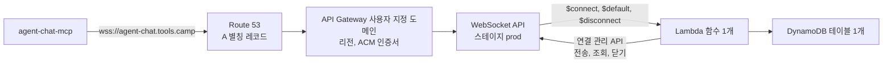

# 배포

시그널링 서버 두 가지의 구성과 배포 절차를 정한다.

- **공용 서버** `agent-chat.tools.camp`: AWS 서버리스(API Gateway WebSocket API + Lambda + DynamoDB). EC2 를 쓰지 않는다.
- **자체 호스팅 서버**: 공용 IP 를 가진 컴퓨터에서 도는 Node 프로세스(ws + 메모리 상태).

두 서버 모두 연결 주선만 한다. TURN 과 데이터 중계는 어떤 형태로도 없다.

- 상태: 설계안. **제품용 AWS 자원은 만들지 않았다.** 아래 절차는 구현 단계에서 실행한다.
- API Gateway 관련 값 가운데 **[실측 PRE-AWS-…]** 는 일회용 탐색 스택에서 본 것이다([AWS 실측 이력](../../tests/test-history/2026-11-15-aws-apigw-websocket-probe.md)). 조건은 서울 리전, 기본 엔드포인트, Lambda `nodejs24.x` arm64, 이 PC 의 Node `ws` 클라이언트다. 스택은 지웠다. 제품 경로의 통과가 아니므로 배포한 제품으로 다시 확인한다. 재지 못한 것은 **[문서]** 또는 **[가정 A-AWS-…]** ([검증 계획의 가정 목록](verification-plan.md#2-먼저-확인할-외부-가정))로 남겼다.
- 표기는 [protocol.md](protocol.md) 머리말과 같다.

## 1. 두 조립이 같은 규칙 코드를 쓰는 방식

와이어 계약은 하나다([protocol.md 2절](protocol.md#2-시그널링-websocket-와이어-계약)). 클라이언트는 어느 서버인지 구분하지 않는다.

| | 자체 호스팅 | 공용 |
|---|---|---|
| 규칙 (방, 참가자, 전달, 검증, 속도 제한) | `src/signaling-core` | **같은 코드** |
| 조립 | `src/signaling-selfhost` | `src/signaling-aws` |
| 진입점 | `dist/entry/server.js` | `build/lambda/index.mjs` (esbuild 번들) |
| `RoomStore` 구현 | 메모리 `Map` | DynamoDB 테이블 |
| `ConnectionSink` 구현 | `ws` 소켓 | API Gateway 연결 관리 API |
| 연결 ID | 프로세스가 만든 증가 번호 | API Gateway `connectionId` |
| 연결 종료 감지 | 소켓 `close` 이벤트(확실) | `$disconnect`(소켓이 닫히면 14~29ms **[실측 PRE-AWS-06]**. 전해지지 않는 단절은 미실측) + 전송 410 + 오래됨 판정 |
| 타이머 | 있음(미입장 기한, 죽은 소켓 정리) | 없음(읽을 때 걸러냄) |
| 처리 순서 | 한 이벤트 루프. 한 소켓에는 쓴 순서대로 간다 | 호출마다 독립. 순서가 바뀌고 **[실측 PRE-AWS-05]** 드물게 사라진다 |

같게 유지하는 수단:

1. core 는 **약한 쪽(공용)의 전제**로 쓴다. 상태 없음, 동시 처리, 순서 뒤바뀜을 견딘다. 자체 호스팅은 그보다 강한 환경일 뿐이다. 클라이언트도 같다. 공용 서버에서만 생기는 순서(`joined` 보다 먼저 오는 시그널)와 유실을 전제로 만든다. 그래서 두 서버에서 클라이언트 동작이 갈리지 않는다.
2. core 안에 조립별 분기를 넣지 않는다. 차이는 포트 구현 안에만 있다.
3. `RoomStore` 계약 테스트 묶음 하나를 두 구현이 모두 통과한다(`V-U7`. DynamoDB 구현은 `npm run test:store`).
4. 와이어 계약 테스트 파일 하나를 URL 만 바꿔 두 서버에 실행한다(`V-L1`, `V-P1`).
5. 조립에만 있는 동작(미입장 기한, 총 연결 수 제한)은 와이어 계약에 넣지 않는다. 클라이언트가 그것에 기대지 않는다.

## 2. 공용 서버 (AWS 서버리스)

### 2.1 구성



그림은 정적 검토만 했다. 자원은 모두 한 리전(서울, `ap-northeast-2`)에 둔다.

### 2.2 API Gateway 라우트

| 라우트 | 통합 | 하는 일 |
|---|---|---|
| `$connect` | Lambda | `Origin` 헤더가 없거나 `https://tools.camp` 면 200. 다른 값이나 잘못된 헤더는 403. **저장도 전송도 하지 않는다** |
| `$default` | Lambda | 본문을 `core.onMessage(connectionId, body)` 에 넘긴다 |
| `$disconnect` | Lambda | `core.onDisconnect(connectionId)` |

- 라우트 선택식은 `$request.body.action` 으로 두되 **action 별 라우트는 만들지 않는다.** 모든 메시지가 `$default` 로 간다. `action` 이 없는 본문과 JSON 이 아닌 본문도 `$default` 로 들어왔다 **[실측 PRE-AWS-04]**. 이유: 분기와 검증은 core 한 곳에서 한다.
- **라우트 응답을 만들지 않는다.** `RouteResponseSelectionExpression` 과 `AWS::ApiGatewayV2::RouteResponse` 자원을 두지 않는다. 켜 두면 본문 없이 200 만 돌려줘도 보낸 쪽에 빈 프레임이 메시지마다 갔다 **[실측 PRE-AWS-04]**.
- 응답은 연결 관리 API(`PostToConnection`)로만 보낸다. 요청자에게 보내는 것과 다른 참가자에게 보내는 것이 같은 경로다. `$default` 처리 중에 자기 연결로 보내는 것은 됐다(30회 중앙값 42ms) **[실측 PRE-AWS-04]**.
- `$connect` 가 돌려준 상태 코드와 본문은 그대로 핸드셰이크 응답이 됐다. `$connect` 안에서 자기 연결로 보내면 410 이었다. 거절된 연결에는 `$disconnect` 가 불리지 않았다(9건 중 0건) **[실측 PRE-AWS-03]**. 그래서 `$connect` 에서는 판단만 하고 아무 것도 저장하지 않는다.
- 함수는 하나다. 이벤트의 `requestContext.eventType` 으로 구분한다.

### 2.3 Lambda 핸들러

| 항목 | 값 | 근거 |
|---|---|---|
| 런타임 | `nodejs24.x`, arm64 | 이 조합에서 함수 생성·호출을 확인했다 **[실측 PRE-AWS-02]**. `nodejs22.x` 는 재지 않았고 지원 종료가 2027-05-30 으로 24.x(2028-04-30)보다 이르다 **[문서]**. `nodejs26.x` 도 돌았지만 공개 프리뷰다 **[실측, 문서]** |
| 메모리 / 제한 시간 | 256MB / 10초 | 실측에서 본 최대 메모리 사용은 109MB 였다 **[실측 PRE-AWS-05]**. 통합 제한 시간은 29초다 **[문서]**. 값은 **[제안]** |
| 번들 | esbuild 로 단일 ESM 파일 `index.mjs`. `@aws-sdk/*` 는 외부로 둔다 | 런타임 내장 SDK v3(3.1105.0)에서 DynamoDB, 문서 클라이언트, 연결 관리 클라이언트가 번들 없이 import 됐다 **[실측 PRE-AWS-02]**. 번들에 `zod` 와 core 만 들어간다. `node-datachannel`, `ws`, MCP SDK 는 들어가지 않는다 |
| 환경 변수 | `TABLE_NAME`, `LOG_LEVEL` | |
| 예약 동시 실행 | 인자(기본: 설정 안 함) | 20건을 연달아 보내면 동시 실행이 20까지 올랐다 **[실측 PRE-AWS-05]**. 낮게 걸면 넘는 호출의 메시지가 버려진다. 걸려면 `--throttle-burst` 이상으로 준다 |

- **패키지의 Node 하한(22)과 Lambda 런타임(24)은 달라도 된다.** 번들은 `node22` 문법을 대상으로 만들고 24 에서 돈다. core 는 런타임마다 다른 API 를 쓰지 않는다. MCP 프로세스와 자체 호스팅 서버는 22 이상이면 된다.
- **내장 SDK 를 쓰는 선택의 위험.** AWS 는 버전을 고정하려면 SDK 를 배포 묶음에 넣기를 권한다 **[문서]**. 내장 SDK 는 런타임 갱신 때 바뀔 수 있다. 내장으로 시작하고, 배포 때마다 `verify.mjs` 로 확인한다. 문제가 생기면 `build:lambda` 에서 외부 지정을 빼 번들에 넣는다. 코드 변경은 없다.
- 콜드 스타트는 초기화 중앙값 248ms 에 첫 실행 중앙값 435ms 로, 보낸 쪽이 느끼는 지연이 640~990ms 였다 **[실측 PRE-AWS-05]**. 클라이언트의 요청 기한(10초)과 시그널 재전송(3초)이 이것을 견딘다.
- 연결 관리 API 의 주소는 `https://<apiId>.execute-api.<리전>.amazonaws.com/<스테이지>` 로 만든다. `apiId` 와 스테이지는 이벤트의 `requestContext` 에서, 리전은 `AWS_REGION` 에서 얻는다. **사용자 지정 도메인 이름으로 만들지 않는다.** 실측은 기본 엔드포인트로만 했다. 사용자 지정 도메인으로 들어온 연결에서도 이 주소가 통하는지는 재지 않았다 **[가정 A-AWS-4]**.
- 핸들러는 항상 `{statusCode: 200}` 을 돌려준다(`$connect` 거절 제외). 예외로 끝나면 `$connect` 에서는 502 와 `{"message": "Internal server error", …}` 본문이 갔다 **[실측 PRE-AWS-03]**. `$default` 에서 예외가 났을 때 클라이언트가 받는 프레임은 재지 않았다 **[가정 A-AWS-6]**. 클라이언트는 `type` 없는 프레임을 견딘다([protocol.md 2.4](protocol.md#24-오류-코드)).
- esbuild 를 devDependency 로 두는 이유: Lambda 에 올릴 파일이 `zod` 를 포함해 혼자 돌아야 한다. `node_modules` 를 통째로 압축하면 네이티브 모듈까지 들어간다. 대안(의존성 없이 손으로 쓴 검증)은 클라이언트와 스키마를 공유하지 못해 버렸다.

### 2.4 DynamoDB 데이터 모델

테이블 하나, 요청 과금(on-demand), TTL 속성 `ttl`.

| 항목 | 파티션 키 `pk` | 정렬 키 `sk` | 속성 |
|---|---|---|---|
| 참가자 | `ROOM#<방 ID 의 SHA-256 앞 32자리>` | `PEER#<peer>` | `connId`, `sid`, `keyHash`, `seq`, `lastSeenAt`(ms), `ttl`(= `lastSeenAt` + 1시간, 초), `claimed?`(입장 판정을 통과한 처리가 그 판을 차지했다. `PutItem` 으로 다시 쓰면 없어진다. 검토 1차 SERVER-R1-01. 읽을 때 기록의 `claimed: true` 로 싣는다. 등록 전에 실패한 `join` 의 재전송이 다시 판정받지 않게 한다. 검토 3차 SERVER-R3-01) |
| 연결 | `CONN#<connectionId>` | `CONN` | `roomKey?`, `peer?`, `sid?`(등록할 때의 `join.sid`. 이 연결이 보낸 `signal` 에 붙인다), `w<분 번호>`(그 분의 메시지 수), `miss`(연속 `ROOM_NOT_FOUND` 수), `ttl`(= 생성 + 3시간, 초) |

- 방 항목은 없다. 방은 참가자 항목이 있는 동안 있다([protocol.md 2.8](protocol.md#28-방-수명)).
- 보조 인덱스는 없다. 연결 → 참가자는 연결 항목으로 찾는다.
- **모든 읽기는 강한 일관성**(`ConsistentRead`)이다.
- **방 ID 원문을 저장하지 않는다.** 키에는 해시를 쓴다. 해시로도 정확히 일치하는 조회가 된다. 방 ID 는 유일한 접근 수단이라 테이블을 볼 수 있는 사람에게도 드러내지 않는다. 로그의 `room_ref` 는 같은 해시의 앞 12자리다.
- `key` 원문도 저장하지 않는다. SHA-256 해시만 둔다.
- 참가자 이름은 정렬 키에 원문으로 남는다. 목록으로 돌려줘야 하기 때문이다. 설치가 넣는 기본 이름은 호스트 이름에서 만들지 않는다([architecture.md 5절](architecture.md#5-설정-항목과-기본값)).
- 테이블에 접근하는 것은 Lambda 역할과, 저장소 계약 검증을 실행하는 배포자뿐이다([2.6](#26-iam-최소-권한)).

**동작별 연산**

| 동작 | 연산 |
|---|---|
| 모든 메시지 | 연결 항목 `UpdateItem`: 이번 분의 카운터 +1, 결과로 등록(`roomKey`, `peer`, `sid`)과 건수를 받는다. 쓰기 1회로 속도 제한과 등록 조회를 겸한다 |
| `join` | (이미 같은 방·이름으로 등록된 연결이면 방 `Query` → `joined` 만) 참가자 `GetItem`(이 연결·이 `seq` 의 기록이 `claimed` 면 방 `Query` → 연결 항목 기록 → `joined` 만. 검토 3차) → 참가자 조건부 `PutItem` 또는 `UpdateItem`(인계) → 방 `Query` → 사후 판정. 실패면 판정에 쓴 항목 조건부 `DeleteItem`(조건: `connId` 와 판정에 쓴 `lastSeenAt` 일치, `claimed` 없음. 실패하면 참가자 `GetItem` 으로 아직 이 연결·이 `seq` 인지 보고, 그렇다면 오류를 보내지 않는다. 그 기록이 `claimed` 면 연결 항목 기록 → `joined`) → 통과면 참가자 조건부 `UpdateItem`(`claimed` 표시. 조건: `connId` 와 판정에 쓴 `lastSeenAt` 일치. 실패면 `SERVER_ERROR`) → 연결 항목에 `roomKey`·`peer`·`sid` 기록 → `joined` 전송. 전송이 410 이면 연결 항목 `DeleteItem` → 참가자 조건부 `DeleteItem`(조건: `connId` 일치) |
| `signal` | 대상 참가자 `GetItem` → 전송. 410 이면 대상 항목 조건부 `DeleteItem`. 보낸 쪽의 `from`·`sid` 는 위 "모든 메시지"에서 받은 등록의 값이라 보낸 쪽 참가자 항목은 읽지 않는다 |
| `ping` | 참가자 `lastSeenAt`·`ttl` 조건부 `UpdateItem`(조건: `connId` 일치, 그리고 저장된 `lastSeenAt` 이 `now − PARTICIPANT_STALE_MS` 이상. 오래된 기록은 되살리지 않는다) → 방 `Query` → `pong` 전송 |
| `leave`, `$disconnect` | 연결 항목 `DeleteItem`(옛 값 반환) → 참가자 조건부 `DeleteItem`(조건: `connId` 일치) |

**정원, 중복 입장, 유령 참가자**

| 문제 | 처리 |
|---|---|
| 정원 | 잠금 없이 "쓰고 → 강한 일관성으로 읽고 → **읽은 참가자 수**가 정원을 넘으면 자기 항목을 지우고 `ROOM_FULL`". 정원을 넘지 않는다. 대신 동시에 들어온 입장자가 둘 다 거절될 수 있다. 근거와 한계는 [protocol.md 2.3](protocol.md#23-서버-처리-규칙) |
| 방 생성 충돌 | 읽은 목록에 다른 참가자가 있으면 자기 항목을 지우고 `ROOM_EXISTS`. 많아야 한 명이 성공한다 |
| 같은 이름의 동시 입장 | 새 항목 쓰기는 `attribute_not_exists(pk)` 조건부, 덮어쓰기는 "방금 읽은 `connId` 와 `seq` 그대로" 조건부. 하나만 성공한다 |
| 같은 프로세스의 재접속 | `keyHash` 가 같고 `seq` 가 저장값보다 크면 `connId`·`sid`·`seq` 를 바꾼다. 옛 연결은 `REPLACED` 를 보내고 닫는다. 실제로는 드물다. 소켓이 닫힐 때 항목이 이미 지워지기 때문이다 **[실측 PRE-AWS-06]** |
| 옛 연결의 늦은 `join` | `seq` 가 저장값보다 작아 조건이 맞지 않는다. 항목을 바꾸지 않고 그 연결에 `REPLACED` 를 보낸다 |
| 재시작한 참가자 (key 가 다름) | 옛 연결을 `GetConnection` 으로 확인한다. 410 이면 덮어쓴다. 살아 있으면 `NAME_IN_USE`. `GetConnection` 으로 열림과 닫힘이 구분되는지는 재지 않았다 **[가정 A-AWS-13]** |
| 옛 연결의 늦은 `$disconnect` | 삭제가 `connId` 조건부라 새 항목을 지우지 못한다 |
| 같은 연결의 같은 `join` 이 두 실행에서 겹침 | 판정에 실패한 쪽은 판정에 쓴 판이고 차지되지 않았을 때만 지운다. 통과한 쪽은 그 판을 차지(`claimed`)한 뒤에만 등록한다. 둘 중 하나만 이긴다. 지우지 못한 쪽은 기록이 아직 이 연결이면 실패 코드를 보내지 않는다(같은 요청에 반대 답 둘을 보내지 않는다). 그 기록이 차지돼 있으면 지우지 못한 쪽도 등록하고 `joined` 를 보낸다. 차지한 쪽이 등록(`bind`) 전에 실패했을 수 있기 때문이다(`joined` 가 둘 가면 클라이언트는 두 번째를 버린다)([protocol.md 2.3](protocol.md#23-서버-처리-규칙) 6번. 검토 1차 SERVER-R1-01, 검토 2차 SERVER-R2-01, 검토 3차 SERVER-R3-01. **재배포 필요**). 남는 틈: 지운 뒤 같은 `join` 의 나중 처리가 새 판을 써서 다시 판정하면 실패 뒤 `joined` 가 갈 수 있다. 클라이언트는 첫 답(실패)을 따르고 소켓을 닫으므로 등록은 종료 통지에서 지워진다 |
| 차지한 뒤 등록(`bind`) 전에 실패한 `join`(DynamoDB 5xx·스로틀·요청 기한, Lambda 기한) | 그 요청에는 `SERVER_ERROR` 가 가거나(저장소 예외) 답이 없다(함수 기한). 클라이언트가 같은 연결에 같은 `join` 을 다시 보내면, 차지된 자기 기록을 보고 **다시 판정하지 않고** 등록해 `joined` 로 답한다. 다시 판정하면 만든 쪽이 `ROOM_EXISTS`(상대는 그를 멤버로 본다)를 받고, 등록 없이 차지된 기록이 종료 통지로도 지워지지 않는 유령으로 90초 남는다(검토 3차 SERVER-R3-01. **재배포 필요**). 재전송 없이 연결이 끝나면 그 기록은 오래됨으로 빠질 때까지 남는다 |
| `join` 처리 중에 끝난 연결(`$disconnect` 가 `join` 보다 먼저 처리됨) | **대부분 `joined` 전송의 410 으로 지운다.** 등록 뒤 보낸 `joined` 가 410 이면 그 `join` 이 방금 만든 연결 항목과 참가자 항목(`connId` 조건. 그 사이 인계된 새 항목은 지우지 못한다)을 지우고 로그를 `outcome=gone` 으로 남긴다(검토 2차 SERVER-R2-02. **재배포 필요**). 남는 경우: `joined` 전송이 410 이 아닌 경우(연결이 아직 닫히는 중이라 전송은 성공했고 그 뒤 종료 통지가 먼저 처리됨, 또는 전송이 다른 이유로 실패). 그때는 고치기 전처럼 참가자 항목이 다른 입장자의 `signal` 410(3번 겹) 또는 `lastSeenAt` 90초(4번 겹)로 빠지고, 연결 항목은 TTL(3시간)로 지워진다 **[검토 1차 SERVER-R1-02 재현. W9 관찰 8 의 "빈 항목"과 다른 경우]**. 종료 표시로 막는 방법(`$disconnect` 가 짧은 TTL 의 `closed` 를 남기고 `hitRate`·`bind` 가 그것을 조건으로 본다)은 남은 과제다 |
| 없는 방 입장의 반복 | 연결 항목의 `miss` 를 올리고 5회면 `RATE_LIMITED` 뒤 닫는다 |
| 유령 참가자 | [architecture.md S14](architecture.md#s14-유령-참가자-공용-서버)의 네 겹. 판정은 `lastSeenAt` 비교로 하고, TTL 은 남은 항목을 치우는 데만 쓴다 |

- "쓰고 읽고 수를 센다"는 방식 자체는 DynamoDB 에서 재지 않았다 **[가정]**. 잰 것은 전제(쓰기 뒤 강한 일관성 조회 20회에서 둘 다 못 본 경우 0회)와, 조건식을 쓰는 다른 두 방식이 정원을 넘지 않았다는 것이다 **[실측 PRE-AWS-09]**. `verify.mjs` 의 동시 입장 항목([2.11](#211-배포-후-검증-verifymjs))에서 초과가 나오면 조건식 방식으로 바꾼다.
- TTL 삭제는 기한이 지나도 한참 늦을 수 있다 **[가정: 문서로 알려진 동작. 이번 조사에서 다시 확인하지 않았다]**. 그래서 읽는 쪽이 `lastSeenAt` 으로 걸러낸다. TTL 이 꺼져 있어도 규칙은 맞게 동작한다.

### 2.5 API Gateway 제약과 대응

근거 칸의 **[실측]** 은 일회용 탐색 스택에서 본 것이다. 제품을 배포한 뒤 `V-P1`~`V-P7` 에서 다시 본다.

| 제약 | 근거 | 설계의 대응 |
|---|---|---|
| 아무 것도 보내지 않은 연결은 600.0초에 종료 코드 1001 로 닫힌다. 4분마다 보낸 앱 메시지나 ping 프레임으로는 765~780초까지 유지됐다 | **[실측 PRE-AWS-07]** | 클라이언트가 30초마다 `ping` 메시지를 보낸다 |
| 연결은 최대 2시간이고 늘릴 수 없다 | **[실측 `V-P4`]** 첫 연결 뒤 119.99~120.00분에 끊겼다. 네 프로세스 모두 0.38~1.36초 안에 재접속·재등록했고 DataChannel 이 열린 채였다(링크 닫힘 0, 채팅 유실 0)([이력](../../tests/test-history/2026-11-16-final-long.md)) | 클라이언트가 끊김을 정상 사건으로 다루고 재접속·재등록한다. **열린 DataChannel 은 유지된다** |
| 메시지는 131,072바이트까지 전달된다. 131,073바이트부터 연결이 종료 코드 1009 로 닫힌다. 서버가 보내는 쪽(`PostToConnection`)도 131,072바이트까지이고 넘으면 HTTP 413 이다 | **[실측 PRE-AWS-08]** | 와이어 상한을 16KB 로 둔다 |
| 프레임 한도 32KB | **[문서]** 와 달랐다. 32,769~122,880바이트의 단일 프레임이 전달됐다 **[실측 PRE-AWS-08]** | 16KB 상한에는 영향이 없다 |
| `$connect` 처리 중에는 그 연결로 보낼 수 없다(410) | **[실측 PRE-AWS-03]** | `$connect` 에서는 아무 것도 보내지 않는다. 버전 협상과 등록은 `join` 메시지에서 한다 |
| 소켓이 닫히면 `$disconnect` 가 14~29ms 안에 불린다(정상 닫힘 3회, 프로세스 강제 종료 3회). 그 뒤 그 연결로의 전송은 30건 모두 410 | **[실측 PRE-AWS-06]** | 종료 통지로 기록을 지운다. 전송 410 을 "연결 없음"으로 다룬다 |
| 닫힘이 서버에 전해지지 않는 단절(전원 차단, 망 끊김)은 유휴 한도까지 통지가 오지 않을 수 있다. 통지 자체가 누락될 수도 있다 | **[추론, 문서]** 재지 않았다(A-AWS-3) | `lastSeenAt` 판정(90초)으로 보완한다 |
| 메시지마다 Lambda 가 따로 호출된다. 연달아 보낸 20건은 10회 중 10회 순서가 바뀌었다. 20ms 간격은 3회 중 1회, 100ms 간격은 2회 중 0회 | **[실측 PRE-AWS-05]** | 서버 쓰기는 조건부이고 `join` 은 접속 순번으로 가린다. 클라이언트는 `join` 직후부터 시그널을 받고, 후보를 묶어 보내고, `offer` 보다 먼저 온 후보를 보관한다([protocol.md 3절](protocol.md#3-webrtc-연결-절차)) |
| 메시지가 사라질 수 있다. 배포 직후 연속 20건 중 2건이 500 으로 남고 도착하지 않았다(원인 모름. 이후 260건에서는 없었다). 스로틀을 넘은 메시지는 버려진다 | **[실측 PRE-AWS-05, 10]** | 클라이언트가 시그널과 `join` 을 다시 보낸다([protocol.md 3.3](protocol.md#33-재전송-기한-실패)) |
| 스로틀을 넘으면 연결은 유지되고 보낸 쪽에 `{"message":"Too Many Requests"}` 가 온다 | **[실측 PRE-AWS-10]** | 클라이언트가 `type` 없는 프레임을 "최근 보낸 것이 사라졌을 수 있다"로 다룬다. 재접속하지 않는다 |
| 스테이지 스로틀은 스테이지 전체에 걸리고, 서버 → 클라이언트 전송(`POST /@connections`)에도 걸린다. 그때 버려진 `pong`·`joined`·전달 `signal` 은 받는 쪽에 아무 흔적도 남기지 않는다(게이트웨이 프레임이 오지 않는다). 다른 연결들의 부하가 초당 35건이면 정상 참가자가 `ping` 3회 놓침으로 재접속했고, 초당 45건부터 입장이 실패했다 | **[실측 W9 `V-P7`(나), P-W9P-05~09]** | **알려진 한계로 둔다(총괄 결정, 검토 1차).** 스로틀 값(초당 25·버스트 100)은 바꾸지 않는다. 올리면 남용 때의 비용 상한도 오른다. 값의 변경은 사용자가 정한다. 위험이 적은 개선만 했다: (가) answer 쪽도 시도 안에서 `answer` 를 주기마다 다시 보낸다([protocol.md 3.3](protocol.md#33-재전송-기한-실패)). (나) 연결 관리 API 를 다시 시도하지 않고, 전달이 스로틀에 걸리면 `SERVER_ERROR` 응답을 보내지 않는다(요구량을 키우지 않는다. **재배포 필요**). 재접속은 DataChannel 을 끊지 않으므로 `ping` 놓침 규칙(2.6)은 그대로다. **같은 서버를 쓰는 다른 연결이 스로틀 한도를 넘기면 입장이 실패할 수 있다.** `V-P7`(나)의 판정은 실패로 남긴다([W9 공용 서버 이력](../../tests/test-history/2026-11-15-w9-public.md), [Gate 3](../../tests/test-history/2026-11-15-gate3.md), [검토 1차](../../tests/test-history/2026-11-16-review-r1.md)) |
| 콜드 스타트 때 응답이 640~990ms, 연결 수립이 861~1017ms 걸린다 | **[실측 PRE-AWS-05, 07]** 연결 수립의 가장 큰 값 1017ms 는 유휴 시험의 첫 연결에서 나왔다 | 요청 기한 10초, 시그널 재전송 3초 |
| Lambda 호출은 상태가 없다. 서버가 스스로 타이머를 돌릴 수 없다 | 구조 | 모든 상태는 DynamoDB 에 있다. 주기 작업이 없다. 오래된 항목은 읽을 때 걸러낸다 |
| 서버가 닫을 때 클라이언트가 보는 종료 코드 | 재지 않았다(A-AWS-5) | 계약이 종료 코드에 의미를 두지 않는다. 닫기 전에 `error` 를 보낸다 |
| 계정 한도: 새 연결 초당 500, 계정 스로틀 초당 10,000(버스트 5,000), 라우트 300 | **[문서]** | 공용 서버 하나의 쓰임으로는 닿지 않는다고 본다 **[추론]** |

### 2.6 IAM 최소 권한

Lambda 실행 역할:

| 권한 | 대상 |
|---|---|
| `logs:CreateLogStream`, `logs:PutLogEvents` | 이 함수의 로그 그룹 |
| `dynamodb:GetItem`, `PutItem`, `UpdateItem`, `DeleteItem`, `Query` | 이 테이블 |
| `execute-api:ManageConnections` | `arn:aws:execute-api:<리전>:<계정>:<apiId>/<스테이지>/*/@connections/*` |

- 그 밖의 권한은 없다. VPC 에 넣지 않는다. 다른 AWS 서비스를 부르지 않는다.
- API Gateway 가 함수를 부를 권한(`AWS::Lambda::Permission`)은 이 API 의 ARN 으로 제한한다. 접근 로그를 쓰려면 API Gateway 가 로그 그룹에 쓸 권한이 계정에 있어야 한다. 없으면 사전 점검에서 알린다.
- 계정 ID 와 `apiId` 는 템플릿의 의사 인자와 참조로 채운다. 저장소에 적지 않는다.
- 배포하는 사람에게 필요한 권한: CloudFormation 스택 생성·갱신·삭제, IAM 역할 생성(`CAPABILITY_IAM`), Lambda, API Gateway v2, DynamoDB, CloudWatch Logs, 지정한 호스팅 영역의 레코드 조회·변경, ACM 인증서 조회.
- **저장소 계약 검증을 실행하는 사람**에게는 이 테이블의 `GetItem`, `PutItem`, `UpdateItem`, `DeleteItem`, `Query` 가 더 필요하다. `Scan` 은 선택이다. 있으면 끝난 뒤 시험 항목이 테이블 어디에도 남지 않았는지 훑어 보고, 없으면 그 확인을 비워 두고 실패로 치지 않는다(구현 W2). `npm run test:store -- --table <테이블 이름> --region <리전>` 이 실행하는 사람의 자격으로 테이블에 직접 쓴다.
  - 시험 항목이 운영 항목과 섞이지 않게 하는 규칙: 시험은 실행마다 무작위로 만든 방 ID 만 쓴다(방 키가 해시라 실제 방과 겹치지 않는다). 연결 ID 는 `test-<실행 ID>-` 로 시작한다(API Gateway 가 만드는 ID 와 형식이 달라 겹치지 않는다). 끝날 때 자기가 만든 항목을 모두 지우고, 남은 것이 없는지 확인한다. 중간에 죽어 남은 항목은 TTL(1~3시간)로 치워진다.

### 2.7 스로틀, 로그, 비용 상한

| 수단 | 값(인자 기본값) | 막는 것 |
|---|---|---|
| 스테이지 기본 라우트 스로틀 | 초당 25건, 버스트 100 | 전체 호출량. **엄격한 상한은 아니다** |
| Lambda 예약 동시 실행 | 설정 안 함 | 동시 실행 폭주. 걸려면 버스트 값 이상으로 |
| 연결별 속도 제한(core) | 60초에 300건 | 한 연결의 독점. 초과하면 연결을 닫는다 |
| 없는 방 입장의 반복(core) | 연결당 연속 5회 | 방 ID 대입 |
| 메시지 크기(core) | 16KB | 큰 본문 전달 |
| 방 정원(core) | 8 | 방 하나의 전달 증폭 |
| 로그 보존 | 7일 | 로그 저장 비용, 로깅 가이드 |

- 스로틀은 스테이지 전체에 걸린다고 본다. 연결별이 아니다 **[가정 A-AWS-11]**. 그래서 남용이 있으면 정상 사용자도 스로틀에 걸릴 수 있다. 연결별 제한이 그 영향을 줄인다.
- **스로틀은 정확히 그 수에서 끊지 않는다.** 초당 1건·버스트 1 로 두고 10건을 연달아 보냈을 때 한 번은 10건이 모두, 한 번은 9건이 통과했다 **[실측 PRE-AWS-10]**. 스로틀 값으로 계산한 비용 상한은 어림값이다.
- **기본값의 근거와 한계.** 한 쌍을 잇는 데 시그널이 약 5건 든다(`offer-request`, `offer`, `answer`, 후보 묶음 2건). 네 명이 동시에 들어오면 6쌍에 약 30건, 여덟 명이면 28쌍에 약 140건이다 **[추론]**. 여덟 명의 동시 입장은 버스트 100 을 넘을 수 있다. 넘은 메시지는 버려지고 클라이언트가 3초 뒤 다시 보낸다. 스로틀은 공용 서버의 모든 방이 나눠 쓴다. 이 기본값은 **[제안]** 이고 `V-P7`(콜드 상태 동시 입장, 스로틀을 넘긴 상태의 입장)의 결과로 다시 정한다.
- 로그:
  - 함수는 [architecture.md 6절](architecture.md#6-로깅-설계)의 허용 필드만 JSON 으로 쓴다. **본문, SDP, candidate, 방 ID 원문, 참가자 이름 원문, IP 를 쓰지 않는다.**
  - 스테이지의 실행 로그와 데이터 추적은 끈다(켜면 본문이 로그에 들어갈 수 있다).
  - **접근 로그는 켠다**(`--access-log off` 로 끌 수 있다). 게이트웨이 단계에서 500 으로 사라진 메시지는 함수 로그에 남지 않았다 **[실측 PRE-AWS-05]**. 접근 로그가 없으면 서버 쪽에서 유실을 볼 수 없다.
  - 접근 로그 형식에는 본문, 연결 ID, IP 를 넣지 않는다. 넣는 것은 `$context.requestId`, `$context.eventType`, `$context.routeKey`, `$context.status`, `$context.error.message`, `$context.integrationStatus`, `$context.requestTimeEpoch` 다. **형식에 `$context.requestId` 가 없으면 스테이지 생성이 실패한다** **[실측 PRE-AWS-01]**. 값은 모두 따옴표로 감싼다. `$context.error.messageString` 은 오류가 없을 때 따옴표 없는 `-` 를 내서 줄이 JSON 으로 읽히지 않는다 **[실측 W2]**.
- 비용 **[가정 A-AWS-12: 단가는 배포 전에 요금표로 확인]**:
  - 호출 한 번에 드는 것: 게이트웨이 메시지 약 2건(수신 + 응답), Lambda 호출 1회, DynamoDB 쓰기 1~2회와 읽기 1~2회, 접근 로그 한 줄.
  - 보통 쓰임(참가자 4명, 2시간): `ping` 약 960건 + 시그널 수십~수백 건. 1센트에 못 미친다고 추정한다.
  - 어림 상한: 스로틀 한도로 한 달 내내 호출되면 약 6천5백만 건이다. 호출 백만 건당 수 달러로 잡으면 **월 수백 달러**가 된다. 위에 적었듯 스로틀이 정확한 상한이 아니므로 이보다 클 수 있다.
  - 스로틀은 지출을 멈추지 않는다. 계정에 **AWS Budgets 알림**을 걸 것을 권한다. 선택 인자 `--alarm-topic-arn` 을 주면 시간당 메시지 수 경보를 스택에 만든다.

### 2.8 사용자 지정 도메인

| 자원 | 설정 |
|---|---|
| `AWS::ApiGatewayV2::DomainName` | 도메인 이름(인자), 리전 엔드포인트, TLS 1.2, 인증서 ARN(인자) |
| `AWS::ApiGatewayV2::ApiMapping` | 도메인 → 이 API 의 스테이지. 매핑 키 없음. 그래서 접속 주소가 `wss://agent-chat.tools.camp` 다(경로 없음) **[가정 A-AWS-8]** |
| `AWS::Route53::RecordSet` | A 별칭 레코드. 대상은 도메인 자원의 리전 도메인 이름과 호스팅 영역 ID. 레코드를 둘 호스팅 영역 ID 는 인자 |

- 인증서는 **같은 리전**의 ACM 에서 발급 완료(`ISSUED`) 상태여야 한다. 인증서는 이 스택이 소유하지 않는다. 스택을 지워도 남는다.
- 인증서 ARN, 호스팅 영역 ID, 계정 ID 는 저장소에 적지 않는다. 배포 인자로 받는다.
- 사용자 지정 도메인은 탐색 스택에서 재지 않았다. 처음 확인하는 것은 제품 배포의 `verify.mjs` 1번이다.

### 2.9 배포물과 인자

저장소 `deployments/aws/` 에 둔다.

| 파일 | 내용 |
|---|---|
| `template.yaml` | CloudFormation 템플릿. 테이블, 역할, 로그 그룹 둘(함수, 접근 로그), 함수, API, 통합, 라우트 3개, 배포, 스테이지, 권한, 도메인, 매핑, DNS 레코드, (선택) 경보. **라우트 응답 자원은 없다** |
| `deploy.sh` | 사전 점검 → 번들 → 스택 배포 → 함수 코드 올리기 → 검증 실행 |
| `destroy.sh` | 스택 삭제와 확인 |
| `verify.mjs` | 배포 후 검증(2.11). 도메인과 TLS 를 확인한 뒤 저장소의 와이어 계약 테스트(`tests/wire/wire-contract.mjs`)를 공용 주소로 실행한다 |

| 인자 | 필수 | 기본값 | 뜻 |
|---|---|---|---|
| `--region` | 예 | — | 배포 리전 |
| `--stack-name` | 아니오 | `agent-chat-signaling` | 스택 이름 |
| `--domain` | 예 | — | 사용자 지정 도메인. 공용 서버는 `agent-chat.tools.camp` |
| `--certificate-arn` | 예 | — | 같은 리전의 ACM 인증서 |
| `--hosted-zone-id` | 예 | — | 도메인이 속한 Route 53 호스팅 영역 |
| `--stage` | 아니오 | `prod` | 스테이지 이름 |
| `--throttle-rate`, `--throttle-burst` | 아니오 | 25, 100 | 2.7 |
| `--reserved-concurrency` | 아니오 | 없음 | 2.3 |
| `--access-log` | 아니오 | `on` | 2.7 |
| `--alarm-topic-arn` | 아니오 | 없음 | 2.7 |
| `--profile` | 아니오 | AWS CLI 기본 | 자격 증명 프로필 |

구현이 더한 인자(W2): `deploy.sh` 의 `--skip-install`(공유 작업 트리에서 `npm ci` 를 건너뜀), `--skip-verify`, `--verify-args`(검증에 넘길 인자), `--verify-full`(갱신 배포에서도 부하 항목을 모두 돈다. 검토 1차), `--alarm-messages-per-hour`(경보 기준. 템플릿 기본 50000). `destroy.sh` 의 `--yes`(없으면 지울 대상만 출력한다). `verify.mjs` 의 `--ready-wait-ms`(1번 핸드셰이크를 다시 시도할 기한. 기본 420초), `--wire-timeout-ms`. 이름은 `<스택>-table`, `<스택>-fn`, 로그 그룹 `/agent-chat/<스택>/function`, `/agent-chat/<스택>/access` 다.

**함수 코드를 올리는 방식.** 템플릿에는 자리만 잡아 두고 스크립트가 `aws lambda update-function-code --zip-file` 로 올린다. S3 없이 올라갔다 **[실측 PRE-AWS-02]**.

- 템플릿의 임시 코드는 **CommonJS** 로 쓴다(`exports.handler = async () => ({ statusCode: 500 })`). 인라인 `ZipFile` 은 `index.js` 로 저장되어 CommonJS 로 읽힌다. `import` 문을 쓰면 `Runtime.UserCodeSyntaxError` 가 난다 **[실측 PRE-AWS-02]**.
- 올리는 묶음은 `index.mjs` 하나를 담은 zip 이다. 핸들러 이름은 `index.handler` 로 임시 코드와 같다.
- 이유: 코드 묶음을 둘 S3 버킷과 그 인자를 없앤다. 비용: 스택을 처음 만든 직후 몇 초 동안 함수가 임시 코드다. 그 사이의 접속은 500 으로 거절된다. 스크립트가 바로 이어서 올리고, 검증이 통과해야 배포 성공으로 본다. 대안(`aws cloudformation package` + S3)은 버킷 관리가 늘어 버렸다.

### 2.10 배포, 갱신, 삭제 절차

**처음 배포와 갱신** (`deploy.sh`. 같은 명령이다. 여러 번 실행해도 결과가 같다)

1. 사전 점검. 하나라도 실패하면 멈추고 이유를 출력한다.
   - `aws sts get-caller-identity` 가 성공한다.
   - 인증서가 같은 리전에 있고 상태가 `ISSUED` 다. 아니면 DNS 검증 레코드를 확인하라고 안내한다.
   - 호스팅 영역이 있고 도메인이 그 영역에 속한다.
   - 그 도메인에 이 스택이 만들지 않은 레코드가 이미 있지 않다.
   - **스택 상태.** 없거나 `*_COMPLETE` 면 계속한다. `ROLLBACK_COMPLETE` 면 첫 생성이 실패한 스택이다. 이 상태의 스택은 같은 명령으로 다시 배포되지 않는다. 지우고 처음부터 만든다(지운다는 것을 출력한다). `*_IN_PROGRESS` 나 `*_FAILED` 면 멈추고 상태를 알린다.
   - **이 제품의 스택인지**(검토 1차 SERVER-R1-05). 갱신하거나(`*_COMPLETE`) 지우기(`ROLLBACK_COMPLETE`) 전에 태그 `project=agent-chat`(이 스크립트가 붙인다)과 템플릿 설명(ASCII 부분 `agent-chat … API Gateway WebSocket API + Lambda + DynamoDB`. 한글은 CLI 출력 인코딩에 따라 `?` 로 나온다 **[실측]**)을 본다. 갱신이면 출력 `ApiId`·`TableName`·`FunctionName` 도 있어야 한다. 아니면 아무 것도 바꾸지 않고 멈춘다. `--stack-name` 을 잘못 주면 같은 계정·리전의 다른 스택을 이 템플릿으로 갱신하거나(템플릿에 없는 자원이 지워진다) 지울 수 있기 때문이다.
2. `npm ci` 와 `npm run build:lambda`. 결과물(`index.mjs`)을 압축한다.
3. `aws cloudformation deploy` 로 스택을 만들거나 갱신한다(`CAPABILITY_IAM`).
4. `aws lambda update-function-code` 후 `aws lambda wait function-updated`.
5. 스택 출력(접속 주소, API ID, 테이블 이름, 함수 이름)을 출력한다.
6. `verify.mjs` 를 실행한다. 실패하면 종료 코드 1.
   - **갱신 배포의 검증은 부하 항목을 줄인다**(검토 1차 SERVER-R1-04): 속도 제한 flood 를 건너뛰고(`--no-flood`), 동시 입장·생성(12번)을 2회로 줄인다(`--rounds 2`). flood 는 약 16초 동안 스테이지에 초당 약 40건(보낸 것 20 + 응답 20)을 걸어 스로틀(초당 25)을 넘기고, 그동안 같은 서버의 모든 방이 `pong`·`joined` 를 잃는다(2.5 표의 스로틀 행). 처음 배포(스택이 없었다)와 `--verify-full` 은 전체를 돈다. 줄인 항목은 통과로 세지 않는다(건너뜀).
   - **처음 배포 직후 약 3분 동안은 사용자 지정 도메인의 핸드셰이크가 HTTP 400 이다**(도메인 매핑이 퍼지는 시간) **[실측 W2]**. 그래서 1번의 핸드셰이크 확인은 기한(`--ready-wait-ms`) 안에서 다시 시도한다. DNS 조회와 TLS 는 그 전에도 통과한다.

- **API 배포는 템플릿이 소유한다.** `AWS::ApiGatewayV2::Deployment`(라우트에 `DependsOn`)와 스테이지 자원으로 만든다. 이 구성의 스택이 62초에 만들어졌다 **[실측 PRE-AWS-01]**. 스크립트는 `create-deployment` 를 따로 부르지 않는다. 부르면 실행할 때마다 배포가 하나씩 늘고 스테이지가 템플릿과 어긋난다.
- 함수 코드만 바꾸는 갱신에는 API 배포가 필요 없다. 라우트나 통합을 바꾸는 변경은 템플릿의 배포 자원 이름을 함께 바꿔 새 배포가 만들어지게 한다(템플릿 주석에 적는다). 라우트 셋과 통합 하나는 고정이라 드문 일이다.

**되돌리기**: 이전 커밋을 체크아웃해 같은 명령으로 배포한다. 테이블 항목은 한 시간 안에 만료되는 등록뿐이라 옮길 데이터가 없다. 와이어 버전을 올리는 변경은 구버전 클라이언트가 `UNSUPPORTED_VERSION` 을 받게 되므로, 서버가 두 버전을 함께 받는 기간을 둔다.

**삭제** (`destroy.sh`)

1. 이 제품의 스택인지 확인한다(태그·템플릿 설명. 만들기가 끝난 스택이면 출력도. 위 사전 점검과 같다). 아니면 지우지 않는다. 그다음 `aws cloudformation delete-stack` 후 삭제 완료를 기다린다.
2. 지워지는 것: DNS 레코드, 도메인 매핑, 도메인, API, 함수, 역할, 로그 그룹, 테이블.
3. 남는 것: ACM 인증서, 호스팅 영역.
4. 확인: `describe-stacks` 가 스택 없음을 돌려준다. 호스팅 영역의 레코드 목록(`aws route53 list-resource-record-sets`)에 그 도메인의 A 레코드가 없다. DNS 조회로 확인하지 않는다. 캐시 때문에 결과가 흔들린다.

**재현 가능성 확인**: 삭제 후 다시 배포해 검증이 통과하는지 본다(`V-P6`).

### 2.11 배포 후 검증 (`verify.mjs`)

제품 클라이언트 코드가 아니라 **와이어 계약만 아는 작은 클라이언트**로 한다. 1번은 `verify.mjs` 가 직접 하고, 2~15번은 `tests/wire/wire-contract.mjs` 가 한다. 자체 호스팅 서버에도 같은 테스트 파일을 쓴다(`--url` 만 다르다).

| # | 확인 | 통과 기준 |
|---|---|---|
| 1 | 도메인과 TLS | 도메인이 조회되고, 인증서 이름이 도메인과 맞고, WebSocket 핸드셰이크가 성공한다 |
| 2 | 방 생성 | 무작위 방에 `join(create)` → `joined{members: []}` |
| 3 | 입장과 목록 | 두 번째 연결의 `join(join)` 결과에 첫 참가자가 있다 |
| 4 | heartbeat | `ping` → 같은 `re` 의 `pong`, 목록 포함 |
| 5 | 시그널 전달 | A 가 보낸 `signal` 이 B 에게 `from`·`sid` 가 붙어 도착한다. 다른 방의 연결에는 도착하지 않는다 |
| 6 | 오류 | 없는 방 `join` → `ROOM_NOT_FOUND`. 큰 메시지 → `MESSAGE_TOO_LARGE`. 없는 대상 → `PEER_NOT_FOUND`. 등록 없이 `signal` → `NOT_JOINED`. `v: 99` → `UNSUPPORTED_VERSION`. relay 후보 → `RELAY_NOT_ALLOWED`. 예약 이름 → `BAD_MESSAGE`. 바이너리 프레임 → 응답 없이 1003 종료 |
| 7 | 이름 충돌과 인계 | 다른 key 로 같은 이름 → `NAME_IN_USE`. 같은 key, 더 큰 `seq` 로 새 연결 → 인계되고 옛 연결이 `REPLACED` 를 받는다. 같은 key, **더 작은 `seq`** 의 `join` → 기록이 바뀌지 않고 그 연결이 `REPLACED` 를 받는다 |
| 8 | `join` 다시 보내기 | 등록된 연결이 같은 `join` 을 다시 보내면 `joined` 가 다시 온다. 그 사이 다른 참가자가 들어왔어도 `mode=create` 가 `ROOM_EXISTS` 가 되지 않는다 |
| 9 | 퇴장 | `leave` 뒤 그 참가자에게 보낸 `signal` → `PEER_NOT_FOUND` |
| 10 | 갑작스러운 종료 | A 의 소켓을 강제로 끊은 뒤 B 가 A 에게 `signal` → `PEER_NOT_FOUND`. 걸린 시간을 기록한다 |
| 11 | 정원(순차) | 정원 + 1 번째 `join` → `ROOM_FULL` |
| 12 | 정원과 생성(동시) | 정원에서 하나 모자란 방에 4개 연결이 동시에 `join` 한다. 10회 반복해 **통과한 수가 매번 1 이하**다. 같은 방 ID 로 4개 연결이 동시에 `create` 한다. 10회 반복해 **성공이 매번 1 이하**다. 둘 다 0 인 횟수를 기록한다 |
| 13 | 없는 방 반복 | 한 연결이 없는 방에 5번 `join` → 5번째에 `RATE_LIMITED` 뒤 닫힌다 |
| 14 | `Origin` 거절 | 허용하지 않은 `Origin` 헤더를 붙인 핸드셰이크가 실패한다 |
| 15 | 여분 프레임과 정리 | 검증 내내 `type` 없는 프레임과 빈 프레임이 0건이다. 검증이 만든 등록을 모두 `leave` 로 지운다 |

오래 걸리는 확인(유휴, 2시간 한도, 로그 내용, 스로틀)은 [검증 계획](verification-plan.md#33-실제-환경-공용-서버)의 `V-P3`~`V-P7` 에서 따로 한다.

**다른 사용자에게 주는 영향**(검토 1차 SERVER-R1-04): 공용 도메인에 `verify.mjs` 를 그대로 돌리면 속도 제한 항목(flood)과 12번이 스테이지 스로틀을 넘겨, 그 시간 동안 같은 서버의 모든 방이 `pong`·`joined`·`signal` 을 잃는다(재접속이나 입장 실패가 날 수 있다). 그래서 `deploy.sh` 는 갱신 배포에서 이 둘을 줄인다(2.10). 사용자가 있는 공용 서버에 전체 검증을 돌릴 때는 `--verify-full` 로 고르고 시간을 알린다. 배포 스크립트의 이 분기와 스택 확인은 `npm run test:deploy`(가짜 aws) 가 본다.

## 3. 자체 호스팅 서버

PRD 의 "공용 IP 를 가진 컴퓨터에서 같은 서버를 실행"이다.

### 3.1 실행

필요한 것: Node.js 22 이상, 밖에서 들어올 수 있는 TCP 포트 하나. 서버는 UDP 포트를 열지 않는다(WebRTC 데이터가 서버를 지나지 않는다).

```sh
git clone <저장소 주소> && cd <저장소 폴더>
npm ci && npm run build
node dist/entry/server.js --host 0.0.0.0 --port 8787
```

| 옵션 | 기본값 | 뜻 |
|---|---|---|
| `--host` | `0.0.0.0` | 바인드 주소. 프록시 뒤에서는 `127.0.0.1` |
| `--port` | `8787` | 포트. [주소 정규화](protocol.md#6-서버-주소-정규화)의 기본 포트와 같다 |
| `--max-connections` | `2000` | 총 연결 수. 넘으면 업그레이드를 HTTP 503 으로 거절한다 **[제안, 미실측]** |
| `--max-connections-per-ip` | `20` | 주소별 연결 수. 넘으면 업그레이드를 HTTP 429 로 거절한다 **[제안]**. 한 PC 에서 연결을 이보다 많이 띄우는 시험은 이 값을 올린다 |
| `--join-deadline-ms` | `10000` | 연결 뒤 이 시간 안에 `join` 이 없으면 닫는다 |
| `--trust-proxy` | 꺼짐 | 켜면 `X-Forwarded-For` 의 **마지막 값**(바로 앞 프록시가 붙인 주소)으로 주소별 제한을 건다. 앞쪽 값은 클라이언트가 꾸밀 수 있어 쓰지 않는다. 프록시 뒤에서만 켠다 |
| `--allow-origin <출처>` | 없음 | WebSocket 에 접속할 수 있는 브라우저 출처 하나를 지정한다. 예: `https://tools.camp` |
| `--log-dir` | 없음(stdout) | 주면 그 디렉터리에 시간 단위 파일로 쓰고 7일 지난 파일을 지운다 |

에이전트는 `server` 인자에 이 컴퓨터의 주소를 준다. 예: `203.0.113.5` → `ws://203.0.113.5:8787`.

서버는 신호 처리기를 건 뒤 stdout 에 준비 문구 한 줄을 쓴다: `agent-chat-server 준비됨. listening on ws://<host>:<port>`. 포트 0 으로 띄운 시험은 이 줄에서 주소를 읽는다.

### 3.2 TLS 종단

- 서버 프로세스는 평문 WebSocket 만 받는다. TLS 는 앞단 리버스 프록시(예: Caddy, nginx)가 끝낸다.
- 프록시 설정에서 확인할 것: WebSocket 업그레이드 헤더 전달, 유휴 한도를 60초 이상으로(클라이언트 `ping` 이 30초마다 간다), 서버는 `127.0.0.1` 에 바인드, `--trust-proxy` 켜기.
- 에이전트는 `server` 에 호스트 이름을 준다. 예: `chat.example.com` → `wss://chat.example.com`.
- **`ws://` 를 그대로 쓰면** 방 ID 와 연결 정보가 평문으로 지나간다. 경로 위의 공격자가 연결 정보를 바꿀 수 있다. 신뢰하는 망이나 시험에서만 쓴다.
- 실제 프록시를 통과하는 시험은 이 설계의 검증 범위에 없다([검증 계획 5절](verification-plan.md#5-이-pc-에서-할-수-있는-것과-없는-것)).

### 3.3 프로세스 관리

- `deployments/self-host/` 에 systemd 유닛 예시를 둔다. 내용: 전용 사용자, `Restart=on-failure`, `LimitNOFILE` 을 `--max-connections` 보다 넉넉하게.
- `SIGTERM` 을 받으면 새 연결을 받지 않고, 열린 연결을 닫고, 5초 안에 끝난다.
- **인스턴스는 하나만 돌린다.** 상태가 프로세스 메모리에 있어 여러 대로 나눌 수 없다.
- 재시작하면 등록이 모두 사라진다. 클라이언트가 30초 안에 다시 등록한다. 그 사이의 신규 입장은 실패할 수 있다([architecture.md S6](architecture.md#s6-시그널링-서버-재시작-또는-websocket-끊김)). **재시작해도 진행 중인 채팅은 끊기지 않는다.**

### 3.4 로그와 상태 확인

- 로그는 기본으로 stdout 에 JSON 한 줄씩 쓴다. 내용 규칙은 [architecture.md 6절](architecture.md#6-로깅-설계). 이때는 수집기(journald 등)에 **7일 보존**을 설정한다. 제품이 보존을 보장하게 하려면 `--log-dir` 를 준다. 참가자 이름과 방 ID 는 해시로만 남는다.
- `GET /healthz` 는 `{"ok":true,"connections":n,"rooms":n}` 을 돌려준다. 방 ID 와 이름은 내보내지 않는다. 연결이 꽉 차도 응답한다(WebSocket 이 아닌 HTTP 경로다).
- 60초마다 `server.stats` 사건으로 연결 수, 방 수, 거절 수, 이벤트 루프 지연, 메모리를 남긴다.

### 3.5 접근 통제

- 인증이 없다. 포트에 닿을 수 있는 누구나 방을 만들 수 있다. 쓸 사람이 정해져 있으면 방화벽으로 주소를 제한한다.
- 남용을 막는 것은 총 연결 수, 주소별 연결 수, 연결별 속도 제한, 메시지 크기, 방 정원이다.
