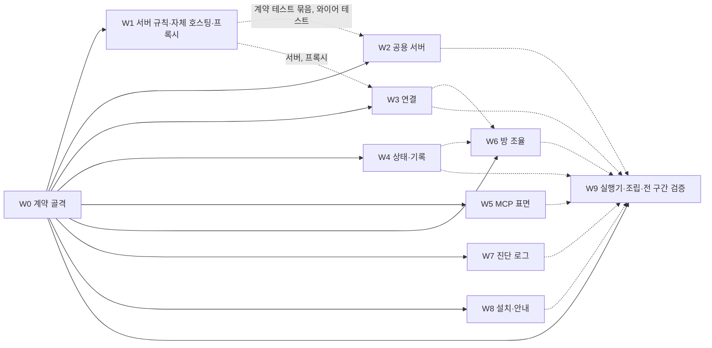

# 구현 계획

여러 담당이 동시에 구현할 수 있도록 작업을 묶고, 묶음마다 소유 파일·의존·완료 기준·검증 명령을 정한다. 설계 내용은 [architecture.md](architecture.md), [protocol.md](protocol.md), [mcp-interface.md](mcp-interface.md), [deployment.md](deployment.md) 가 소유하고, 검증의 뜻은 [verification-plan.md](verification-plan.md) 가 소유한다.

- 상태: **W0~W9 와 Gate 1~3, 독립 코드 검토 1~3차 반영, 마감까지 끝났다(2026-11-16).** 아래는 구현할 때의 계획 그대로다. 완료 기준의 판정은 [마감 기록](../../tests/test-history/2026-11-16-final-close.md)에 있다. 작성 때의 상태 문구("계획. 아직 코드가 없다")는 마감에서 고쳤다.
- 경로와 스크립트 이름은 제안이다. 통합 담당이 W0 에서 확정한다.

## 1. 원칙

1. **계약이 먼저다.** 통합 담당이 와이어 스키마와 모듈 공개 타입을 먼저 만든다(W0). 다른 묶음은 그 파일을 고치지 않고 구현한다.
2. **소유 파일은 겹치지 않는다.** 한 파일은 한 묶음만 고친다. 남의 파일을 바꿔야 하면 소유자에게 요청한다. 시험 폴더도 묶음별 하위 폴더로 나눈다.
3. **묶음은 자기 완료 기준을 자기 파일만으로 채운다.** 다른 묶음이 나중에 만드는 파일(조립한 MCP 진입점 등)에 기대는 검증은 그 파일을 가진 묶음의 완료 기준에 둔다.
4. **형제 모듈은 서로의 구현을 모른다.** 필요한 상대는 `contract.ts` 타입에 맞춘 가짜로 대신하고, 실제 연결은 조립 단계에서 한다.
5. **가정을 먼저 확인한다.** 설계를 바꿀 수 있는 가정([검증 계획 2절](verification-plan.md#2-먼저-확인할-외부-가정))은 그것을 확인할 수 있는 가장 작은 구현이 나오는 즉시 확인한다.
6. **의존성을 늘리지 않는다.** 2절의 목록 밖 패키지는 통합 담당의 결정 없이 넣지 않는다.
7. 모든 모듈은 시각(`now`), 타이머, 로그 포트를 주입받는다. 전역 상태와 숨은 싱글턴을 두지 않는다. 테스트는 `node:test` 의 가짜 타이머를 쓴다. "모든 모듈"에는 `diagnostics`, `setup`, `signaling-selfhost`, `signaling-aws` 도 든다. 전역 시계와 타이머를 부르는 곳은 조립 파일(`src/entry/*`)뿐이고 `V-U8` 이 검사한다([architecture.md 2절](architecture.md#2-모듈-목록과-의존-방향)).
8. 제품 코드에 시험용 분기를 넣지 않는다. 결함은 `tests/support/` 의 도구로 밖에서 만든다.

## 2. 패키지 설정 (W0 에서 확정)

| 항목 | 값 | 근거 |
|---|---|---|
| 패키지 | 단일 npm 패키지, `"type": "module"`, `"private": true` | 설치는 저장소를 받아서 한다. 실수로 배포되지 않게 한다 |
| Node | `>=22` | 통합 담당의 방향. 조사는 Node 26 에서만 했다(다른 버전은 미실행). Lambda 는 `nodejs24.x` 에서 돈다([deployment.md 2.3](deployment.md#23-lambda-핸들러)) |
| 언어 | TypeScript, `strict`, 모듈 해석 NodeNext | `node-datachannel` 타입이 이 설정에서 통과했다 **[실측 PRE-RTC-18]** |
| `bin` | `agent-chat-mcp` → `dist/entry/mcp.js`, `agent-chat-server` → `dist/entry/server.js`, `agent-chat` → `dist/entry/cli.js` | [architecture.md 1절](architecture.md#1-구성-요소와-프로세스-경계) |

**의존성** (버전은 정확히 고정한다)

| 패키지 | 버전 | 쓰는 모듈 | 근거 |
|---|---|---|---|
| `@modelcontextprotocol/sdk` | 1.32.2 | `mcp-server`(서버), `setup`(클라이언트. 연결 점검) | 채널 등록 조건. 2.x 계열과 revision 2026-07-28 을 지원하는 버전은 쓰지 않는다 **[실측 PRE-CH-10]** |
| `zod` | 4.6.7 | `protocol`, `mcp-server` | SDK 의 필수 peer. 이 조합으로 실측했다 **[실측 PRE-MCP-02]** |
| `ws` | 8.23.0 | `signaling-selfhost`, `signaling-client` | 조사에서 쓴 버전 **[실측 PRE-RTC-15]** |
| `node-datachannel` | 0.33.6 | `mesh` | [README 결정 D2](README.md#3-핵심-결정과-근거) |

**개발 의존성**

| 패키지 | 이유 |
|---|---|
| `typescript`, `@types/node`, `@types/ws` | 빌드와 타입 |
| `esbuild` | Lambda 용 단일 파일 번들([deployment.md 2.3](deployment.md#23-lambda-핸들러)) |
| `@aws-sdk/client-dynamodb`, `@aws-sdk/lib-dynamodb`, `@aws-sdk/client-apigatewaymanagementapi` | 타입과 로컬 실행(`test:store`)용. Lambda 에서는 런타임 내장분을 쓴다 **[실측 PRE-AWS-02]** |

테스트 도구는 추가하지 않는다. `node:test` 와 `node:assert` 를 쓴다.

**스크립트**

| 이름 | 하는 일 | 소유 |
|---|---|---|
| `npm run build` | `tsc` → `dist/` | W0 |
| `npm run build:lambda` | `esbuild` → `build/lambda/index.mjs` (`@aws-sdk/*` 외부) | W2 |
| `npm test` | 빌드 뒤 `node --test` 로 `dist/**/*.test.js` 실행. 대역 수준(`V-U*`) | W0 |
| `npm run test:e2e [-- <하위 폴더>]` | `tests/e2e/` 의 프로세스 시나리오를 순차 실행. 하위 폴더를 주면 그것만. 로컬 실물(`V-L*`) | W9 (실행기) |
| `npm run test:wire -- --url <주소>` | 와이어 계약 테스트를 주어진 서버에 실행 | W1 |
| `npm run test:store -- --table <이름> --region <리전>` | `RoomStore` 계약 묶음을 배포된 DynamoDB 테이블에 실행. 끝나면 자기 항목을 지운다([deployment.md 2.6](deployment.md#26-iam-최소-권한)) | W2 |

주의: `npm ci` 에 `--omit=optional` 을 쓰지 않는다. `node-datachannel` 의 프리빌트가 선택 의존성이라 로드가 실패한다 **[실측 PRE-RTC-12]**.

## 3. 작업 묶음

### W0. 공유 계약 골격 (통합 담당, 가장 먼저)

만드는 파일:

```text
package.json, package-lock.json, tsconfig.json, .gitignore (dist/, build/ 추가)
src/protocol/
  index.ts
  identifiers.ts          # 방 ID, 이름(예약 이름 포함), sid, key, cid, 메시지 ID 의 형식과 생성
  limits.ts               # 와이어 상한과 기한 (protocol.md 의 표)
  signaling-wire.ts       # 시그널링 메시지 스키마, 오류 코드
  p2p-wire.ts             # P2P 봉투와 타입 스키마
  state-records.ts        # 공유 상태 기록 스키마, 정규 직렬화, 지문
  server-address.ts       # 서버 주소 정규화
  ice-config.ts           # ICE 서버 검증, relay 후보 판별
  local-files.ts          # channel-check.json 스키마 (mcp-server 가 쓰고 setup 이 읽는다)
  runtime-ports.ts        # Now, Timers, Subscribable 타입
  testing.ts              # 시험 전용: Subscribable 적합성 시험 (세 모듈의 시험이 가져다 쓴다)
  *.test.ts               # V-U1
src/diagnostics/log-port.ts          # LogPort, ServerLogPort 타입만
src/diagnostics/contract.ts          # 로거 생성 함수와 닫는 손잡이의 타입 (조립만 쓴다)
src/signaling-core/ports.ts          # RoomStore, ConnectionSink 타입
src/signaling-core/contract.ts
src/signaling-client/contract.ts
src/mesh/contract.ts
src/shared-state/contract.ts         # 명령, 도메인 변화(changes), 규칙 오류 코드
src/inbox/contract.ts                # 사건 봉투(InboxEvent), 전달 모드
src/records/contract.ts              # 기록 줄, 보고서 입력(ReportInput)
src/room-session/contract.ts         # 방 동작과 결과 코드
src/mcp-server/contract.ts           # 설정 타입, tool 결과로 옮기는 표
src/boundaries.test.ts               # V-U8 의 정적 검사
tests/support/proc.mjs               # 프로세스 띄우기와 "남은 프로세스 없음" 확인
```

- `protocol` 은 타입만이 아니라 **구현과 테스트까지** W0 에서 끝낸다. 모든 묶음이 이것에 기대기 때문이다.
- `contract.ts` 는 타입과 짧은 주석만 둔다. 내용은 [architecture.md 3절](architecture.md#3-모듈-계약)의 공개 진입점이다.
- **타입의 소유는 만드는 쪽이다.** 사건 봉투는 `inbox`, 규칙 오류 코드와 도메인 변화는 `shared-state`, 보고서 입력은 `records`, 방 동작의 결과 코드는 `room-session` 의 `contract.ts` 에 둔다. `mcp-server/contract.ts` 에는 설정 타입과 tool 결과로 옮기는 표만 있다. 아래 모듈이 `mcp-server` 의 타입을 import 하지 않는다([architecture.md 2절](architecture.md#2-모듈-목록과-의존-방향)).
- 각 모듈의 `index.ts` 는 그 모듈의 소유 묶음이 만든다. 그래서 조립 파일(`src/entry/*.ts`)은 필요한 모듈이 생긴 뒤에 만든다.
- 완료 기준: `npm run build` 와 `npm test` 가 통과한다(`V-U1`, `V-U8`). 이 시점부터 다른 묶음이 시작한다.
- 이후 계약 변경은 6절의 절차를 따른다.

### W1~W9

| 묶음 | 만드는 것 | 소유 파일 | 필요한 계약 | 완료 기준 (자기 파일만으로 채운다) | 검증 명령 |
|---|---|---|---|---|---|
| **W1** 서버 규칙과 자체 호스팅 | `signaling-core` 규칙, `RoomStore` 계약 테스트 묶음(시험 전용 진입점 `signaling-core/testing.ts` 로 내보낸다), 메모리 저장소, ws 리스너, 와이어 계약 테스트, **시험용 시그널링 프록시** | `src/signaling-core/**` (W0 파일 제외), `src/signaling-selfhost/**`, `src/entry/server.ts`, `tests/wire/**`, `tests/support/signal-proxy.mjs`, `deployments/self-host/**` | `protocol`, `ports.ts` | `V-U2`, `V-U7`(메모리), `V-L1` 통과. [결함 주입](verification-plan.md#6-소켓-서버-결함-주입) F-01~F-14 실행. 프록시가 지정한 메시지를 버리고 늦춘다는 자체 시험 | `npm test`, `npm run test:wire -- --url ws://127.0.0.1:8787` |
| **W2** 공용 서버 | DynamoDB 저장소, 연결 관리 API 전송, Lambda 핸들러, CloudFormation 템플릿, 배포·삭제·검증 스크립트, 저장소 계약 실행기 | `src/signaling-aws/**`, `src/entry/lambda.ts`, `deployments/aws/**` | `ports.ts`, W1 이 `signaling-core/testing.ts` 로 내보내는 계약 테스트 묶음, `tests/wire` | 번들이 만들어진다. 배포 뒤 `V-P1` 통과(`verify.mjs`, `test:store`) | `npm run build:lambda`, `deployments/aws/deploy.sh …`, `npm run test:store -- …` |
| **W3** 연결 | 시그널링 클라이언트(재접속 루프, `ping` 놓침, 게이트웨이 프레임), mesh(`node-datachannel`. 후보 묶음과 두 큐, 재전송, 교체 확인), 연결 단독 시험 | `src/signaling-client/**`, `src/mesh/**` (각 `contract.ts` 제외), `tests/e2e/mesh/**` | `protocol`, 두 `contract.ts`. 통합 시험에는 W1 서버와 프록시 | `V-U10`, `V-U11`, `V-L11` 통과. A-RTC-2, 3, 5 확인 | `npm test`, `npm run test:e2e -- mesh` |
| **W4** 상태와 기록 | 복제본·병합·지문·규칙 판정·경과 시간, 기록 파일, 보고서 | `src/shared-state/**`, `src/records/**` (각 `contract.ts` 제외) | `protocol` | `V-U3`, `V-U5` 통과 | `npm test` |
| **W5** MCP 표면 | 수신함과 전달 모드와 `listening`, 환경 변수 해석, tool 등록, instructions, 채널 알림, 확인 기록 파일, stdio 수명. 가짜 세션으로 띄우는 시험 진입점 | `src/inbox/**`, `src/mcp-server/**` (각 `contract.ts` 제외), `tests/e2e/mcp/**` | `room-session/contract.ts` (가짜로 대신), `protocol/local-files.ts` | `V-U4` 통과. 가짜 세션으로 `V-L7`(가) 통과. **최소판**(tool 두 개 + 채널)으로 A-MCP-1, 2, 9 확인 | `npm test`, `npm run test:e2e -- mcp` |
| **W6** 방 조율 | 입장·보정, P2P 세션, 채팅 전달, 참가자 표시, 사건 변환, 종료. 하위 모듈을 직접 세우는 하네스 | `src/room-session/**` (`contract.ts` 제외), `tests/e2e/room/**` | W3, W4, W5 의 `contract.ts` | `V-U9` 통과. 실제 하위 모듈과 붙인 하네스로 `V-L12` 통과 | `npm test`, `npm run test:e2e -- room` |
| **W7** 진단 로그 | 파일·stdout 로거, 필드 필터, 보존 정리 | `src/diagnostics/**` (`log-port.ts`, `contract.ts` 제외) | `log-port.ts`, `diagnostics/contract.ts` | `V-U6` 통과 | `npm test` |
| **W8** 설치와 안내 | 설치 진입 셸 스크립트(`installer/install.sh`, `claude.sh`, `codex.sh`)와 그 시험(`installer/*.test.mjs`), 설치 본체(`scripts/install.mjs`), MCP 등록과 제거, Channels 판정, `doctor`, 설치 시험 스크립트, **설정 전후 비교 도구**(`tests/e2e/install/settings-snapshot.mjs`), 저장소 README, 에이전트 안내 | `installer/**`, `scripts/install.mjs`, `src/setup/**`, `src/entry/cli.ts`, `tests/e2e/install/**`, 저장소 `README.md`, `docs/agent-guide.md` | 진입점 이름(2절), [mcp-interface.md](mcp-interface.md), `protocol/local-files.ts` | `V-L10` 통과(셸 진입점 시험과 비교 도구의 자체 시험 포함). `V-S1`·`V-S2` 를 실행하는 스크립트가 있다(실행은 G7). A-MCP-10 확인 | `node --test installer/*.test.mjs`, `npm run test:e2e -- install`, `sh installer/install.sh`, `agent-chat doctor` |
| **W9** 조립과 전 구간 검증 (통합 담당. **W0 부터 병행**) | 시험 실행기, MCP 진입점 조립, 전 구간 시나리오, 장시간 시험, 이력 색인 | `src/entry/mcp.ts`, `tests/e2e/run.mjs`, `tests/e2e/scenarios/**`, `tests/test-history/README.md` | 전부 | `V-L2`~`V-L9`, `V-L7`(나), `V-P2`~`V-P7`, `V-S1`, `V-S2`, `V-I*` 실행과 기록 | `npm run test:e2e` |

묶음별 메모:

- **W1, W2**: 서버 쪽 모듈은 `ServerLogPort` 를 주입받는다. 참가자 이름은 `peer_ref` 로만 남긴다(`peer` 필드는 타입이 받지 않는다). 연결 등록(`bind`)에는 `sid` 를 함께 적고, 전달하는 `signal` 의 `sid` 는 그 값을 쓴다. 보낸 쪽 참가자 기록을 다시 읽지 않는다. `signaling-selfhost` 와 `signaling-aws` 도 `now`·`timers` 를 주입받는다. 전역 시계는 `entry/server.ts`, `entry/lambda.ts` 에서만 부른다. 서버가 보내는 글은 `protocol.encodeServerMessage` 로 만든다. 이 함수는 `Result` 를 돌려준다. 실패(`BAD_MESSAGE`)는 그 요청의 `SERVER_ERROR` 와 로그로 바꾼다([protocol.md 2.3](protocol.md#23-서버-처리-규칙)).
- **W1**: `tests/wire/wire-contract.mjs` 는 제품 클라이언트 코드를 쓰지 않는다. `ws` 와 `protocol` 스키마만 쓴다. 같은 파일을 W2 가 공용 서버에 실행한다. 프록시도 `ws` 와 JSON 만 쓴다. W3 가 G2 에서 쓰므로 G1 까지 낸다.
- **W2**: 배포는 사용자가 정한 범위 안의 일이다. 그래도 **AWS 자원을 만들고 지우는 실행은 통합 담당의 지시로** 한다. 인증서 ARN 과 호스팅 영역 ID 는 인자로 받고 파일에 적지 않는다. `test:store` 는 운영 테이블에 직접 쓰므로 실행 ID 와 정리 결과를 이력에 남긴다.
- **W3**: `mesh` 는 `signaling-client` 를 import 하지 않는다. 시그널을 보낼 함수를 받는다. ICE 서버는 `{hostname, port}` 객체로 라이브러리에 넘긴다. `url` 문자열을 넘기지 않는다([protocol.md 7절](protocol.md#7-ice-서버-설정-검증)). 두 모듈의 이벤트에 `protocol/testing.ts` 의 적합성 시험을 돌린다. `tests/e2e/mesh/` 의 하네스는 두 모듈을 손으로 이어 프로세스 두 개를 띄운다. 조립한 MCP 진입점에 기대지 않는다. `netInfo()` 의 srflx 는 시도가 끝날 때가 아니라 pc 가 살아 있는 동안 계속 센다([architecture.md 3.6](architecture.md#36-mesh)). W6 의 `get_status.room.net` 과 W8 의 `doctor` D7 이 이 값에 기댄다. 진행 중인 시도가 새 `cid` 의 `offer` 로 바뀌는 것은 시도의 끝이 아니다. `attempt-failed` 를 내지 않고 기한을 바뀐 때부터 새로 잰다. 서버의 `RELAY_NOT_ALLOWED` 는 `ice` / `failed` 로 끝낸다. `expireAttempt(peer)` 는 진행 중인 시도를 기한이 찼을 때와 같은 분류로 그 자리에서 끝낸다([protocol.md 3.2](protocol.md#32-시그널별-처리), [3.3](protocol.md#33-재전송-기한-실패)). `node-datachannel/polyfill` 을 import 하면 `V-U8` 이 실패한다.
- **W4**: 경과 시간의 계산과 두 값(기준 시각, 이미 흐른 시간)은 `shared-state` 가 갖는다. `adoptElapsed` 는 받은 값이 자기 값보다 클 때만 두 값을 함께 바꾼다([protocol.md 5.5](protocol.md#55-파생-판정), [architecture.md 3.7](architecture.md#37-shared-state)). 받은 값을 견주거나 더하는 코드를 W6 에 두지 않는다. W6 는 받은 `sync_end` 의 값을 그대로 넘긴다. `applyLocal` 이 만드는 기록과 `snapshot()` 은 `protocol.parseStateRecord` 를 통과한 값이어야 한다. W6 가 그것을 `protocol.packStateFrames` 로 보내고, 그 함수는 걸리는 기록이 하나라도 있으면 프레임을 만들지 않는다. 본 `lc` 가 `protocol.STATE_CLOCK_MAX` 면 다음 쓰기를 `INVALID_ARGUMENT` 로 거절한다. 값을 접지 않는다([protocol.md 5.2](protocol.md#52-논리-시각)).
- **W5**: `mcp-server` 는 `process.env` 를 직접 읽지 않는다. `loadConfig` 가 받은 인자만 본다. tool 호출은 이름과 `cursor` 를 `inbox.noteToolCall` 에 넘긴다. `inbox` 의 이벤트에 `protocol/testing.ts` 의 적합성 시험을 돌린다. `inbox.discardAll()` 은 대기열을 비우고 내주지 않은 수를 돌려준다(부르는 쪽은 W6). `mcp-server` 의 제품 코드는 MCP SDK 의 서버 쪽과 stdio 전송만 import 한다([architecture.md 2절](architecture.md#2-모듈-목록과-의존-방향)). 시험 파일은 SDK 클라이언트를 써도 된다.
- **W5**: A-MCP-1, 2, 9 는 사람의 승인이 필요하다. W5 는 방 기능 없이 "점검 알림 → `confirm_channel` → 시험 사건 전달"만 되는 최소판을 `tests/e2e/mcp/` 에 먼저 낸다. 가짜 세션을 붙인 시험 진입점이고 제품 진입점이 아니다. 통합 담당이 그것을 호스트에 `agent-chat` 이름으로 잠시 등록해 사용자와 함께 확인하고, 끝나면 등록을 지운다.
- **W6**: 시그널 전송 함수(`sendSignal`)는 `src/room-session/signal-gate.ts` 한 파일에서만 다룬다. `joined` 전 보관, `signaling-client.sendSignal` 호출, 그 함수를 넣어 `createMesh` 를 부르는 일이 거기에 든다. 다른 파일이 그 이름을 쓰면 `V-U8` 이 실패한다.
- **W6**: 방을 나가는 모든 길(`leave`, `create`·`join` 의 실패와 취소)의 정리에서 `inbox.discardAll()` 을 부른다. `leave` 는 그 수를 `undelivered_events` 로 돌려준다. 입장 기한에 아직 시도 중인 필수 피어에는 `mesh.expireAttempt(peer)` 를 불러 단계와 사유를 얻는다. 필수 목록에서 빼는 `attempt-failed` 는 `peer_gone` 하나다. `state` 프레임은 `protocol.packStateFrames` 로 만들고, 실패(`BAD_FRAME`)는 보내지 않고 로그로 남긴다(결함이다).
- **W6**: W0 직후에 시작한다. 하네스 시험(`V-L12`)은 W3·W4 가 나온 뒤에 돈다. `V-U9` 가운데 경과 시간을 보는 8번과 11번은 `shared-state` 실물을 쓰므로 W4 가 나온 뒤에 돈다. `V-U9` 의 나머지는 W4 를 기다리지 않는다. MCP 프로세스를 띄우는 `V-L2`~`V-L8` 은 W6 의 완료 기준이 아니다. 조립 파일을 가진 W9 의 것이다. 스냅샷 교환, 재동기화 간격, 진전 판정, 중단의 즉시 교환은 "P2P 세션" 부분이 맡는다. 판정 기준은 [검증 계획의 `V-U9` 표](verification-plan.md#31-대역-단위계약)에 고정돼 있다. `V-L12` 의 부분 mesh 시험은 3분이 걸린다.
- **W7**: 로거 생성 함수의 서명은 `src/diagnostics/contract.ts` 에 있다(`level`, `now`, `timers`, `close(budgetMs)`). `svc` 가 `server`·`lambda` 면 `peer` 필드를 출력하지 않는다. 전역 시계와 타이머를 직접 부르지 않는다.
- **W8**: `src/setup` 에서 `child_process` 는 `host-cli.ts` 한 파일만 쓴다. 실행하는 하위 명령의 목록을 `host-cli.test.ts` 가 고정한다. 그 시험이 없으면 `V-U8` 이 실패한다. SDK 의 클라이언트 stdio 전송(`@modelcontextprotocol/sdk/client/stdio.js`)은 `mcp-process.ts` 한 파일만 쓰고, `mcp-process.test.ts` 가 "등록에서 읽은 명령·인자·환경만 넘긴다"를 고정한다. 이 시험도 없으면 `V-U8` 이 실패한다. `scripts/install.mjs` 와 `installer/*.sh` 에도 권한을 넓히는 실행 옵션 문자열을 두지 않는다(`V-U8` 이 그 폴더도 읽는다). 시각과 타이머는 `entry/cli.ts` 가 넘긴다.
- **W8**: 설치 진입점은 `installer/` 의 셸 스크립트다 **[사용자 결정 2026-11-15]**. 셸은 POSIX `sh`, `set -eu`, 한국어 출력이고, Node 를 찾아 `scripts/install.mjs` 에 넘기는 일만 한다(`--client claude|codex|all`, 제거면 `--remove`). 의존성 설치·빌드·네이티브 확인·등록·Channels 판정·`doctor`·안내의 논리는 `scripts/install.mjs` 와 `src/setup` 에만 둔다. 셸과 Node 에 같은 논리를 두 번 쓰지 않는다. 설치기가 읽는 환경 변수(`AGENT_CHAT_HOME`, `AGENT_CHAT_NODE`, `AGENT_CHAT_CLAUDE_BIN`, `AGENT_CHAT_CODEX_BIN`, `AGENT_CHAT_SERVER`, `AGENT_CHAT_IN_PLACE`)는 [architecture.md 3.13](architecture.md#313-setup)의 표대로다. `installer/*.test.mjs` 는 `node:test` 로 쓰고, 설치기를 공백이 든 임시 폴더에 복사해 가짜 호스트 CLI 와 임시 `HOME` 으로 설치·재설치·제거를 본다. 실제 사용자 설정을 건드리지 않는다. 이 시험이 `npm ci` 와 빌드를 실제로 돌릴지, `PATH` 앞에 둔 가짜 `npm` 과 미리 만든 빌드 결과로 대신할지는 W8 이 정해 이력에 적는다. 어느 쪽이든 제품 코드에 시험용 분기를 넣지 않는다. 설치는 권한 설정을 바꾸지 않는다([mcp-interface.md 10절](mcp-interface.md#10-권한-경계)). 단계, 판정표, 점검표, 설치가 쓰는 곳, 전후에 비교하는 키의 목록은 [architecture.md 3.13](architecture.md#313-setup)이 정한다. 비교 도구는 `src/setup` 의 코드를 import 하지 않는다. 설정 파일을 읽는 코드를 설치와 따로 둬야 같은 결함을 함께 갖지 않는다. TOML 해석 의존성을 더하지 않는다. 등록 명령의 형식은 조사에서 본 것이다(`claude mcp add --scope user agent-chat -e … -- <node> <경로>`, `codex mcp add agent-chat --env … -- <node> <경로>`) **[실측 PRE-CH-01, PRE-ALT-03. 도움말 기준]**. 저장소 README 에는 고정 설치 위치의 명령(`git clone <저장소 주소> ~/.agent-chat/app && sh ~/.agent-chat/app/installer/install.sh`), 호스트별 스크립트와 `--uninstall`, Windows 에서는 `node scripts/install.mjs` 를 직접 실행한다는 안내(미실행 표기), "에이전트는 권한 설정을 고치지 않는다", "참가자와 서버가 내 IP 를 본다", channel 모드의 호스트 경고문을 싣는다.
- **W9**: 통합 담당은 W0 뒤에 실행기와 시나리오 스크립트를 먼저 쓴다. `src/entry/mcp.ts` 는 W3~W6 의 `index.ts` 가 생기는 대로 붙인다(G5).
- **W9 (G1 에서 넘겨받은 것)**:
  - 실행기(`tests/e2e/run.mjs`)가 하위 폴더를 돌리는 명령: `mesh` 는 `node tests/e2e/mesh/v-l11.mjs`, `room` 은 `node tests/e2e/room/v-l12.mjs`, `mcp` 는 `node --test tests/e2e/mcp/*.test.mjs`, `install` 은 `node --test tests/e2e/install/`. 모두 빌드가 먼저이고 `AGENT_CHAT_DIST` 를 따른다. `V-L1` 은 `node tests/wire/run-local.mjs` 다.
  - `entry/mcp.ts`: `startMcpServer` 가 stdio 와 신호 리스너를 직접 건다. `await handle.closed` 뒤 로그를 닫고 `process.exit` 을 부른다. 수신함 하나를 세션과 서버에 함께 넘긴다. 로거는 `createFileLogger` 만 만든다(stdout 로거를 만들면 stdout 에 쓴다).
  - 종료 시간: 가짜 세션이 예산을 다 쓰는 경로에서 프로세스가 405~411ms 에 끝났다 **[실측 W5]**. 기준은 400ms 이하다(`V-L7`). 조립에서는 로그 닫기가 더해진다. 세션에 넘기는 예산을 `SHUTDOWN_BUDGET_MS` 보다 작게 잡을지를 `V-L7`(나)의 실측으로 정한다. 기준을 낮추지 않는다.
    - **W9 결과**: `entry/mcp` 가 `mcp-server` 에 320ms(400 − 80)를 넘기고 남은 시간으로 로그를 닫는다([architecture.md 3.11](architecture.md#311-mcp-server)). 조립한 프로세스의 종료는 10~35ms, 서버가 멈춘 경로도 332ms 이하였다(세션 정리가 예산 320ms 를 넘긴 1회도 329ms. [W9 이력](../../tests/test-history/2026-11-15-w9-assembly.md)).
  - `tests/e2e/mcp/harness.mjs` 의 `connectSdk`·`connectRaw` 는 띄울 대상만 바꾸면 `V-L7`(나)에 다시 쓸 수 있다.
  - 한 PC 에서 서버에 연결을 20개 넘게 띄우는 시나리오는 `--max-connections-per-ip` 를 올린다. `v-l11.mjs --requests` 를 290 넘게 주면 서버의 연결별 속도 제한에 걸린다.
  - 공용 서버에 `wire-contract.mjs` 를 돌릴 때는 `--flood-interval-ms 50` 을 주거나 `--no-flood` 로 속도 제한 항목을 건너뛴다(기본값이면 게이트웨이 스로틀에 걸린다).

## 4. 의존 관계와 병렬 구간



- 실선은 "시작하려면 끝나 있어야 한다", 점선은 "통합할 때 필요하다"는 뜻이다. 그림은 정적 검토만 했다.
- W0 뒤에는 W1~W9 가 **모두 동시에** 시작할 수 있다. 서로의 구현이 아니라 W0 의 타입에 기대기 때문이다.
- 통합 순서가 정해진 곳: W2 는 W1 의 테스트 묶음을, W3 의 `V-L11` 은 W1 의 서버와 프록시를, W6 의 `V-L12` 는 W3·W4 를, W6 의 `V-U9` 8번·11번은 W4 를, W9 의 조립은 W3~W7 을 기다린다.
- 어느 묶음도 자기보다 늦게 끝나는 묶음의 파일에 완료 기준을 걸지 않는다. 가장 일찍 해야 하는 가정 확인(G2, G3)은 W1·W3·W5 의 파일만으로 된다.

## 5. 조립 순서

각 단계는 앞 단계의 통과 조건을 만족해야 넘어간다. 검증한 제품 코드를 그대로 연결한다. 계약이 맞지 않으면 소유 모듈에서 고치고 그 모듈과 소비자를 다시 검증한다.

| 단계 | 하는 일 | 넘어가는 조건 |
|---|---|---|
| G0 | W0 병합 | `npm run build`, `npm test` 통과 |
| G1 | W1 | `V-U2`, `V-U7`, `V-L1` 통과. 프록시 사용 가능 |
| G2 | W3 을 W1 서버와 프록시에 붙인다 | `V-L11` 통과. **A-RTC-2, 3, 5 확인.** 틀리면 접촉 규칙을 고치고 G1 부터 영향 범위를 다시 본다 |
| G3 | W5 최소판(시험 진입점)을 실제 호스트에 붙인다 | **A-MCP-1, 2, 9 확인**(사람 필요). 틀리면 전달 모드 설계를 고친다. 실행하지 못했으면 "미실행"으로 적고 진행하되, 완료 기준 "자동 수신"은 [검증 계획 8절](verification-plan.md#8-완료-보고)대로 부분 검증으로 남는다 |
| G4 | W4, W7 | `V-U3`, `V-U5`, `V-U6` 통과 |
| G5 | W6 하네스, 이어서 `src/entry/mcp.ts` 조립 | `V-L12` 통과 뒤 `V-L2`~`V-L8` 통과. A-RTC-4, 6 확인 |
| G6 | W2 배포 | `V-P1` 통과 뒤 `V-P2`, `V-P3`, `V-P5`, `V-P7`. 미실측으로 남은 A-AWS 항목 확인 |
| G7 | W8 을 이 PC 에 실제로 설치(`installer/install.sh`) | `V-L10` 통과. A-MCP-10 을 확인해 비교 목록을 확정한다. 그 뒤 **`V-S1`, `V-S2` 통과(반드시 실행한다).** 이어서 `V-I1`~`V-I6` 중 실행할 수 있는 것. `V-I3`·`V-I4` 는 자동 수신의 판정이므로 사용자와 일정을 잡아 실행을 시도한다 |
| G8 | 장시간과 재현 | `V-L9`, `V-P4`, `V-P6` |
| G9 | 완료 보고 | [검증 계획 8절](verification-plan.md#8-완료-보고)의 조건 |

- 공용 서버(G6)는 G1 만 끝나면 시작할 수 있다. G5 를 기다리지 않는다. `V-P2` 와 `V-P7` 은 G5 뒤에 한다.
- `V-S2` 는 공용 서버가 필요하므로 G6 뒤에 한다.
- 실패를 관찰하면 그것에 기대는 단계를 멈추고 고친 뒤 다시 검증한다. 실행 조건만 모자란 경우(사람, 다른 PC)는 독립된 작업을 먼저 끝내고 미실행으로 남긴다.

## 6. 공통 규칙

**계약 변경**

1. `src/protocol/**`, `**/contract.ts`, `src/signaling-core/ports.ts`, `src/diagnostics/log-port.ts`, `src/boundaries.test.ts` 는 통합 담당만 고친다.
2. 바꿔야 하면 담당이 이유와 영향받는 묶음을 적어 요청한다.
3. 통합 담당이 고치고, 설계 문서의 해당 절을 함께 고치고, 영향받는 묶음에 알린다.
4. 와이어 계약의 뜻이 바뀌면 [protocol.md](protocol.md) 의 호환성 규칙(선택 필드 추가 또는 `v` 올림)을 따른다.

**설계와 다른 관찰**

- 가정이 틀렸거나 문서대로 구현할 수 없으면 멈추고, 관찰한 것·영향·대안을 통합 담당에게 보고한다.
- 오류를 무시하거나 통과 기준을 낮춰서 돌아가지 않는다.

**기록**

- 묶음마다 `tests/test-history/<날짜>-<묶음 이름>.md` 에 실행을 기록한다([검증 계획 7절](verification-plan.md#7-테스트-실행-이력-운영)). 색인은 통합 담당이 고친다.
- 커밋과 푸시는 사용자가 지시할 때만 한다. `V-I1`(GitHub 에서 받아 설치)은 푸시가 선행 조건이다.

**하지 않는 것**

- TURN, 서버 중계, 피어 중계와 관련된 코드나 설정 항목을 만들지 않는다. 채팅을 다른 참가자를 거쳐 보내는 경로를 만들지 않는다.
- 요구에 없는 기능(여러 방 동시 참가, 채팅 이력 동기화, 계정, 웹 화면 등)을 넣지 않는다([README 범위 밖](README.md#6-범위-밖)).
- 권한 설정, 허용 목록, hook 을 바꾸는 코드를 넣지 않는다.
